# Agreement Inversion Is Not a Mid-Tier Property: Precision of Agreed LLM Answers Follows Pair Accuracy

**Vadym Chernets**, PhD, AI systems architect · ORCID [0009-0007-4845-3163](https://orcid.org/0009-0007-4845-3163)

*Preprint, 9 November 2026.* SSRN: [7682960](https://ssrn.com/abstract=7682960). Archived copy: [10.5281/zenodo.24090580](https://doi.org/10.5281/zenodo.24090580). Data and code: [10.5281/zenodo.24090584](https://doi.org/10.5281/zenodo.24090584). PDF: [agreement-inversion.pdf](agreement-inversion.pdf). The PDF is authoritative.

## Abstract

When two flagship models, asked separately, give the same answer to one of the hardest SimpleQA questions, that answer is usually wrong. On the 106 SimpleQA questions where July mid-tier panels failed, 45 flagship pairs without the client-served GPT arm, where web search cannot be excluded, are right on 96 of 691 agreements (13.9%). Answering only when a second model agrees needs no labels or parameters, and earlier work attributed the failures of this rule to mid-tier models. On both tiers I measured, the precision of agreed answers follows the accuracy of the pair, so inversion is not a mid-tier property. In the hardest quintile, defined the same way for each tier, precision is 17.3% in July and 15.5% in August; across all five quintiles, at the precision expected from each pair's two accuracies, flagship pairs differ from mid-tier pairs by -0.2 points [-3.1, +2.7]. The data are SimpleQA, fresh two-hop questions and product facts, collected in July, August and October 2026 with flagship models from eleven laboratories. A partner from a second laboratory catches more errors but opens the gate less often: for one released model, a same-laboratory partner catches 2 of 29 errors and a partner from another laboratory 20 of 29 (-62.1 points [-79.3, -43.8]), with the gate open on 96% and 61% of questions. When the wider gate is thinned by stated confidence to equal coverage, this advantage holds only where the partner's model is far more accurate. A small model fed measured accuracies predicts out-of-sample precision with mean absolute error 0.037 against 0.099 for the best single model, level with an independent-errors baseline at 0.032, and runs high on product facts and public data. On the same 100 questions the identifier gpt-5.6-sol scores 92.0% in its client-served wave and 46.3% through the API at another effort setting, while eight other models move by at most 4 points.

## 1. Introduction

Ask two large language models (LLMs) from different laboratories the same short factual question, separately, and release the answer only if the two match. The gate needs no label, threshold or judge, only two blind calls. Flagship models make it attractive, because their stated confidence carries little protection: across ten flagship arms in August 2026, 4,910 of 10,540 answers stated with confidence of at least 80 were wrong (Chernets, 2026b).

My earlier measurement on proprietary models, a July 2026 collection of mid-tier models, found replicated panel answers on the hardest quintile of SimpleQA correct on 0 of 342 occasions (Chernets, 2026a). This suggests that agreement inverts for weak models, so that agreed answers are more often wrong than right, and that strong models escape. One flagship pair appeared to confirm it: gpt-5.6-sol with claude-fable-5 was right on 34 of 37 agreements on those same questions (the 106 of Section 3).

At the flagship tier this reading does not hold. Without the single arm behind the 34 of 37, gpt-5.6-sol served through its vendor client, the inversion returns, and with difficulty defined the same way for both tiers the two curves meet at the hard end. Across all quintiles, once the two accuracies of each pair are accounted for, flagship and mid-tier pairs differ by -0.2 points [-3.1, +2.7]. Precision tracks how accurate the two models are on the stratum, whatever their tier.

Table 1 summarises four contributions. Section 5.1 gives a gate-level account of flagships, built wherever possible without the arm that dominates the accuracy range. Section 5.2 measures what a second laboratory contributes, varying the released model and the partner, with GPT and without it. Sections 4 and 5.3 give a descriptive model of the gate with five constants and test it out of sample against stated baselines, and Section 5.4 compares vendor clients with direct API access for the same identifier on the same questions.

**Table 1.** *Claims, evidence and boundary.*

| Claim | Evidence | Boundary |
|---|---|---|
| Precision of agreed answers follows pair accuracy on both tiers | 96/691 on the 106; hardest quintile 17.3% July, 15.5% August; tier at matched accuracy -0.2 [-3.1, +2.7] | Association; one quintile alone spans -1.8 [-22.1, +20.2] |
| A second laboratory catches more errors at the price of coverage | 20/29 against 2/29 errors caught, -62.1 [-79.3, -43.8]; coverage 61% against 96% | At equal coverage, by confidence, it needs a far more accurate partner; two laboratories in October |
| A small model describes precision out of sample | Error 0.037 against 0.099 for the best model, -0.062 [-0.085, -0.035] | Level with independent errors, +0.005 [-0.003, +0.012]; 13 points high on product facts |
| Access mode moves one identifier | 92.0% client against 46.3% API, same 100 questions | Mode, effort and possible search change together |

## 2. Related work

Closest to my question is Goel et al. (2025), who introduce CAPA, a chance-adjusted measure of agreement between models' output distributions, and show across 130 open-weight models on MMLU-Pro and BBH that mistakes grow more similar with capability, which they argue puts AI oversight, including LM juries, at risk. I measure, for proprietary models from different laboratories, what blind agreement certifies when it gates the release of a short open-form answer: the precision of agreed answers, the share of the released model's errors that disagreement exposes, and the floor of shared confident errors. The results are compatible: in my data the cost of rising similarity shows in the recall of disagreement, while precision stays high where accuracy is high (Appendix L). Agreement-based cascading (Kolawole et al., 2025) uses ensemble agreement as a training-free deferral rule with a condition on the joint rate of accepted errors, and my stratified results locate where such errors concentrate.

Correlated errors across providers are documented by Kim et al. (2025), and Hossain et al. (2026) find them stronger among frontier LLM judges. Juries of diverse small judges appear in Verga et al. (2024), and the bias of a model judging its own output in Panickssery et al. (2024), which favours comparing two blind answers. Agreement among samples of one model is a confidence signal in self-consistency (Wang et al., 2023), SelfCheckGPT (Manakul et al., 2023) and semantic uncertainty (Kuhn et al., 2023), and a deferral rule in Yue et al. (2024); I compare it with agreement between laboratories (Section 5.2). The gate is a selective predictor (Geifman & El-Yaniv, 2017), so I compare gates at equal coverage. Recent preprints disagree on whether aggregation helps (Appendix E). I know of no work that reports a release gate at pair level on short open-form facts for proprietary flagships, recall at equal coverage with one released model held fixed, or one identifier measured in two access modes on the same questions.

## 3. Data and protocol

My earlier work reported the July panels (Chernets, 2026a) and August and October aggregates for selected pairs (Chernets, 2026c). New here are the flagship pairs without GPT, the symmetric definition of difficulty, the same-laboratory pairs, the comparisons at equal coverage, the out-of-sample and external tests and the access-mode comparison.

**Collections.** All answers were collected blind: one call per question, with no model seeing another's answer. The system prompt asks for a JSON object with a short answer and a confidence from 0 to 100 and does not ask for sources. Table A1 lists models, dates and access modes, and Appendix F the collections in full. Nine API models and seven local models answered 1,500 SimpleQA questions (Wei et al., 2024) on 24 to 28 July, registered on OSF before data collection (Chernets, 2026a). One flagship from each of eleven laboratories answered the same questions on 3 to 6 August, 1,459 common to all, and nine of them answered 100 of these at temperature 0.7 with three samples (the variance arm). Added were 100 two-hop questions composed by machine from Wikidata, with the file hash fixed before the first model call, and 267 product facts. In October gpt-6.1-sol, gpt-6-astra, gpt-6-sol, claude-opus-5-5 and claude-fable-5-1 answered 300 SimpleQA questions stratified by July quintile, the 106 below and the fresh set, three disjoint sets with 503 questions common to all five models (every pair on them is in Table A2).

**The 106.** These are the hardest-quintile questions on which a July panel replicated an answer (Chernets, 2026a). They were selected on the failure of the July models, so July precision on them is partly a product of the selection, and Section 5.1 pairs them with a symmetric definition of difficulty that does not carry this property.

**Access modes.** In August, claude-fable-5, gpt-5.6-sol and mistral-medium-3.5 ran through the vendor's own first-party client, the official command-line agent that end users deploy, and in October every arm did, so the measurements include vendor-side system prompts and serving defaults as a user of the client receives them. The July wave and the remaining August arms used direct API or aggregator routes pinned to the vendor. Table 2 states the conditions of measurement of the client arms. I call an arm search-possible when its use of web search cannot be excluded, and I report the main results with such arms and without them.

**Table 2.** *Conditions of measurement by arm.* Note: temperature is not set in the Codex and Claude clients; the Codex event streams were not retained. API arms of the July and August waves ran at temperature 0. A dash marks no setting or no entry in the records.

| Arm | Reached by | Effort | Search possible |
|---|---|---|---|
| gpt-5.6-sol, August | Codex client | client default, not recorded | not excluded |
| claude-fable-5, August | Claude client | - | no, 0 search requests recorded |
| mistral-medium-3.5, August | vendor client | - | no, empty tool list |
| gpt-6.1-sol, gpt-6-astra, gpt-6-sol, October | Codex client | medium | not excluded |
| claude-opus-5-5, claude-fable-5-1, October | Claude client | - | no, tools disallowed |
| kimi-k3, gemini-3.8-flash, fresh set | vendor client | - | tools not disabled, prompt forbids |
| gpt-5.6-sol, variance arm | direct API | none | - |

**Gate and measures.** The gate opens when both models answer, neither refuses, and a deterministic equivalence engine, the same for every wave here, finds the two answers equivalent. Grading applies the same engine to the answer and the gold answer: normalised exact match, containment of strings of four or more characters, and rules for dates, numbers and identifiers (Appendix D, with a rescoring in Table A3). A cell is a pair of models on a stratum of questions. Coverage counts open gates among questions both models answered. Precision, PPV, is the share correct among open answers the grader resolves as right or wrong (K/O), and Delta is precision minus the accuracy of the released model on all resolved questions of the cell. Recall is the share of the released model's errors on which the gate stays closed, reported as caught errors. Lift divides the accuracy of the released model with the gate open by that with the gate closed, and the floor counts questions on which both models state confidence of at least 80, agree, and are wrong. I call agreement inverted when PPV is below one half. The released model is the first member of the pair, or the more accurate one when pairs are pooled. To compare gates at equal coverage I thin the wider gate: open answers are ranked by the smaller of the two stated confidences and cut to the target coverage, ties broken at random.

**Inference.** Single proportions carry Wilson intervals. Differences and derived quantities carry 95% bootstrap intervals, two-way over question and model for pooled results (Owen, 2007; B = 2000, seed fixed, with the model refitted in each replicate) and over question for a single pair. Paired accuracy comparisons use the exact McNemar test, and equivalence a two one-sided test (Schuirmann, 1987) with a margin of 2 points. Cells are dependent, so they carry intervals and no p values.

## 4. A model of the gate

Let $a_i$ and $a_j$ be the measured accuracies of two models on a cell and $g = \sqrt{a_i a_j}$. Let $W$ be the probability that both are wrong and $C$ the probability that both are right:

$$\begin{aligned} W &= \min\left(\rho(g)(1-a_i)(1-a_j),\; 1-\max(a_i,a_j)\right),\\ C &= \max(a_i + a_j - 1 + W,\; 0).\end{aligned}$$

Here $\rho(g) = \exp(r g^2)$ inflates the independent rate of joint error. Two right answers match with probability $\eta$. Two wrong answers match with probability $\kappa(g) = \min(1, m \cdot \mathrm{logistic}(k_0 + k_1 g))$, where $m = m_h$ on the 106, whose wrong answers collide more often, and 1 elsewhere. Then

$$\text{coverage} = \eta C + \kappa W, \qquad \text{PPV} = \frac{\eta C}{\eta C + \kappa W}, \qquad \text{wrong agreed} = \kappa W.$$

Fitted on 335 pair-cells of different laboratories (July, August and October, with the 106 among them; $\eta$ is the match rate of two right answers over all fitted cells), the constants are $k_0 = -2.78$, $k_1 = 3.08$, $r = 0.88$, $\eta = 0.989$ (22,536 of 22,785) and $m_h = 3.19$.

The model takes the measured accuracies of the cell as input and returns coverage, precision and the share of wrong agreed answers, $\kappa W$, of which the floor of Section 3 is the part with confidence of at least 80. Given two accuracies, it returns what the gate adds, and it shows why precision must follow accuracy at the top: with $a_i = a_j = a > 1/2$ and right answers matching, the precision of agreed answers cannot fall below $2 - 1/a$, even if every error is shared, since both models are right together on at least $2a - 1$ of the questions and wrong together on at most $1 - a$ (0.947 at $a = 0.95$). At $a = 0.2$ there is no bound, and $\kappa W$ can exceed $\eta C$ whenever wrong answers concentrate on the same string.

I compare it with two baselines. The *independent-errors* baseline sets $\rho = 1$ and refits the rest, so it keeps $\kappa(g)$. The *best-model* baseline predicts $\max(a_i, a_j)$. The criterion was that the model beats both, with the interval of the difference below zero, under leave-one-laboratory-out (LOLO), leave-one-model-out (LOMO) and a temporal split from July and August to October.

## 5. Results

### 5.1 Inversion is not a mid-tier property

Table 3 gives the gate without the client-served GPT arms. On the whole of SimpleQA the two tiers look alike: precision 72.1% in July and 80.6% in August, with a Delta of +28.6 and +26.0 points against the released model. On the 106 precision is low in both waves: 5 of 717 in July and 96 of 691 in August without GPT. Excluding the GPT arm from the July side as well gives 4 of 581, and the August minus July difference is +13.2 points [+2.6, +30.8]. August precision is higher and still far below one half, so agreement is inverted in both waves. It is also below the best single arm on the stratum, by -9.5 points [-16.3, -3.2] in July and -43.2 [-67.6, -16.1] in August. Lift is 0.13 [0.00, 1.21] in July and 0.65 [0.23, 1.22] in August without GPT.

**Table 3.** *The gate without client-served GPT arms.* Note: pooled over pairs of different laboratories unless stated; coverage is over questions both models answered, K/O over open answers the grader resolves; interval on PPV: two-way bootstrap. Product facts: the four arms without search possibility.

| Tier, questions | Pairs | Coverage | PPV (K/O) [95%] | Accuracy of released | Delta, points [95%] |
|---|---|---|---|---|---|
| Mid, July, 106 | 36 | 19.8% | 0.7% (5/717) [0.0, 3.7] | 4.6% | -3.9 [-8.3, +0.3] |
| Mid, July, all SimpleQA | 36 | 20.6% | 72.1% (7743/10745) [53.2, 82.3] | 43.4% | +28.6 [+22.3, +32.4] |
| Flagship, August, 106, no search-possible arm | 45 | 19.1% | 13.9% (96/691) [3.3, 31.8] | 19.9% | -6.0 [-14.1, +2.9] |
| Flagship, August, all SimpleQA, no search-possible arm | 45 | 29.1% | 80.6% (12357/15322) [69.6, 87.9] | 54.7% | +26.0 [+19.9, +30.7] |
| Flagship, August, fresh 100 (GPT by API) | 6 | 37.5% | 88.9% (200/225) [75.6, 97.4] | 66.8% | +22.1 [+7.9, +47.4] |
| Same laboratory, October, fable-5-1 + opus-5-5, 106 | 1 | 39.6% | 47.5% (19/40) | 30.0% | +17.5 [+6.2, +29.7] |
| October, kimi-k3 + gemini-3.8-flash, fresh 100 (tools not disabled) | 1 | 72.0% | 95.8% (69/72) | 74.0% | +21.8 [+14.1, +30.0] |
| Product facts, 267, no search-possible arm | 6 | 63.6% | 75.0% (423/564) [66.4, 82.7] | 62.7% | +12.3 [+5.8, +20.4] |

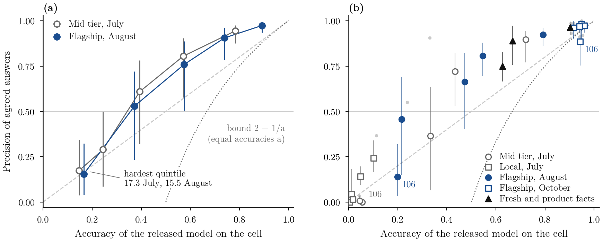

**Figure 1.** *Precision of agreed answers follows the accuracy of the pair.* Note: (a) quintiles of difficulty set within each tier, July mid tier and August flagships without the client-served GPT arms. (b) Every band of every tier, July to October, against the accuracy of the released model; labelled cells are the 106. Whiskers are 95% bootstrap intervals, and small grey dots in (b) are single pairs; dashed line is equality, dotted line the bound 2 - 1/a for equal accuracies a.

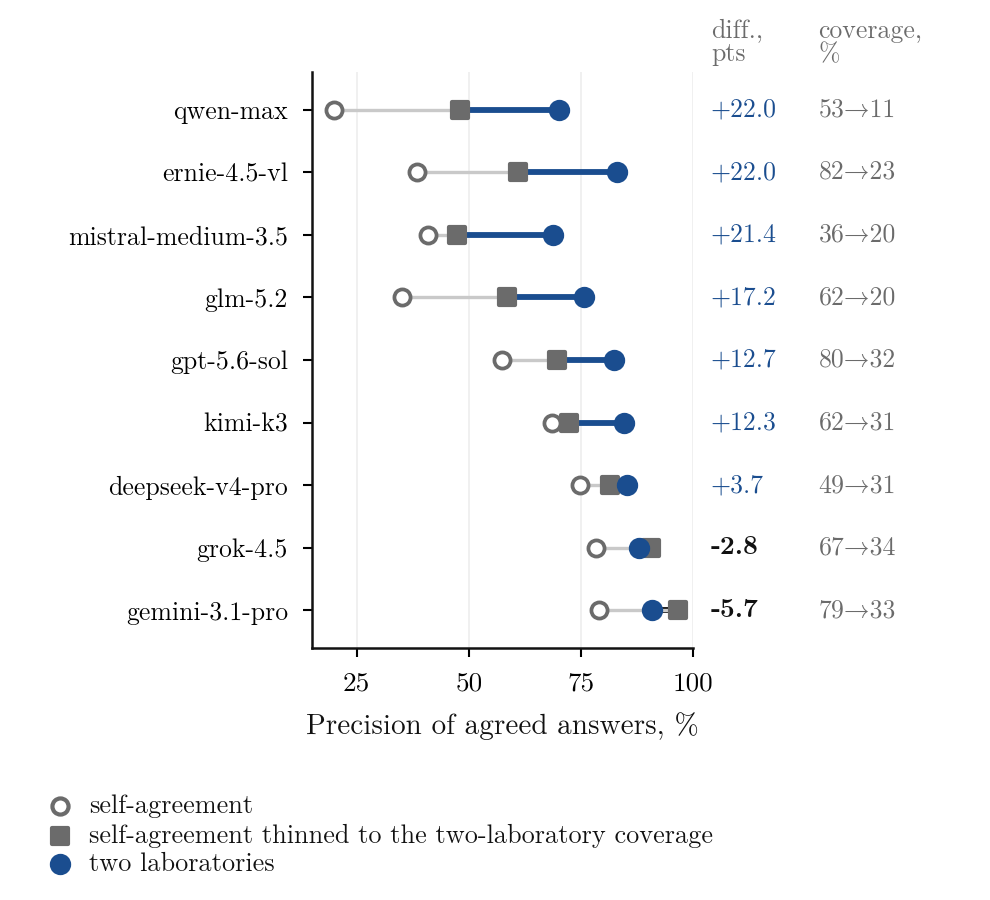

**Figure 2.** *Self-agreement against two laboratories, by model.* Note: variance arm, nine models, 100 questions. Open circle, two calls to one model; square, the same thinned by confidence to the coverage of the two-laboratory gate; filled circle, two laboratories, mean over partners. Right columns give the difference at equal coverage, in points, and the coverage of both gates, in percent.

Three-model panels without the client-served GPT arm give the same result. On the 106 under my engine the July panels give 0 of 318 (the 0 of 342 of Section 1 is the hardest quintile under the earlier matching rule; the 5 of 717 above counts pairs). In August the panel of DeepSeek, Qwen and Kimi gives 0 of 76 and the cross-bloc panel of Claude, DeepSeek and Mistral 11 of 78 (14.1% [2.7, 26.3]), while the panel of Claude, GPT and Gemini, which holds the GPT arm, gives 106 of 131 (80.9%). Flagship pairs line up with their accuracy on the stratum, from 4 of 21 for fable-5 with deepseek-v4-pro to 15 of 24 (62.5% [42.6, 82.6]) for fable-5 with gemini-3.1-pro, whose members lead this group there.

Because the 106 were chosen on July failure, which lowers July precision on them and favours August, Figure 1a sets difficulty within each tier. For each tier, questions are ranked into quintiles by the accuracy of the same tier without the pair under evaluation, so the hardest quintile holds the same rank for each, and the released model's accuracy there is close, 15.3% in July and 16.0% in August. Precision there is 159 of 917 (17.3% [3.8, 34.3]) in July and 203 of 1,308 (15.5% [4.0, 32.4]) in August without GPT, a difference of -1.8 points [-22.1, +20.2]. Pooling all five quintiles gives a sharper test. The model of Section 4 has no tier term. Given each cell's two accuracies, it supplies the precision expected there, and a tier effect would show as a difference in the residuals. Flagship cells sit -0.2 points [-3.1, +2.7] from mid-tier cells, and -0.5 [-3.6, +2.4] when the constants are fitted on July cells alone, so that August is out of sample. kimi-k3 belongs to both collections; without it the difference is +0.1 [-3.6, +3.8]. On cleaned gold answers precision stays low: on the 24 of the 106 that survive in SimpleQA Verified (Haas et al., 2025), August pairs without GPT are right on 18.7% of agreements [0.0, 57.1] (Appendix G).

Across every band of every tier (Figure 1b), precision rises with the accuracy of the released model in each wave and lies above the diagonal in 17 of 23 cells. Of the six below it, three are 106 cells and three are bands with released accuracy under 0.06. At the top, kimi-k3 with gemini-3.8-flash reach 95.8% on the fresh set (Appendix G).

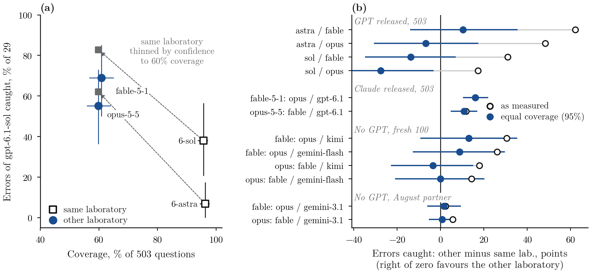

**Figure 3.** *A second laboratory: coverage and errors caught.* Note: (a) gpt-6.1-sol on 503 common questions, 29 errors, four partners of Table A4, 95% bootstrap intervals; arrows lead from the same-laboratory gate to the same gate thinned by confidence to 60% coverage. (b) The twelve comparisons of Table A5: errors caught by the other minus the same laboratory, as measured (open) and at equal coverage (filled, 95% question bootstrap).

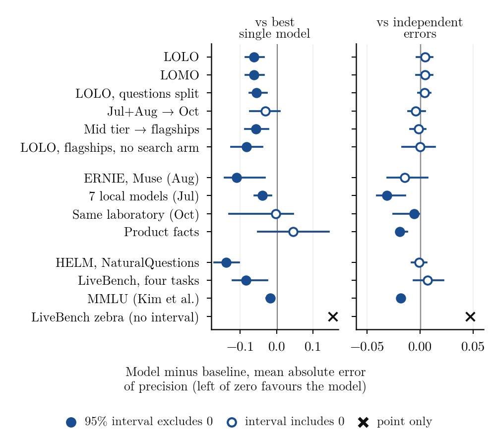

**Figure 4.** *The model against two baselines, out of sample.* Note: model minus baseline in mean absolute error of predicted precision, below zero favours the model, with 95% two-way bootstrap intervals (Tables A6 and A8). Top group, fitting schemes; middle, sets outside the fit with constants frozen; bottom, public data (Section 5.5). Filled marker, the 95% interval excludes zero; open, it includes zero; cross, a point estimate (the LiveBench zebra task).

### 5.2 A second laboratory catches more errors, at the price of coverage

Precision alone cannot separate the cases, because accurate pairs from one laboratory also have high precision. Recall has to be read with coverage, since a gate that opens less often blocks more errors by construction.

I begin with the variance arm: two calls to one model at temperature 0.7, against two calls to different laboratories (Figure 2). Pooled over nine models and 100 questions, self-agreement covers 63.5% at a precision of 56.1%, and two laboratories cover 26.1% at 82.9%. The difference in precision is +26.8 points [+16.6, +34.6] as measured and +9.0 [+0.5, +17.4] at equal coverage, where self-agreement is thinned by confidence, which favours it. By model, the two-laboratory gate leads for seven of nine. The arm holds no Claude model and has GPT by API at effort none. Without GPT, over eight models, the difference at equal coverage is +7.7 points [-1.9, +16.5].

The October wave holds two models each from two laboratories, which gives a direct test on 503 common questions (Figure 3a). One released model, gpt-6.1-sol, keeps the same 29 errors in every row and changes only the partner. Its same-laboratory partner gpt-6-astra catches 2 of them and fable-5-1 catches 20, a difference of -62.1 points [-79.3, -43.8]; against opus-5-5 the difference is -48.3 [-66.7, -29.6]. The price is coverage, 60 to 61% against 96%. Precision is similar across the rows: 94.3 and 96.2% for the same laboratory, 95.6 and 97.0% across laboratories (Table A4). Same-laboratory partners differ widely: gpt-6-sol catches 11 of 29 (Appendix H).

To see whether this is more than a move along the coverage curve, and whether it needs GPT, each row of Figure 3b keeps one released model and compares its two partners, as measured and at equal coverage (Table A5). As measured, the other laboratory catches more errors in every row. At equal coverage its advantage holds only when Claude is released with gpt-6.1-sol as partner, a partner of 93.9% accuracy against 66.6 to 69.2% for the same-laboratory one on the stratified set. With GPT released, the same-laboratory gate thinned by confidence is level or ahead, and without GPT the difference is level, or favours the same laboratory against weak partners. With two laboratories in October I detect no effect of the laboratory beyond partner accuracy and coverage, and HELM, with 20 developers, shows none once both are matched (Section 5.5).

### 5.3 The model out of sample

Out of sample, the model improves clearly on reading off the better model and is level with the independent-errors baseline (Figure 4, Table A6). Under LOLO its error is 0.037 against 0.099 for the best-model baseline (-0.062 [-0.085, -0.035]), and that interval lies below zero under LOMO, the question split and in seven of the ten rows of Table A6. The temporal split gives 0.019 against 0.050, -0.031 [-0.074, +0.008], below zero when clustered on question or on model alone (Appendix I). Against independent errors the model is level under all three schemes and better on three of four sets outside the fit, with constants frozen, so the criterion of Section 4 is met against the best-model baseline.

Precision is carried by the measured accuracies and by $\kappa(g)$: removing $\kappa$ raises the LOLO error to 0.323, and holding it constant gives 0.046. The multiplier $\rho$ adds nothing to precision in the main schemes and helps on coverage and log loss.

On product facts the model runs high. Its error is 0.130 against 0.086 for the best model, all of it overstatement (13 points), and 0.190 against 0.067 with that domain's native grader, again all overstatement (19 points). Appendix I sorts the cells into outcome classes.

### 5.4 Model access, and the GPT arms

On one set of 100 SimpleQA questions, gpt-5.6-sol scores 92 of 100 (92.0%) in the main wave, 99 of them through the Codex client, and 139 of 300 samples (46.3%) through the direct API in the variance arm, a gap of 45.7 points (Figure 5). Verbatim reproduction of the gold string falls with it, from 64.0% to 26.0%. The client runs at its default effort setting under its own instructions, with temperature not settable, while the API runs at effort none and temperature 0.7.

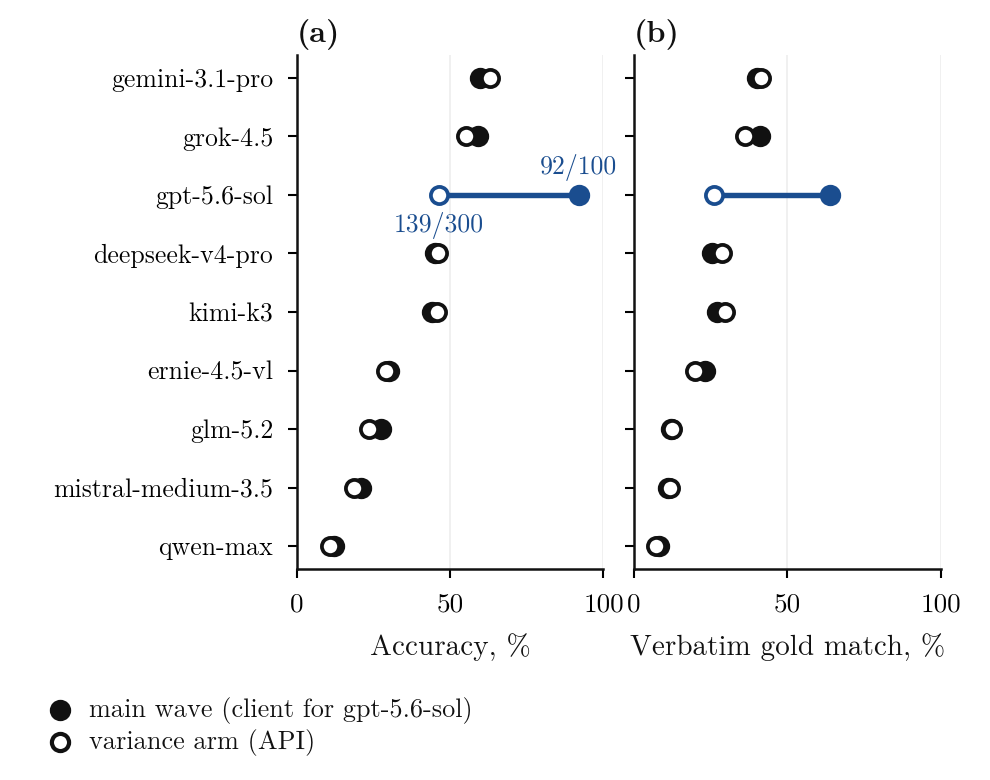

**Figure 5.** *One set of 100 questions, two arms, nine models.* Note: (a) accuracy, (b) verbatim match with the gold string. Filled, main wave (client-served for gpt-5.6-sol, 92/100); open, variance arm through the API (139/300). For gpt-5.6-sol the arms also differ in effort setting.

The eight other models, whose temperature also changes between the two columns, move by at most 4.0 points in either direction. Effort is one candidate, though a paired reasoning-budget measurement on gemini-3.1-pro left accuracy close to unchanged (Chernets, 2026c). Web search is the other: October responses from the same client contain links that the prompt does not request, in 3 of 506 answers of gpt-6.1-sol and 18 of 506 of gpt-6-astra, and median token use per August client call is 4,829.

The client figure is what a person using the product receives, and the API figure is what a benchmark harness at effort none reads. On fresh questions in August, with GPT through the API, gpt-5.6-sol and fable-5 are right on 29 of 32 agreements, Delta +57.6 points [+46.3, +69.7]. In October, with a newer GPT through the client on the same questions, the pair with opus-5-5 is right on 72 of 74, Delta +2.3 [-0.7, +6.0]. The two comparisons also differ in GPT model and date, and in both the value of the gate tracks the accuracy of the released arm, as in Section 5.1.

The client-served GPT arms, left out of Table 3, are accurate: the August arm with fable-5 is right on 997 of 1,016 agreements (98.1%) and on 34 of 37 on the 106, inheriting the accuracy of the arm (Delta -3.3 [-10.3, +2.6]; Table A7 and Appendix J).

### 5.5 External check on public data

I applied the frozen constants, with no refitting, to public data that share neither models nor fit with mine: HELM Lite (Liang et al., 2023), 95 models from 20 developers answering 1,000 closed-book NaturalQuestions; LiveBench (White et al., 2025), 70 models from 11 laboratories on 346 questions with a short final answer; and the pair aggregates of Kim et al. (2025) for 70 models on multiple-choice MMLU (Table A8). The results match Section 5.3 (Figure 4, bottom group). The model beats reading off the better model in all three sources and is level with independent errors in HELM and LiveBench. It runs high by 5.3 to 6.6 points and fails on zebra puzzles (0.231 against 0.076).

In HELM the observed curve flattens where the model keeps rising (Figure 6): at pair accuracy between 0.5 and 0.6 precision is 74.6% for models of 2023 and early 2024 and 75.9% for later ones, against 84.4% predicted at the middle of the bin. On MMLU the median chance that two wrong answers match is 0.621 against 0.368 from $\kappa(g)$, since four options force collisions. Precision rises with pair accuracy (Spearman +0.575 in HELM and +0.786 on MMLU, over dependent cells).

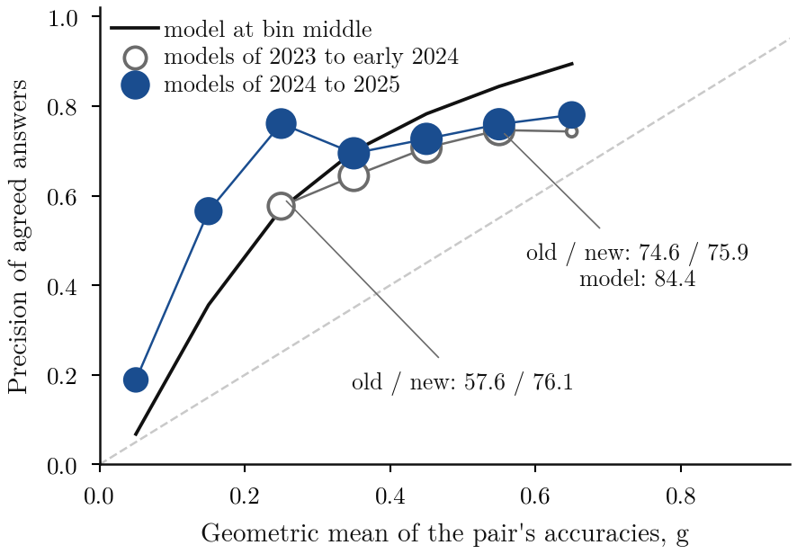

**Figure 6.** *HELM Lite: precision of agreed answers by pair accuracy, older and newer models.* Note: bins of the geometric mean g of the pair's accuracies, pairs of different laboratories; marker size grows with the number of pairs. The line is the frozen model at the middle of each bin.

HELM also allows the test of Section 5.2 with many laboratories and no GPT dependence. With one released model and partners within 3 points of accuracy, another laboratory catches 75.5% of errors against 72.3% for the same laboratory, -3.2 points [-4.2, -2.3], at coverage higher by 2.7 points. Adding a match on coverage within 3 points removes it: 75.7 against 75.9%, -0.2 [-0.6, +0.2].

## 6. Discussion

Running the gate needs no labels, but checking it does. Measure the accuracy of both models on a labelled sample of the stratum that matters, in the access mode that will be deployed. In these data, an agreed answer from two flagships on a question beyond both of them is no safer than an agreed answer from two mid-tier models. Pairing two laboratories is a reasonable default when no confidence values are available, but it has to be checked on the stratum: a same-laboratory pair thinned by confidence, or the released model's own confidence, can do as well (Section 5.2, Appendix J).

Chance-adjusted similarity (Goel et al., 2025) and precision of agreed answers are different quantities, and Han (2026) names decorrelation as the lever where I put accuracy and coverage first (Appendix L). For reporting, a study of model agreement should state access mode, effort, tool conditions and retained event logs for each arm.

## 7. Scope and boundary conditions

Tiers are compared through two waves on different dates and access routes, and the tier comparison is precise to about 3 points at matched accuracy, much less so on the hardest quintile alone. The fresh evidence is one set of 100 questions and eight templates at two dates, and October Delta on it includes zero. Pair accuracy and precision move together across dates and across reasoning settings that differ between waves, and the design does not isolate capability as a cause.

Whether the Codex, kimi and gemini-3.8-flash clients searched cannot be settled from the retained files, so their accuracies measure the client as deployed, not model memory. Sections 5.1 and 5.3 show the main results without those arms.

Same-laboratory pairs exist in October, for two laboratories, and without GPT the same-wave comparison is the 100 fresh questions. October cells draw on five models from two laboratories, so the model dimension of the two-way bootstrap has few levels and pooled intervals are lower bounds on uncertainty. Comparisons at equal coverage use stated confidence, which the bare gate does not, and random tie-breaking moves the widest row between 0.0 and +20.7 points (Appendix H).

The engine is rule-based, and its checks here are the cleaned gold of SimpleQA Verified (Section 5.1) and a rescoring of answer parts. It evaluates the whole answer, and long answers can draw a false "wrong"; scoring only the first part moves the precision of reference pairs by at most 3 points, and gpt-6-astra with opus-5-5 on the 106 from 80.0 to 88.9% (Table A3).

The model takes measured accuracies for each cell as input, so it describes a labelled check of the gate and does not replace one. It runs high on product facts and public data. HELM, LiveBench and the aggregates of Kim et al. hold older models in few-shot or multiple-choice formats, so they test the relation on other models, not on flagships of 2026.

## 8. Conclusion

The precision of agreed answers rises with the accuracy of the pair on the stratum at hand, on both tiers and within about 3 points at matched accuracy. Inversion appeared wherever I measured a weak pair, flagships included. A partner from a second laboratory catches more errors mostly by opening the gate less often, and at equal coverage it kept its advantage only where its model was far more accurate. A small model of the gate describes precision out of sample far better than the better model and as well as independent errors. One identifier measured through two access configurations differs by 45.7 points, so a claim about a model's accuracy should state the access mode.

## Impact Statement

This paper studies when agreement between two language models can be relied on as a rule for releasing short factual answers. Practitioners can check, on the stratum that matters and in the access mode they deploy, whether a two-model gate is precise enough for their use, instead of assuming that stronger models or a second vendor are enough. The main risk is over-trust in agreement on hard questions, and the results show the strata where agreed answers are mostly wrong. The study uses public benchmarks and machine-composed questions only.

## References

Chen, J. (2026). When does combining language models help? A co-failure ceiling on routing, voting, and mixture-of-agents across 67 frontier models. arXiv:2606.27288.

Chernets, V. (2026a). Verification theater: Measured failure modes of AI verifier panels. NeurIPS 2026 Workshop: Who Verifies the Agents?

Chernets, V. (2026b). Weakly discriminative, not repaired by profile injection, and manipulable: Self-confidence in LLM evaluation. NeurIPS 2026 Workshop: Can We Trust AI Evaluation? Robustness, Causality, and Risk in Modern AI Assessment.

Chernets, V. (2026c). Architectural trust: When an AI agent buys for you, does trust belong to the model, or the architecture above it? SSRN 7191261.

Denisov-Blanch, Y., Kazdan, J., Chudnovsky, J., Schaeffer, R., Guan, S., Adeshina, S., and Koyejo, S. (2026). Consensus is not verification: Why crowd wisdom strategies fail for LLM truthfulness. arXiv:2603.06612.

Ding, K. (2026). When LLMs agree, are they right? Auditing self-consistency and cross-model agreement as confidence signals. arXiv:2607.08065.

Geifman, Y. and El-Yaniv, R. (2017). Selective classification for deep neural networks. In *Advances in Neural Information Processing Systems 30*. arXiv:1705.08500.

Goel, S., Strüber, J., Auzina, I. A., Chandra, K. K., Kumaraguru, P., Kiela, D., Prabhu, A., Bethge, M., and Geiping, J. (2025). Great models think alike and this undermines AI oversight. In *Proceedings of the 42nd International Conference on Machine Learning*, PMLR 267. arXiv:2502.04313.

Han, J. (2026). Partially correlated verifier cascades in LLM harnesses: Concave log-odds, polynomial reliability, and blind-spot ceilings. arXiv:2607.13918.

Haas, L., Yona, G., D'Antonio, G., Goldshtein, S., and Das, D. (2025). SimpleQA Verified: A reliable factuality benchmark to measure parametric knowledge. arXiv:2509.07968.

Hossain, E., Yousefi, N., and Lim, S.-N. (2026). Agreement overstates evidence: Error dependence in LLM judge consensus. arXiv:2609.22512.

Kim, D. (2026). Are diversity metrics measuring diversity? A capability-controlled audit of majority-vote gain in LLM ensembles. arXiv:2607.20768.

Kim, E., Garg, A., Peng, K., and Garg, N. (2025). Correlated errors in large language models. In *Proceedings of the 42nd International Conference on Machine Learning*, PMLR 267:30038-30066. arXiv:2506.07962.

Kohli, G. (2026). Nine judges, two effective votes: Correlated errors undermine LLM evaluation panels. arXiv:2605.29800.

Kolawole, S., Dennis, D., Talwalkar, A., and Smith, V. (2025). Agreement-based cascading for efficient inference. *Transactions on Machine Learning Research*, 07/2025. arXiv:2407.02348.

Kuhn, L., Gal, Y., and Farquhar, S. (2023). Semantic uncertainty: Linguistic invariances for uncertainty estimation in natural language generation. In *International Conference on Learning Representations*. arXiv:2302.09664.

Liang, P., Bommasani, R., Lee, T., et al. (2023). Holistic evaluation of language models. *Transactions on Machine Learning Research*. arXiv:2211.09110.

Liu, N. (2026). LLMs as a jury: Cross-model consensus can outperform process reward models for LLM reasoning. arXiv:2607.10139.

Manakul, P., Liusie, A., and Gales, M. J. F. (2023). SelfCheckGPT: Zero-resource black-box hallucination detection for generative large language models. In *Proceedings of EMNLP 2023*. arXiv:2303.08896.

Naik, N. (2024). Probabilistic consensus through ensemble validation: A framework for LLM reliability. arXiv:2411.06535.

Owen, A. B. (2007). The pigeonhole bootstrap. *The Annals of Applied Statistics*, 1(2), 386-411.

Panickssery, A., Bowman, S. R., and Feng, S. (2024). LLM evaluators recognize and favor their own generations. In *Advances in Neural Information Processing Systems 37*.

Schuirmann, D. J. (1987). A comparison of the two one-sided tests procedure and the power approach for assessing the equivalence of average bioavailability. *Journal of Pharmacokinetics and Biopharmaceutics*, 15(6), 657-680.

Tan, H., Sun, F., Liu, S., Su, D., Cao, Q., Chen, X., Wang, J., Cai, X., Wang, Y., Shen, H., and Cheng, X. (2025). Too consistent to detect: A study of self-consistent errors in LLMs. In *Proceedings of EMNLP 2025*. arXiv:2505.17656.

Verga, P., Hofstatter, S., Althammer, S., Su, Y., Piktus, A., Arkhangorodsky, A., Xu, M., White, N., and Lewis, P. (2024). Replacing judges with juries: Evaluating LLM generations with a panel of diverse models. arXiv:2404.18796.

Wang, X., Wei, J., Schuurmans, D., Le, Q., Chi, E., Narang, S., Chowdhery, A., and Zhou, D. (2023). Self-consistency improves chain of thought reasoning in language models. In *International Conference on Learning Representations*.

Wei, J., Karina, N., Chung, H. W., Jiao, Y. J., Papay, S., Glaese, A., Schulman, J., and Fedus, W. (2024). Measuring short-form factuality in large language models. arXiv:2411.04368.

White, C., Dooley, S., Roberts, M., et al. (2025). LiveBench: A challenging, contamination-limited LLM benchmark. In *International Conference on Learning Representations*. arXiv:2406.19314.

Xue, Y., Greenewald, K., Mroueh, Y., and Mirzasoleiman, B. (2026). Verify when uncertain: Beyond self-consistency in black box hallucination detection. arXiv:2502.15845.

Yue, M., Zhao, J., Zhang, M., Du, L., and Yao, Z. (2024). Large language model cascades with mixture of thought representations for cost-efficient reasoning. In *International Conference on Learning Representations*. arXiv:2310.03094.

## Declarations

**Competing interests.** The author is a named applicant on pending patent applications, not granted patents, covering AI orchestration and multi-model validation systems of the kind this paper examines.

**Data and code.** Per-call responses, analysis scripts and the mapping from every reported number to its source table are archived at Zenodo, doi:10.5281/zenodo.24090584 (CC BY 4.0).

## Appendix A. Models and access modes

**Table A1.** *Collections and access modes, per wave.*

| Collection | Dates | Models | Access |
|---|---|---|---|
| July mid tier | 24 to 28 July 2026 | claude-haiku-4-5, gpt-5-mini, gemini-3.6-flash, grok-4-fast, deepseek-chat, qwen-plus, kimi-k3, glm-4.5, mistral-small | Direct API |
| July local | 24 to 28 July 2026 | seven local open-weight models | Local inference |
| August flagships | 3 to 6 August 2026 | claude-fable-5, gpt-5.6-sol, mistral-medium-3.5 | Vendor client; gpt-5.6-sol at the client default effort setting, 14 of 1,500 records by API fallback |
| | | glm-5.2 | Vendor endpoint |
| | | deepseek-v4-pro, grok-4.5, kimi-k3, qwen-max | Direct API |
| | | gemini-3.1-pro, ernie-4.5-vl-424b, muse-spark-1.1 | Direct API or aggregator route pinned to the vendor; muse-spark-1.1 partial (251 answers) |
| Variance arm | 6 August 2026 | Nine flagships, no Claude | gpt-5.6-sol by direct API, effort none; mistral-medium-3.5 through its vendor client, which records the requested temperature; others as in the August wave; temperature 0.7, three samples |
| Fresh, August | 6 August 2026 | gpt-5.6-sol (effort none), claude-fable-5, deepseek-v4-pro, kimi-k3 | gpt-5.6-sol and deepseek-v4-pro by direct API, claude-fable-5 by vendor client, kimi-k3 by aggregator route |
| Product facts | 15 August 2026 | Six models, 15 pairs; four without search possibility, 6 pairs | Mixed; gpt-5.4 and grok through clients |
| October | 26 and 27 October 2026 | gpt-6.1-sol, gpt-6-astra, gpt-6-sol | Codex client, effort medium, no search flag, event stream not retained |
| | | claude-opus-5-5, claude-fable-5-1 | Claude client, tools disallowed |
| | | kimi-k3, gemini-3.8-flash (fresh only) | Vendor clients, tools not disabled |

In the August wave, 19 answers of the claude-fable-5 arm were served by other Claude models. The wave's 34 of 37 on the 106 does not depend on them (Chernets, 2026a).

## Appendix B. Pairs over the 503 common questions

**Table A2.** *All pairs of different laboratories, first member released, 503 common questions.*

| Pair | Coverage | PPV (K/O) | Delta, points [95%] | Errors caught |
|---|---|---|---|---|
| gpt-6.1-sol + opus-5-5 | 59.8% | 95.6% (285/298) | +1.5 [-0.2, +3.3] | 16/29 |
| gpt-6.1-sol + fable-5-1 | 60.8% | 97.0% (294/303) | +2.9 [+1.1, +4.8] | 20/29 |
| gpt-6-astra + opus-5-5 | 58.3% | 94.8% (275/290) | +2.5 [+0.5, +4.7] | 23/38 |
| gpt-6-astra + fable-5-1 | 61.4% | 95.4% (291/305) | +3.1 [+1.1, +5.3] | 24/38 |
| gpt-6-sol + opus-5-5 | 61.6% | 95.4% (291/305) | -0.7 [-1.9, +0.6] | 5/19 |
| gpt-6-sol + fable-5-1 | 62.8% | 97.1% (301/310) | +1.0 [-0.4, +2.5] | 10/19 |

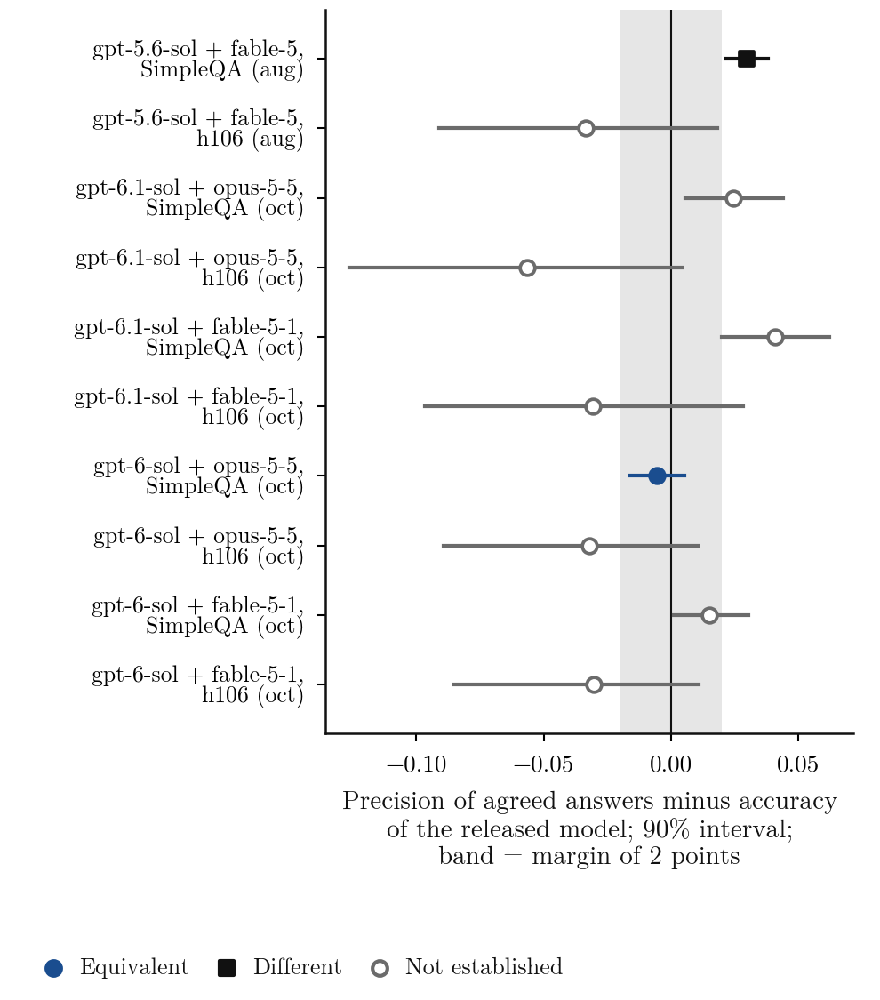

**Figure A1.** *Equivalence test of pair precision against the released model.* Note: 90% question bootstrap, margin of 2 points shaded. Pairs with a Codex client arm released.

## Appendix C. Verbatim match with the gold string

Verbatim match rank-correlates perfectly with SimpleQA accuracy across the nine models with both a SimpleQA and a fresh measurement, since a correct answer is often the gold string. Its correlation with the SimpleQA minus fresh gap is +0.47 (exact permutation p = 0.21, n = 9), or +0.29 (p = 0.50) without gpt-5.6-sol, whose two accuracies come from different access modes (Figure A2). Restricted to correct answers, it is +0.10 (p = 0.81). Among correct answers the rate is 65.7% for gpt-5.6-sol, 66.4% for fable-5, 68.6% for deepseek-v4-pro and 64.9% for kimi-k3. The residual of the model does not depend on it, with a slope of +0.064 [-0.072, +0.167] across 112 flagship cells. The gap itself is close to zero or negative for most models, at -3.0 points for fable-5, -20.5 for deepseek-v4-pro, -5.4 for opus-5-5 and -7.8 for fable-5-1, and it is large only for gpt-5.6-sol (+62.4), where the access mode differs between the two measurements.

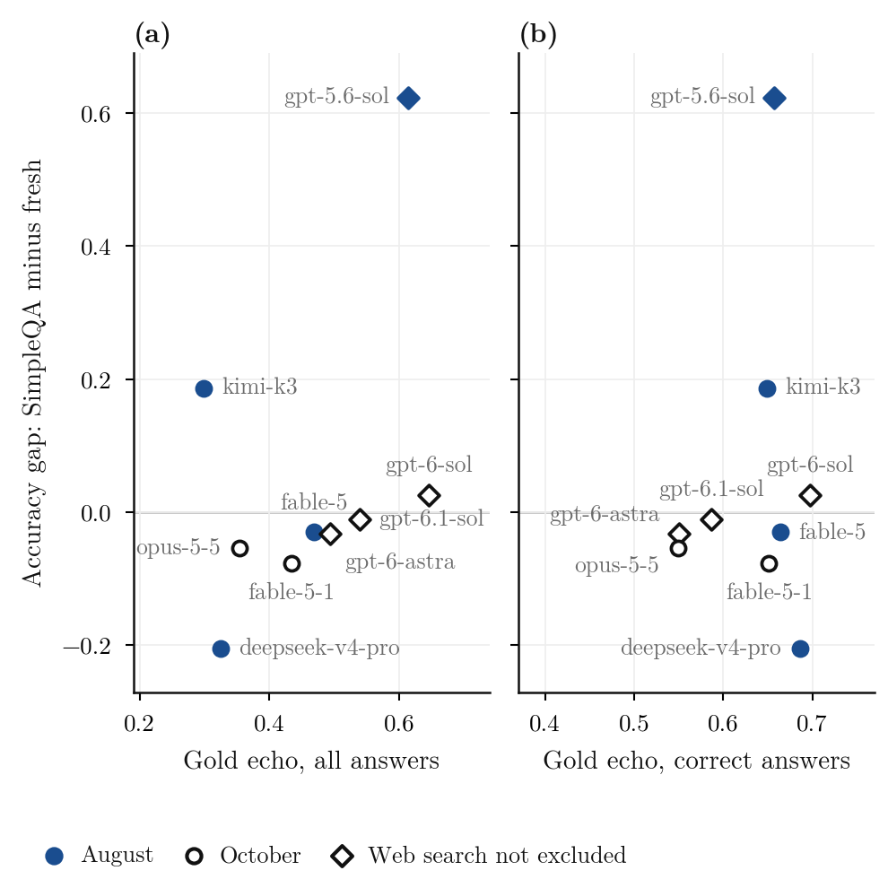

**Figure A2.** *Verbatim match with the gold string against the accuracy gap.* Note: (a) all answers, (b) correct answers only. Filled blue, August wave; open, October wave. Diamonds mark arms for which web search is not excluded.

## Appendix D. Grader sensitivity

The engine normalises case, articles and punctuation, accepts exact matches and containment of strings of four or more characters, compares dates, numbers and alphanumeric identifiers by rule, and otherwise compares content words; an answer it cannot settle against the gold is unresolved. In Table A3 the first part of each answer, without parentheses and trailing explanation, is used for matching as well as grading, so the open count changes too.

**Table A3.** *Scoring the whole answer against scoring its first part. The first member is released.*

| Pair, set | PPV, whole answer | PPV, first part |
|---|---|---|
| gpt-5.6-sol + fable-5, all, August | 997/1016 | 997/1019 |
| gpt-6.1-sol + opus-5-5, 106, October | 31/35 | 30/34 |
| gpt-6.1-sol + fable-5-1, 106, October | 31/34 | 31/35 |
| gpt-6-astra + opus-5-5, 106, October | 28/35 | 32/36 |
| gpt-6.1-sol + opus-5-5, strat, October | 183/190 | 189/195 |
| gpt-6.1-sol + fable-5-1, strat, October | 187/191 | 198/201 |
| gpt-6.1-sol + opus-5-5, fresh, October | 72/74 | 72/74 |

## Appendix E. Further related work

Recent preprints point in two directions. On the sceptical side, Denisov-Blanch et al. (2026) find that polling-style aggregation across five benchmarks and models yields no consistent accuracy gain at 25 times the inference cost, because errors are correlated. Ding (2026) audits 265,000 samples on GPQA Diamond and AIME and finds agreement a positive but weak predictor (Spearman 0.20 to 0.59), with 48% of the high-agreement GPQA entries of the most consistent frontier model wrong. In an exploratory check on 46 items, same-wrong-answer rates between gpt-4.1 and Claude tiers exceed a marginal-preserving null for two of three tiers. Kohli (2026) finds that nine frontier judges on three inference datasets carry about two independent votes, and that the best single judge matches or beats the panel. Kim (2026) audits 31,900 subsets of 30 models on MMLU-Pro: voting beats the strongest member in 9.98% of size-3 subsets, and a strict diversity measure is nearly collinear with one minus mean accuracy (Spearman +0.991). Hossain et al. (2026) find an average pairwise error correlation of 0.21 across ten judges, which carry about as much information as 3.5 independent ones, with stronger dependence among frontier judges from different providers. Chen (2026) shows that any policy that outputs one member's answer cannot exceed one minus the rate $\beta$ at which all models are wrong together, and finds $\beta$ of 0.052 on open-ended mathematics across 67 models against 0.023 under a Gaussian copula, and 0.127 on free-response GPQA-Diamond. On the other side, Naik (2024) reports precision rising from 73.1% to 93.9% with two models and to 95.6% with three on 78 cases in multiple-choice format, and Liu (2026) shows a four-model panel selecting answers better than self-consistency on seven benchmarks, with a closed-form law in member accuracy, error correlation and a shared-misconception rate that predicts consensus accuracy to a mean absolute error of 0.028. Xue et al. (2026) report that cross-model consistency with a verifier improves on the ceiling of self-consistency for hallucination detection on QA benchmarks, and Tan et al. (2025) that self-consistent errors do not shrink with model scale, tend to be model-specific, and are better detected with a second model. Han (2026) gives a theory of serial verification gates in which a blind-spot mass caps reliability and names decorrelation, by changing model family, modality or evidence source, as the practical lever. Two of the works of Section 2 carry details that bear on the gate. Goel et al. (2025) define CAPA so that distinct wrong options count as disagreement, and besides the trend with capability they show that nine open-weight LLM judges score models more similar to themselves higher, and that weak-to-strong gains are larger on tasks where supervisor and student make less similar errors (12 model pairs). Kolawole et al. (2025) state a safe-deferral condition on the joint rate of accepted errors over the test distribution, with a threshold estimated on a small validation set. A condition on the joint rate permits accepted errors to concentrate on one stratum, and Section 5.1 finds such a stratum: on the 106, mid-tier panels certify the error, and so do flagship pairs without the highest-accuracy arm.

None of these works reports, as noted in Section 2, the pair-level release gate, recall at equal coverage with one released model held fixed, or one identifier measured in two access modes.

## Appendix F. Data and protocol details

**Collections.** The protocol is that of Section 3, and the collections follow in full. Table A1 lists models, dates and access modes.

- *July mid tier (24 to 28 July).* Nine API models and seven local models on 1,500 SimpleQA questions (Wei et al., 2024), a fixed random subsample of the 4,326 questions in the benchmark. The collection was registered on OSF before data collection (Chernets, 2026a).
- *August flagships (3 to 6 August).* One flagship from each of eleven laboratories on the same 1,500 questions, of which 1,459 form the common pool.
- *Variance arm (6 August).* Nine of the flagships on 100 of those questions, 20 per quintile, at temperature 0.7 with three samples per question.
- *Fresh questions (6 August and 26 October).* 100 two-hop questions composed by machine from Wikidata across eight templates, with the file hash fixed before the first model call.
- *Product facts (15 August).* 267 questions about commercial products, also composed from Wikidata, on six models, four of them without search possibility.
- *October flagships (26 and 27 October).* gpt-6.1-sol, gpt-6-astra, gpt-6-sol, claude-opus-5-5 and claude-fable-5-1 on 300 SimpleQA questions stratified by July quintile (60, 120, 120; 297 common to all five; "strat" in the tables), the 106 questions below and the fresh set, 503 common questions in total. kimi-k3 and gemini-3.8-flash answered the fresh set.

**Access modes.** Models were reached in the two ways described in Section 3. gpt-5.6-sol also ran by direct API in the variance arm and on the August fresh set. Model identifiers and client versions are recorded per call.

Because the clients set the conditions of measurement, I state them in full. Temperature cannot be set in them. The August Codex arm ran at the client default setting for reasoning effort, which the call does not set and the records do not state. The October Codex arms ran with effort set to medium in each call. The August manifest records zero web search requests for the Claude arm and an empty tool list for the Mistral arm, and the October Claude arms ran with tools disallowed. The Codex arms were started without the search flag, and their event streams were not retained, so whether they searched cannot be determined from the files. In the kimi and gemini-3.8-flash clients, tools were not disabled and the prompt forbids them.

## Appendix G. The 106 and the tiers

Figure A3 shows the panels and pairs of Section 5.1 on the 106 and two more pairs: fable-5 with grok-4.5 is right on 7 of 28 agreements and gemini-3.1-pro with grok-4.5 on 8 of 25.

The 0 of 342 of Section 1 depends on how difficulty is ranked. When each panel's own answers are left out of the difficulty ranking, the count becomes 78 of 354, and the cross-bloc panel stays at 0 of 116.

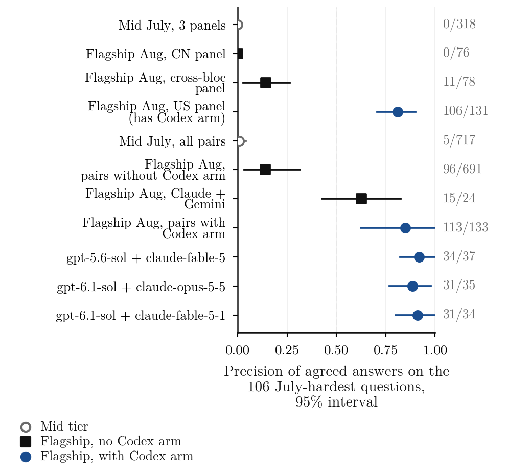

**Figure A3.** *Precision of agreed answers on the 106 questions.* Note: 95% two-way bootstrap for pooled rows, question bootstrap for panels and single pairs. Blue rows contain a Codex client arm. August and October collections.

Figure A4 gives the own-tier quintiles of Section 5.1 in full. With all arms, August reaches 26.6% [6.7, 53.4] in the hardest quintile, a difference of +9.3 [-18.1, +39.8] from July. Without kimi-k3, which belongs to both collections, the hardest quintile gives 147 of 675 (21.8%) in July and 192 of 995 (19.3%) in August, -2.5 points [-29.7, +28.2]. The pooled test of Section 5.1 uses all five quintiles, 180 cells per tier; mid-tier cells sit +0.3 points [-2.4, +2.9] and flagship cells +0.0 [-1.4, +1.6] from the frozen model. Lift in the hardest quintile is 1.15 [0.39, 1.90] in July and 0.97 [0.42, 1.49] in August. Across the quintiles, August without GPT gives 15.5, 52.9, 75.8, 90.5 and 97.3% and July 17.3, 29.0, 60.9, 80.4 and 94.4%, while released-model accuracy runs 16.0, 36.6, 56.8, 73.3 and 88.5% against 15.3, 25.0, 40.0, 57.7 and 78.9%.

Precision stays low on cleaned gold answers. Haas et al. (2025) rebuilt SimpleQA into a cleaned set of 1,000 questions, and 24 of the 106 survive in it, against 24.5 expected from the share of the benchmark retained, with the gold answer identical on 21. The cleaning does not remove these questions more often than others, though its selection also favours hard questions. Under the same statistic and bootstrap, August pairs without GPT are right on 28 of 150 agreements on those 24 questions (18.7% [0.0, 57.1]) and on 67 of 538 on the other 82 (12.5% [2.8, 28.1]; the more accurate member is released on each subset, so the parts need not sum to 96 of 691), and July pairs on 4 of 157 (2.5% [0.0, 15.2]).

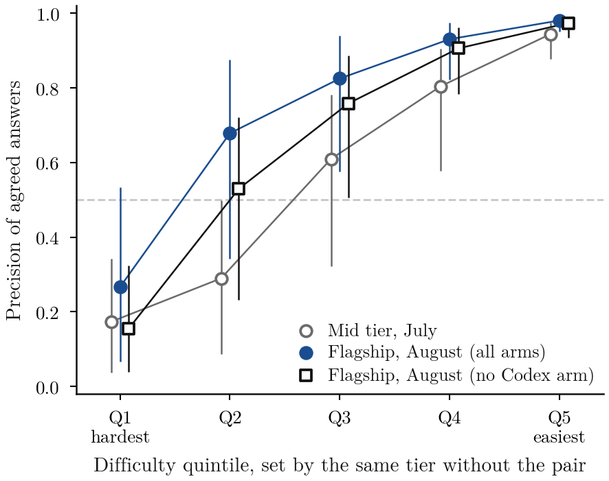

**Figure A4.** *Precision of agreed answers by own-tier difficulty quintile.* Note: 95% two-way bootstrap. Difficulty for each pair is set by the same tier without that pair. Dashed line at 0.5.

The most accurate pairs fit the same relation. The pair kimi-k3 and gemini-3.8-flash reach 95.8% on the fresh set, with 23 of 26 errors of the released model caught and a lift of 5.37 [2.86, 21.36]. The model, given only their accuracies of 0.74 and 0.82, returns 95.1%. And the two Claude flagships together, with no search possibility in either arm, reach 47.5% on the 106, where the released model's accuracy is 30.0%, and 86.2% across all 503 questions. Figure A5 plots every band of every tier against released-model accuracy, with precision above the diagonal in 17 of 23 cells.

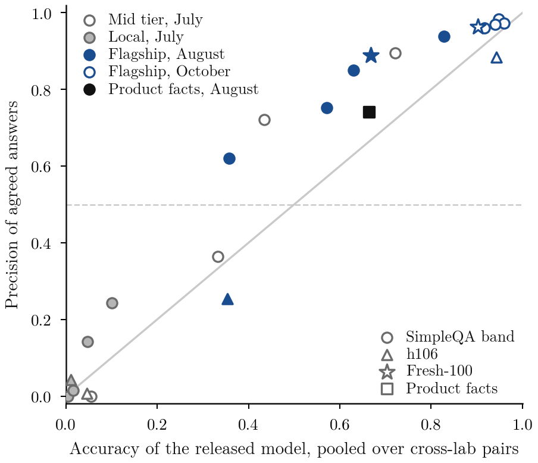

**Figure A5.** *Precision of agreed answers against accuracy of the released model.* Note: pooled over pairs of different laboratories, by tier and band. Colour and fill give the tier, marker shape the set. Dashed line at 0.5, solid line is equality.

## Appendix H. The second laboratory in detail

**The variance arm.** By model at equal coverage (Figure 2), the two-laboratory gate leads for seven of nine and trails for gemini-3.1-pro (-5.7 points) and grok-4.5 (-2.8). Without GPT, over eight models, self-agreement covers 61.4% at a precision of 55.9% and two laboratories 24.4% at 83.3%. The difference in precision is +27.4 points [+16.0, +35.7] as measured and +7.7 [-1.9, +16.5] at equal coverage, and errors caught differ by +38.3 points [+26.0, +50.9] as measured and +3.0 [-1.5, +8.4] at equal coverage. October has no repeated calls, so self-agreement is measured in August only.

**Four partners of one released model.** Table A4 gives the four partners of Figure 3a: one released model, gpt-6.1-sol, so the 29 errors at stake are the same in every row.

**Table A4.** *One released model, four partners: gpt-6.1-sol on 503 common questions (29 errors among 495 resolved, 95% question bootstrap).*

| Partner | Laboratory | Coverage [95%] | PPV (K/O) | Delta, points [95%] | Errors caught [95%] |
|---|---|---|---|---|---|
| gpt-6-astra | same | 96.2% [94.4, 97.8] | 94.3% (449/476) | +0.2 [-0.2, +0.8] | 2/29 = 6.9% [0.0, 17.4] |
| gpt-6-sol | same | 95.6% [93.6, 97.2] | 96.2% (457/475) | +2.1 [+0.9, +3.4] | 11/29 = 37.9% [20.7, 56.5] |
| claude-opus-5-5 | different | 59.8% [55.9, 64.0] | 95.6% (285/298) | +1.5 [-0.2, +3.3] | 16/29 = 55.2% [36.4, 73.0] |
| claude-fable-5-1 | different | 60.8% [56.7, 65.0] | 97.0% (294/303) | +2.9 [+1.1, +4.8] | 20/29 = 69.0% [50.0, 85.2] |

The other same-laboratory partner, gpt-6-sol, catches 11 of 29, which is -31.0 points [-50.0, -10.7] against fable-5-1 and -17.2 [-37.0, +3.0] against opus-5-5. The Claude pair, with no search possibility in either arm, covers 60.6% and catches 140 of 181 errors of fable-5-1 at a precision of 86.2% and a Delta of +23.5 points [+19.6, +27.2]. Two models of one laboratory, both far from the ceiling, can thus disagree often enough to catch most errors.

Table A5 tests whether this is more than a move along the coverage curve, and whether it needs GPT. Each row keeps one released model and compares its same-laboratory partner with a partner from another laboratory, first as measured and then at equal coverage, reached by thinning the wider gate by confidence (Section 3).

**Table A5.** *Errors caught with a same-laboratory partner and with a partner from another laboratory. Differences are same minus other, in points, with a 95% question bootstrap, so negative favours the other laboratory; as-measured differences in the first four rows share the bootstrap of Table A4.*

| Released | Same / other partner | Questions | Caught, as measured | Difference [95%] | Caught, equal coverage | Difference [95%] |
|---|---|---|---|---|---|---|
| gpt-6.1-sol | astra / fable-5-1 | 503 | 2/29, 20/29 | -62.1 [-79.3, -43.8] | 17/29, 20/29 | -10.3 [-35.3, +13.8] |
| gpt-6.1-sol | astra / opus-5-5 | 503 | 2/29, 16/29 | -48.3 [-66.7, -29.6] | 18/29, 16/29 | +6.9 [-17.1, +30.4] |
| gpt-6.1-sol | gpt-6-sol / fable-5-1 | 503 | 11/29, 20/29 | -31.0 [-50.0, -10.7] | 24/29, 20/29 | +13.8 [-6.7, +34.6] |
| gpt-6.1-sol | gpt-6-sol / opus-5-5 | 503 | 11/29, 16/29 | -17.2 [-37.0, +3.0] | 24/29, 16/29 | +27.6 [+3.4, +51.6] |
| fable-5-1 | opus-5-5 / gpt-6.1-sol | 503 | 140/181, 169/181 | -16.0 [-21.7, -10.6] | 140/181, 169/181 | -16.0 [-21.7, -10.6] |
| opus-5-5 | fable-5-1 / gpt-6.1-sol | 503 | 154/195, 177/195 | -11.8 [-17.8, -5.9] | 156/195, 177/195 | -10.8 [-16.7, -5.0] |
| fable-5-1 | opus-5-5 / kimi-k3 | fresh 100 | 13/23, 20/23 | -30.4 [-50.0, -12.5] | 17/23, 20/23 | -13.0 [-35.0, +9.1] |
| fable-5-1 | opus-5-5 / gemini-3.8-flash | fresh 100 | 13/23, 19/23 | -26.1 [-45.5, -8.7] | 17/23, 19/23 | -8.7 [-29.4, +12.5] |
| opus-5-5 | fable-5-1 / kimi-k3 | fresh 100 | 18/28, 23/28 | -17.9 [-38.5, +0.0] | 24/28, 23/28 | +3.6 [-14.7, +22.6] |
| opus-5-5 | fable-5-1 / gemini-3.8-flash | fresh 100 | 18/28, 22/28 | -14.3 [-33.3, +4.5] | 22/28, 22/28 | +0.0 [-20.0, +20.7] |
| fable-5-1 | opus-5-5 / gemini-3.1-pro (August) | 344 | 107/130, 110/130 | -2.3 [-9.8, +5.3] | 108/130, 110/130 | -1.5 [-9.1, +5.8] |
| opus-5-5 | fable-5-1 / gemini-3.1-pro (August) | 344 | 118/141, 126/141 | -5.7 [-12.1, +0.8] | 125/141, 126/141 | -0.7 [-6.4, +5.1] |

The August rows are the only SimpleQA comparison without GPT, and they pair models from different dates. gemini-3.1-pro is the August arm closest in accuracy to the Claude models on these questions (65.4% against 60.6 and 57.7% on these questions). Pooled over all seven August partners, most of them much weaker, the difference is -5.1 points [-10.1, -0.3] for fable-5-1 and -6.0 [-10.6, -1.2] for opus-5-5 as measured, and it turns to +7.9 [+4.8, +11.2] and +6.8 [+3.6, +10.2] at equal coverage, in favour of the same laboratory. Ties in confidence are broken at random, and over 200 draws the widest row moves between 0.0 and +20.7 points.

## Appendix I. The model out of sample in detail

Table A6 gives the out-of-sample errors behind Section 5.3. The temporal split gives 0.019 against 0.050 for the best-model baseline, a difference of -0.031 [-0.074, +0.008] under the two-way bootstrap, and the interval lies below zero when clustered on question alone or on model alone. With 9 and 23 folds, LOLO and LOMO give the same error to three decimals.

**Table A6.** *Mean absolute error of predicted PPV, cells with at least 20 open answers. Two-way bootstrap, question by model.*

| Scheme | Model [95%] | Indep. | Best | Model minus best [95%] | Model minus indep. [95%] |
|---|---|---|---|---|---|
| LOLO | 0.037 [0.033, 0.055] | 0.032 | 0.099 | -0.062 [-0.085, -0.035] | +0.005 [-0.003, +0.012] |
| LOMO | 0.037 [0.033, 0.055] | 0.032 | 0.099 | -0.062 [-0.085, -0.036] | +0.005 [-0.004, +0.012] |
| LOLO, questions split | 0.054 [0.052, 0.088] | 0.050 | 0.109 | -0.055 [-0.075, -0.027] | +0.004 [-0.002, +0.010] |
| July and August to October | 0.019 [0.008, 0.041] | 0.023 | 0.050 | -0.031 [-0.074, +0.008] | -0.004 [-0.011, +0.005] |
| Mid tier to flagships | 0.030 [0.025, 0.053] | 0.031 | 0.087 | -0.057 [-0.087, -0.022] | -0.001 [-0.009, +0.005] |
| LOLO, flagships, no search-possible arm | 0.037 [0.029, 0.071] | 0.038 | 0.120 | -0.083 [-0.125, -0.039] | -0.000 [-0.017, +0.014] |
| Held out: ERNIE and Muse, August | 0.019 [0.015, 0.055] | 0.033 | 0.128 | -0.110 [-0.143, -0.032] | -0.014 [-0.031, +0.007] |
| Held out: 7 local models, July | 0.037 [0.018, 0.072] | 0.068 | 0.077 | -0.040 [-0.061, -0.015] | -0.031 [-0.041, -0.014] |
| Held out: same laboratory, October | 0.038 [0.017, 0.083] | 0.043 | 0.041 | -0.003 [-0.130, +0.045] | -0.006 [-0.025, -0.001] |
| Held out: product facts | 0.130 [0.077, 0.187] | 0.149 | 0.086 | +0.045 [-0.051, +0.143] | -0.019 [-0.021, -0.012] |

The practical gain over reading off the better model is large, including transfer from the mid tier to flagships and two of the four sets that took no part in the fit (Figure A6). The multiplier $\rho$ adds nothing to precision in the main schemes, and the work is done by the measured accuracies and by $\kappa(g)$. Removing $\kappa$ altogether raises the LOLO error to 0.323, and holding it constant gives 0.046. On coverage and log loss, $\rho$ does help: under LOLO the differences from independent errors are -0.0079 [-0.0111, -0.0020] and -0.0024 [-0.0045, -0.0003]. On three of the four held-out sets, the interval against independent errors lies below zero, with constants frozen. The joint-error term therefore matters for coverage, while precision rests on the measured accuracies and $\kappa(g)$.

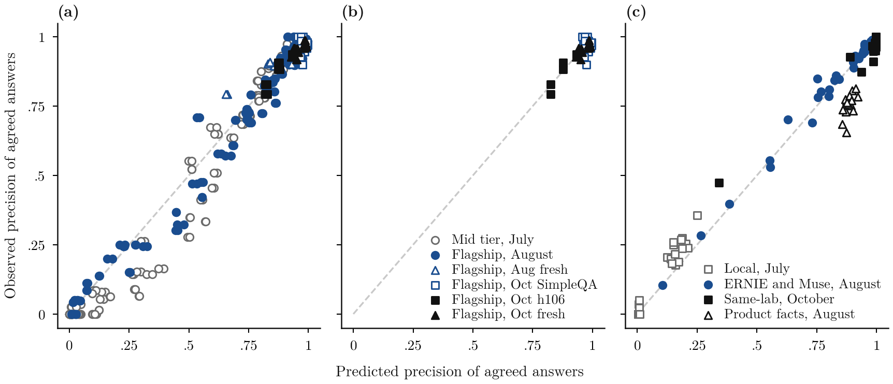

**Figure A6.** *Predicted against observed precision of agreed answers.* Note: (a) leave one laboratory out. (b) Fit on July and August and predict October. (c) Sets outside the fit, constants fixed. Dashed line is equality.

On product facts the model runs high. The error is 0.130 against 0.086 for the best model, with a mean overstatement of 13 points. With that domain's native grader the overstatement rises to 19 points (0.190 against 0.067). Product facts lie outside the domain the constants were fitted on.

Sorting cells into three outcome classes (inverted at PPV below 0.5, no gain at Delta up to +2 points, gain above that), the temporal split matches 28 of 39 cells, and nine of the misses predict no gain where gain was observed. The model is reliable for the size of precision and weaker at sorting cells on either side of the +2 point line.

## Appendix J. Access modes and the GPT arms in detail

**Same identifier, same questions.** On one set of 100 SimpleQA questions, gpt-5.6-sol scores 92 of 100 (92.0%) in the main wave, where 99 of the 100 records came through the Codex client and one wrong answer through an API fallback, and 139 of 300 samples (46.3%) through the direct API in the variance arm, a gap of 45.7 points (Figure 5). On the 99 client records alone the figures are 92 of 99 (92.9%) and 139 of 297 (46.8%), a gap of 46.1 points. Verbatim reproduction of the gold string falls with it, from 64.0% to 26.0%. The conditions differ as follows: the client runs at its default effort setting under its own instructions, with temperature not settable, while the API runs at effort none and temperature 0.7.

Across the two columns the other eight models of the arm, whose temperature also changes, move by at most 4.0 points either way. Effort is one candidate for gpt-5.6-sol, though a paired reasoning-budget measurement on gemini-3.1-pro left accuracy close to unchanged (Chernets, 2026c). Web search is the other. October responses from the same client contain links that the prompt does not request, in 3 of 506 answers of gpt-6.1-sol and in 18 of 506 of gpt-6-astra, including a real MusicBrainz identifier. Median token use per August client call is 4,829, with 36.4% of calls above 6,000. Those tokens may be reasoning or search, and the event stream that would separate them was not retained.

A benchmark harness and a person using the product can thus see accuracies 45.7 points apart on one identifier and one question set, and a study of "the model" has to state which it measured. Inside the August wave, the client arm scores 1,392 of 1,457 (95.5%), and the 14 records served by API after a client failure score 11 (78.6%), on questions selected by that failure. On the fresh set, gpt-5.6-sol through the API scores 33 of 100, where fable-5 scores 76, while gpt-6.1-sol through the client scores 95 in October. And the model of Section 4 keeps its form under this question, since it takes measured accuracies as input: on flagships without search-possible arms its LOLO error is 0.037 against 0.120 for the best model.

**Gate value by access mode.** On fresh questions in August, with GPT through the API, the pair gpt-5.6-sol and fable-5 is right on 29 of 32 agreements, Delta +57.6 points [+46.3, +69.7], catching 64 of 67 errors, and confident errors of the GPT arm fall from 61 of 91 to 2 of 29. In October, with a newer GPT through the client on the same questions, the pair with opus-5-5 is right on 72 of 74, and the pair with fable-5-1 on 76 of 78, with a Delta of +2.3 [-0.7, +6.0] and +2.4 [-0.5, +6.3] and 3 of 5 errors caught. Gate value here tracks the accuracy of the released arm, as in Section 5.1.

**Client arms on SimpleQA.** Table A7 reports the arms set aside in Section 5.1. In August, the pair gpt-5.6-sol and fable-5 is right on 997 of 1,016 agreements (98.1%) against 95.4% alone, Delta +2.8 points [+1.9, +3.7], with the floor at 15 of 1,459. On the 106 it reaches 34 of 37 (91.9%), and all pairs with the GPT arm reach 113 of 133 (85.0% [62.2, 100.0]), against 96 of 691 without it. The arm alone is right on 100 of 105. These agreements inherit that accuracy: the Delta on the 106 is -3.3 points [-10.3, +2.6] in August and -5.7 [-13.7, +1.2] with opus-5-5 in October. By contrast, the mid-tier pair of the same two vendors, gpt-5-mini and claude-haiku-4-5, is right on 45 of 123 agreements (36.6% [28.6, 45.4]) overall and 0 of 13 on the 106, with its first member at 163 of 1,435.

**Table A7.** *Client-arm pairs. The first member is released. Wilson interval on PPV, question bootstrap on Delta.*

| Pair, set | Coverage | PPV (K/O) [95%] | Released alone | Delta, points [95%] | Errors caught |
|---|---|---|---|---|---|
| gpt-5.6-sol + fable-5, all SimpleQA, August | 1028/1500 | 98.1% (997/1016) [97.1, 98.8] | 1403/1471 | +2.8 [+1.9, +3.7] | 49/68 |
| gpt-5.6-sol + fable-5, 106, August | 37/106 | 91.9% (34/37) [78.7, 97.2] | 100/105 | -3.3 [-10.3, +2.6] | 2/5 |
| gpt-6.1-sol + opus-5-5, strat, October | 192/300 | 96.3% (183/190) [92.6, 98.2] | 276/294 | +2.4 [+0.2, +4.9] | 11/18 |
| gpt-6.1-sol + fable-5-1, strat, October | 193/297 | 97.9% (187/191) [94.7, 99.2] | 273/291 | +4.1 [+1.6, +6.7] | 14/18 |
| gpt-6.1-sol + opus-5-5, 106, October | 36/106 | 88.6% (31/35) [74.0, 95.5] | 98/104 | -5.7 [-13.7, +1.2] | 2/6 |
| gpt-6.1-sol + fable-5-1, 106, October | 35/106 | 91.2% (31/34) [77.0, 97.0] | 98/104 | -3.1 [-10.9, +3.5] | 3/6 |
| gpt-6.1-sol + opus-5-5, fresh, October | 74/100 | 97.3% (72/74) [90.7, 99.3] | 95/100 | +2.3 [-0.7, +6.0] | 3/5 |
| gpt-6.1-sol + fable-5-1, fresh, October | 78/100 | 97.4% (76/78) [91.1, 99.3] | 95/100 | +2.4 [-0.5, +6.3] | 3/5 |

**Gate value near the ceiling.** On familiar questions the pair still adds a little (Figure A1). In August on SimpleQA without the 106, its Delta is +3.0 points [+2.0, +4.0], a difference in favour of the pair. In October the strat pairs lie above zero, at +2.4 [+0.2, +4.9] and +4.1 [+1.6, +6.7], and short of a decision against the margin. The single equivalence is gpt-6-sol with opus-5-5 at -0.6 (90% interval -1.6 to +0.5, p = 0.020), which does not survive Holm correction (0.277). On the 106, every pair with gpt-6.1-sol and gpt-5.6-sol is undecided with a downward direction. Outside this arm the effect is large: on the same August set, fable-5 with gemini-3.1-pro is at +19.3 points and fable-5 with grok-4.5 at +18.0.

The arm's own confidence is a competitor in this range. Thinned by its own confidence to the coverage of the pair with opus-5-5, gpt-6.1-sol is at 34 to 36 of 36 on the 106, depending on how ties are broken, against 31 of 35 for the pair, and 74 of 74 on fresh against 72 of 74. On strat the pair leads, by +1.6 points [-1.4, +4.7] with opus-5-5 and by +3.2 [+0.6, +6.2] with fable-5-1.

**Which GPT and which partner.** On common questions both models resolve, gpt-6.1-sol beats gpt-6-astra 10 to 1 on discordant pairs (p = 0.012, +1.83 points [+0.61, +3.26]), and gpt-6-sol beats gpt-6-astra 21 to 5 (p = 0.002, +3.29 [+1.23, +5.34]). gpt-6.1-sol against gpt-6-sol stands at 5 to 12 (p = 0.143). opus-5-5 against fable-5-1 stands at 29 to 44 (p = 0.101, -3.12 [-6.65, +0.21]). Pairs of the two strongest GPTs with the two Claudes sit between 95.4 and 97.1% over 503 questions (Table A2), with fable-5-1 catching more of the errors in each comparison. And kimi-k3 with gemini-3.8-flash, the pair without GPT, is not separable from them on the fresh set: its difference from gpt-6.1-sol with opus-5-5 is -1.5 points [-6.3, +2.8] in precision and -2.0 [-10.0, +6.0] in coverage.

## Appendix K. External data in detail

The external check of Section 5.5 uses the frozen constants with no refitting. HELM Lite (Liang et al., 2023) holds short open answers of 95 models from 20 developers, released between 2023 and 2025, to 1,000 closed-book NaturalQuestions, graded here by my engine. LiveBench (White et al., 2025) holds answers of 70 models from 11 laboratories to 346 questions with a short final answer, graded against its ground truth. Kim et al. (2025) release pair aggregates for 70 models on the multiple-choice MMLU, which give observed precision as the both-correct rate over the agreement rate. Table A8 gives the result. The accuracies in Table 7 of Haas et al. (2025) carry no agreement outcomes, so they yield predictions and no test.

**Table A8.** *The frozen model on other models and questions. Mean absolute error of predicted PPV for pairs of different laboratories, cells with at least 20 open answers in the first two sources. Two-way bootstrap, by model only for MMLU. Shift is predicted minus observed.*

| Source | Cells | Model [95%] | Indep. | Best | Model minus best [95%] | Model minus indep. [95%] | Shift |
|---|---|---|---|---|---|---|---|
| HELM, NaturalQuestions | 4,088 | 0.069 [0.054, 0.087] | 0.070 | 0.208 | -0.139 [-0.171, -0.103] | -0.001 [-0.008, +0.006] | +0.053 |
| LiveBench, four tasks | 952 | 0.114 [0.101, 0.150] | 0.107 | 0.198 | -0.084 [-0.121, -0.026] | +0.007 [-0.006, +0.022] | +0.056 |
| LiveBench, math_comp | 431 | 0.075 | 0.096 | 0.279 | | | -0.034 |
| LiveBench, zebra_puzzle | 203 | 0.231 | 0.184 | 0.076 | | | +0.230 |
| LiveBench, spatial | 161 | 0.148 | 0.114 | 0.167 | | | +0.148 |
| LiveBench, web_of_lies_v2 | 157 | 0.036 | 0.031 | 0.166 | | | -0.017 |
| Kim et al., MMLU (aggregates) | 2,189 | 0.066 [0.060, 0.072] | 0.084 | 0.084 | -0.018 [-0.028, -0.010] | -0.018 [-0.019, -0.017] | +0.066 |

As in Section 5.3, the model beats reading off the better model in all three sources taken whole, and it fails on zebra puzzles, at 0.231 against 0.076. It does not improve on independent errors in HELM or LiveBench. It runs high, by 5.3 to 6.6 points overall. In HELM the observed curve flattens where the model keeps rising: at pair accuracy between 0.5 and 0.6 precision is 74.6% for models of 2023 and early 2024 and 75.9% for later ones, against 84.4% predicted at the middle of the bin. On MMLU the median chance that two wrong answers match is 0.621 against 0.368 from $\kappa(g)$, since four options force collisions.

On these models precision rises with pair accuracy (Spearman +0.575 in HELM and +0.786 on MMLU, over dependent cells). Older and newer models with similar accuracy give similar precision between pair accuracy 0.4 and 0.6 (70.7 and 72.7%, 74.6 and 75.9%), and they differ more between 0.2 and 0.3 (57.6 and 76.1%). The lower bound of Section 4 holds in all 4,088 HELM cells. Pairs below one half are rare there, 24 of 4,088, because these cells are not stratified by difficulty.

HELM also allows the test of Section 5.2 with many laboratories and no GPT dependence, because partner accuracy can be matched without confidence values. With one released model and partners within 3 points of accuracy, a same-laboratory partner catches 72.3% of errors and another laboratory's 75.5%, a difference of -3.2 points [-4.2, -2.3], at coverage higher by 2.7 points [+2.1, +3.4]. Adding a match on coverage within 3 points removes it: 75.7 against 75.9%, -0.2 [-0.6, +0.2], with precision -0.5 [-1.4, +0.1]. Two wrong answers match in 31.6% of cases within a laboratory and 27.0% across laboratories.

Shared errors also stand far above chance in the collections of Section 3. Under the label-permutation null of Ding (2026), which keeps each model's wrong answers and shuffles them across questions, two wrong answers that are not refusals match in 14.0% of cases in July and 15.4% in August without GPT, against a null of 0.1%. On the 106 the rates are 25.7% and 22.8% against 0.4% and 0.5%, and on fresh questions 14.5% in August and 32.7% in October against 0.8% and 3.8%. Open answers rarely collide by chance, so the observed sharing stands far above this null, on questions composed after the models' release as well.

## Appendix L. Further discussion

**Relation to Goel et al. (2025).** Their trend concerns chance-adjusted similarity, and mine concerns the precision of agreed answers, so the findings do not conflict. The data bear on it through the conditional share of shared error, F/W, the probability that two wrong answers are the same, on questions where both answers are graded and with refusals counted as wrong. For the reference pairs it rises from 63 of 1,088 (0.058) for the mid-tier pair to 15 of 42 (0.357) for the flagship pair, about sixfold. Pooled over all pairs, GPT included, the rise is smaller and the interval includes zero: 0.097 in July and 0.132 in August, a difference of +0.034 [-0.006, +0.084]. On the October strat set, F/W is 0.493 [0.179, 0.840], a difference from August of +0.361 [+0.041, +0.712]. At equal coverage, bin by bin, flagship recall is lower by 0.7 to 2.5 points, a small effect, and $\kappa_{EM}$ is 0.140 [0.092, 0.192] against 0.113 [0.082, 0.146]. The direction thus agrees with theirs, though the pooled interval includes zero. The direct reading of their warning, that similarity threatens the gate, does appear in recall: October client pairs catch 66.3% of errors at a coverage of 65.3%, where all 55 August pairs catch 88.2% at 32.5%, a contrast that coverage partly explains. Precision stays high largely because, at these accuracies, the bound of Section 4 leaves it little room to fall.

**Relation to Han (2026).** Han names decorrelation as the practical lever. My measurements put accuracy and coverage first. At equal coverage with one released model, the advantage of a second laboratory disappears unless its model is far more accurate (Section 5.2). In HELM, with accuracy matched, a second laboratory adds 3.2 points of recall for 2.7 points of coverage, and nothing once coverage is matched as well. Decorrelation is visible there, at 27.0 against 31.6% of matching wrong answers, and it is small. Han's theory concerns the depth of serial gates and mine a single gate, so the two meet at the first step only. Liu (2026) separates the same two things: selection accuracy follows decorrelation, with cross-model panels ahead of resampling by 12.5 to 16.7 points on AIME-2024 at matched member accuracy, while the agreement signal's calibration follows member accuracy. The precision of agreed answers measured here is the second of these.

**The two sides of Section 2.** Published numbers partly reconcile the two sides. Liu's unanimous panel is right on 100.0% of AIME-2025 at an answer-all accuracy of 0.433, and on 70.2% of MMLU-Pro at 0.458. Kohli's unanimous nine judges, each near 68%, are right on 90.9%. Similar accuracies give precision 30 points apart, so accuracy alone does not bring these results together. The size of the answer space explains more. The chance that two wrong answers match is 0.621 on four-option MMLU, 0.270 on NaturalQuestions and 0.132 on SimpleQA for August flagships. These are panels and pairs on different tasks, with no joint calculation across the papers, and they are consistent with precision following accuracy within a task and answer format.

**Familiarity.** A gap between SimpleQA and fresh accuracy invites an explanation through benchmark exposure, and verbatim match with the gold string looks like its signature. My data do not support this as a covariate (Appendix C). Among correct answers, verbatim match is close to one value across models, and it does not explain the residual of the model. F/W on the fresh set in August, 0.145 [0.033, 0.402], shows no visible distance from 0.132 on SimpleQA, within a wide interval.

