# Sealed Before the Open: A Verifiable Standard for Measuring AI Forecasts of Financial Markets

*Fourteen US and Chinese AI models, twelve markets, four horizons: a sealed live league, a count of independent voices behind each consensus and 30 registered predictions*

---
title: "Sealed Before the Open: A Verifiable Standard for Measuring AI Forecasts of Financial Markets"
subtitle: "Fourteen US and Chinese AI models, twelve markets, four horizons: a sealed live league, a count of independent voices behind each consensus and 30 registered predictions"
author: "Vadym Chernets"
date: "October 2026"
---

**Vadym Chernets**, PhD, AI systems architect · Founder, PolyHelper ([polyhelper.ai](https://polyhelper.ai)) · ORCID [0009-0007-4845-3163](https://orcid.org/0009-0007-4845-3163)

**Download this paper**

- **SSRN** (preferred citation): [ssrn.com/abstract=7653679](https://ssrn.com/abstract=7653679) · DOI [10.2139/ssrn.7653679](https://doi.org/10.2139/ssrn.7653679)
- **Zenodo** (archived, open access): [doi.org/10.5281/zenodo.23552697](https://doi.org/10.5281/zenodo.23552697)
- **OSF** (the registered predictions of Section 8): [doi.org/10.17605/OSF.IO/9Q86N](https://doi.org/10.17605/OSF.IO/9Q86N)
- **GitHub** (full text and the verification commands of Appendix B): <https://github.com/vadimchernets/papers/tree/main/sealed-before-the-open>
- **Analysis release** (the files this version reads, frozen, with a SHA-256 manifest): [doi.org/10.5281/zenodo.23552700](https://doi.org/10.5281/zenodo.23552700)
- **Live league and open data** (CC BY 4.0): [trends.polyhelper.ai/markets/](https://trends.polyhelper.ai/markets/) · [trends.polyhelper.ai/api/v1/](https://trends.polyhelper.ai/api/v1/)

**Check a seal in three steps** (Appendix B): download the book and the stamp of 20 October, hash the stamped prefix, verify the anchor.

```
curl -sO https://trends.polyhelper.ai/api/v1/council-book.jsonl
curl -sO https://trends.polyhelper.ai/markets/proof/2026-10-20/130025Z.txt
curl -sO https://trends.polyhelper.ai/markets/proof/2026-10-20/130025Z.txt.ots
head -n 159 council-book.jsonl | shasum -a 256   # 59673b9e...a7d9, as in 130025Z.txt
ots verify 130025Z.txt.ots                       # Bitcoin block 972,334
```


*Cite the SSRN preprint. Reading times of every file: Appendix J.*

**Keywords:** AI forecasting; large language models; financial markets; forecast evaluation; Brier score; calibration; look-ahead bias; trusted timestamping; OpenTimestamps; effective number of independent voices; prediction markets; registered predictions

**JEL:** G17; C53; C52; G14; D84

---

## Abstract

When an AI model says gold will rise, anyone can score the call at the close, but few can check when it was made. A backtest mixes memory with skill, and an operator's log asks for trust. I propose a standard for measuring AI market forecasts, written as a ladder of checkable requirements, and I run its reference implementation, AI Council · Markets: an open league where fourteen models, seven from US and seven from Chinese laboratories, face one question on one price snapshot. Before each New York open the ten on its Council, five from each side, give probabilities for twelve indicators at four horizons. Each answer is sealed into a hash chain before the price it is scored from, the chain is anchored in Bitcoin and signed by independent time-stamping authorities, and one run per session counts by a rule declared in advance. On 21 October 2026, the first counted morning, every counted answer was signed before the 09:30 ET open. Agreement among the models proved to be a count of independent voices, not a headcount: on two development mornings the seven and eight models sealed before the open were as alike as about 1.6 independent forecasters, nine counted ones were worth 2.23, and the closest pairs crossed the US-China line. Check a seal with three commands, and score my thirty predictions, registered on OSF, before I do.

## Executive summary

A forecast about a price is a claim made at a particular moment, and its value depends on that moment. A call that gold will rise, written at 09:00 and scored at the close, says something about the forecaster. The same call written at 15:00, or chosen from ten calls made during the day, says nothing. So a forecast of a price is evidence of skill only if the forecaster did not know the outcome, the forecast existed before it, and the forecast scored is the one that counts, whatever the other tries said. AI models strain all three: they may have read the outcome in training, can be asked again in seconds, and their record is usually kept by whoever asked. I wrote each condition as a requirement a reader can check. AI Council · Markets, run by PolyHelper, is the reference implementation.

A market is a test that renews itself: it asks a new question every morning and answers it the same afternoon, so no model can have read the answer. Each answer is sealed into a hash chain before the opening price it is scored from, since a forecast that has seen the opening move answers a different question. I did not want the record to rest on trust in its keeper, so the chain is anchored in Bitcoin and signed by independent time-stamping authorities. One run per session counts, by a rule declared in advance and sealed, and the other runs stay published and labelled. Figure 4 shows the day each piece entered the record.

The score is the Brier score of the event asked. It is a proper score, so a forecaster gains nothing by stating anything but its belief. The league reads it against a coin, the event's base rate and prediction-market prices, three different bars for skill. Correlated models are not separate witnesses, and agreement among them is reported as a number of independent voices. Readers are randomised once, to see the models before or after they forecast, and stay in that group, so the league can tell whether models help people or only pull them along.

The two development mornings show what these measures read. At the one-day horizon the probability pictures of the seven and eight models sealed before the open on the development mornings were as alike as those of fewer than two independent forecasters, and on the first counted morning nine models gave 2.23. On 20 October three of the four closest pairs joined a US and a Chinese laboratory. Against a dated map of 23 AI forecasting and trading efforts, the league is the first live AI league on financial indicators to combine these elements. A primary test and thirty predictions, registered on OSF before posting, are scored in dated revisions on open data and code.

## 1. Introduction

On Monday morning a person asks an AI model whether to buy gold. The model says yes, with some confidence, and gives a reason. By the close gold has fallen. Was the model wrong, or unlucky, or was this one of several answers it gave that morning? Did the answer exist at 09:00, or was it written at noon? The person cannot tell, and in most published evaluations of AI on markets neither can a researcher (Section 7). The league I describe keeps that record outside the operator. On Tuesday 20 October 2026, before the open, eight models gave gold on average a 45% chance of closing up on Polymarket's daily contract, and the crowd on that contract priced 29%. Both numbers were sealed before the 09:30 ET open, and anyone can read them back (Appendix B). I do not tell you here how gold closed that day. One close decides nothing, and a paper that chose its example after the bell would commit the very selection the league is built to prevent. The sealed record and its outcome are in the open files, and Section 8 says which comparisons will count.

Arenas in which models trade real money drew wide attention in 2025 (Forklog, 2025a, 2025b), and LLM forecasting benchmarks reached the main machine-learning venues: ForecastBench at ICLR 2025 (Karger et al., 2025), FutureX (Zeng et al., 2025) and Prophet Arena (Yang et al., 2025) at ICLR 2026. Trading benchmarks found that most agents did not beat buy and hold (Y. Chen et al., 2025; Yu et al., 2025), and on liquid prediction markets a strong AI forecasting system still trailed the market consensus while a combination of the two beat both (Alur et al., 2025).

These efforts share a dependency: the evidence that a forecast preceded its outcome is kept by whoever ran the evaluation. Backtests cannot supply it at all, because the model may already know the outcome (Lopez-Lira et al., 2025; Paleka et al., 2026). Live benchmarks supply it through the operator's records. The few that seal or commit their forecasts do so on the platform's own clock, report simulated rather than live results, or work outside AI or outside markets (Section 7.2). In the map of Section 7, I found no live league of AI forecasts on a fixed panel of financial indicators that anchors its records outside the operator. My research question is what a measurement of AI market forecasts needs so that a reader can check, against a clock outside the operator's control, what was forecast, by when, and which forecast counted.

I propose a standard for that measurement, written as a ladder of MUST and SHOULD requirements (Section 3.13), and document an implementation of it, the open live league AI Council · Markets, run by PolyHelper, at trends.polyhelper.ai/markets. Fourteen models, seven from US and seven from Chinese laboratories, run simulated portfolios on the same question, snapshot and rules, and ten of them, five from each side, sit on the Council and give probabilities; the other four are spares, two per side, and the roster stays live: a spare that pulls ahead on public benchmarks, trends or the news takes a seat, and a spare answers in a seat's place on any morning that seat is out. Each morning before the New York open the Council forecasts 12 financial indicators, from stock indices to Bitcoin, at four horizons from one day to six months. Every answer is sealed in a hash-chained book whose head is anchored in Bitcoin through OpenTimestamps and signed by independent RFC 3161 time-stamping authorities. A reader can therefore check against clocks outside my control that the counted answers existed before the opening price they are scored from (Section 3.2). Each answer is scored from the first price after its seal, and the book is published with the scoring code and the data. The sealed record is also a new kind of open data for finance: a daily panel of probabilities from many AI models on the same events, fixed before the open, on which their disagreement and its value can be measured.

The event contract is published as a schema with a checker that any other league can run on its own files (Appendix F). What I contribute is the standard and an implementation you can check. The first sessions show the data it produces, and the registered tests of Section 8 will decide skill. The paper follows the path of one forecast. Section 3 seals it, Section 4 scores it, and Section 5 asks how many independent voices stand behind a consensus of such forecasts. Section 6 asks what they do to a human who sees them first. Section 7 sets the league on a dated map of every AI market arena I could find, and Section 7.4 says what is new, cell by cell in Appendix E. Section 8 makes the bets, Section 9 meets the strongest objections, and Section 10 marks how far each claim reaches. A standard has to run ahead of any one implementation, mine included; that is what lets another league adopt it, and Figure 4 shows, day by day, how far mine has climbed.

## 2. Why hindsight breaks AI market forecasts

Human forecasting tournaments guard the three conditions of the Executive summary with registration deadlines and a trusted organizer. AI models slip past each guard. A model may know the outcome from training, it can be asked many times in a minute, and its record is kept, as a rule, by whoever asked. A trading season, the usual answer, cannot stand in for a forecast record (2.4).

### 2.1 What a model remembers

The cheapest evaluation of an AI model on financial forecasting is a backtest, but the model's training data may already contain what happened next. Lopez-Lira et al. (2025) showed that large language models recall exact values of macroeconomic and financial series from before their training cutoff, that an instruction not to use later knowledge does not remove the recall, and that recall stops after the cutoff. Within the training window, skill and memory are not identified. Tests of news-sentiment backtests and of LLM investing strategies tell the same story, with the apparent edge shrinking once look-ahead is controlled (Appendix E).

The literature repairs this in two ways. One restricts the model, training it only on text available before each forecast date (He et al., 2025). The other restricts the time: any model, at full strength and with search, is asked about an outcome still to come, and the answer is fixed, checkably, before the outcome exists. I chose time. The routes are complementary, since a chronologically consistent model can enter a sealed league.

### 2.2 Routes of leakage

Moving to live questions removes the largest leak but not every leak. Paleka et al. (2026) show that temporal leakage in evaluations of language-model forecasters is often subtle, and that performance on an evaluation may not carry over to forecasting in the world. Fake web pages, inputs that were not available at the time of decision and articles that already carry the market's reaction are named forms of the same leak (Appendix E). A forecast sealed before the reference price cannot draw on text written after it.

For financial markets the timing problem is concrete. A forecast for the day recorded at 09:29 and one recorded at 09:45 are different objects, because the second can see the opening move. If the record of when a forecast was made is kept only by the operator, a reader must trust that no later answer stood in for an earlier one. Preregistration separates the generation of a hypothesis from its test by fixing it in a public record before the data exist (Nosek et al., 2018). A sealed forecast is registration made automatic and daily, and trusted timestamping lets a third party check its time (Haber & Stornetta, 1991; Todd, 2016).

### 2.3 Many runs, one score

A forecaster in a tournament submits one answer by a deadline. A model can be asked ten times, with slightly different wording or at slightly different minutes, and its answers vary. An evaluator who keeps the best of ten, or keeps a rerun after a failure, inflates skill without changing a single forecast, and no reader sees it unless every run is recorded and the counting rule is fixed in advance. So I wrote the standard to seal every run it sends, count one per session by a rule written before the runs, and keep the others as labelled reference calculations (Section 3.4).

### 2.4 One trajectory is not a measurement

Arenas in which models trade money answer whose decisions would have made money, but a portfolio's return over a season is one draw from the paths the market could have taken. Press accounts of the first two seasons of Alpha Arena report a reversal of the ranking: the model that won the first season, on cryptocurrency perpetual futures, was among the weakest in the second, on tokenized US equities with new formats and leverage (Forklog, 2025a, 2025b; Yahoo Finance, 2025). Assets, formats and models changed between the seasons, so the reversal, as those accounts report it, does not identify luck. It is what one season as one trajectory predicts. The venue alone can do as much. Prediction Arena gave one cohort of frontier models real capital for 57 days, and the same models averaged a return of −22.6% on Kalshi and −1.1% on Polymarket (Zhang et al., 2026). A return mixes the direction of a call, its size, its timing, its costs and the path of the market into one number, and trading benchmarks that score returns cannot say from it whether a model knew something about the market (Appendix E).

Probabilities isolate the direction and confidence of a call. A model that states a 70% chance that gold rises today can be scored on that statement alone, by a strictly proper rule (Brier, 1950; Gneiting & Raftery, 2007). Twelve markets at four horizons yield many such statements per model per day, though the twelve markets of one day share a session (Section 4.6). Stated probabilities can be miscalibrated even on questions that resolved after training, which is why calibration is checked beside the score (Appendix E).

### 2.5 What the three conditions require

Section 3 writes the conditions as a checklist. A forecast is made after the cutoff about an outcome still to come, fixed in a record whose later change a third party can detect, and counted by a rule written before the runs. It is scored by a proper rule over enough independent sessions, and agreement among models is discounted for the correlation of their errors (Clemen & Winkler, 1985; Kim et al., 2025; Chernets, 2026a).

## 3. The protocol

The protocol makes the moment of a forecast a fact that a third party can check, and it says which layer of that fact rests on whom. Everything below lives in the league's open files (AI Council · Markets, 2026), listed in Appendix C, and every time and hash I quote can be read back from them (Appendix B). I use the morning of 20 October 2026 as the worked example. Each seal carries the version of the methodology in force, so a later change of rules leaves everything sealed before it as it was.

**The event contract.** The standard measures events. A model, a run or a row of a leaderboard is a collection of them, and I define each event by a contract fixed before the question goes out (Table 1). Two forecasts belong to the same event only when every field agrees. A forecast with a reference of its own, such as a line sealed after the open (Section 3.3), is a forecast on a different event. It is scored on that event and kept out of every statistic that compares models on a common event (requirement 4).

One word can hide three events. In this league "yield" names the forecast on the 10-year yield itself, a crowd contract that resolves on the Treasury's par yield (Section 4.9), and a bond fund in the portfolio that rises when the yield falls (Section 4.7). A correct call on one says nothing by itself about the others, and VIX splits the same way (Appendix A).

**Table 1.** *Minimum fields of an event contract, and where the reference implementation fixes each.*

| Field | What it fixes | Reference implementation |
|---|---|---|
| Target | The indicator itself, not an instrument that tracks it | 12 indicators by code |
| Predicate and horizon | The event: a strict rise from the reference to the terminal price | `prob_up`; 1d, 1w, 1m, 6m |
| Price source | Vendor, symbol, bar size and timestamp rule, per indicator | `price_provider`, `price_symbol`, `reference_rule` |
| Information cutoff | Anything before the reference price, never the reference itself | `snapshot_sha256`, `ask_sha256` |
| Deadline and counted run | Which answer counts for the session | Scheduled morning run, declared in advance (`asks.jsonl`) |
| Reference price | One reference per event, taken after the seal | First price at or after 09:30 ET; Bitcoin, the first one-minute bar after the seal |
| Resolution | Terminal price, its time and its rule | Close at 16:00 ET; the 10-year yield at 15:00 ET |
| Draw rule | Which small moves are draws and how they are scored | `direction`, `noise_rolls` (Section 3.5) |
| Scoring rule and benchmarks | The proper score and what it is compared with | Brier score over all rows; 50%; `climatology_fixed` |
| Rules version | Which methodology applies | `methodology_version` on each row |
| Event identifier | One key for "the same event" | `event_id_v2` (Appendix F) |

Note: The full wording of every row, with the counted-run rule of the development sessions, is in Appendix A.

### 3.1 A day of the league

A league day has five steps (Figure 1).

*Snapshot.* Before the question goes out, the engine reads one price snapshot of the 12 markets, from the S&P 500 and the 10-year yield to gold, oil, copper and Bitcoin. Its hash goes into the run line. The question tells every model that these prices are the facts for all of them, so nobody can later say that one model saw a different market.

*Question.* One question goes to every model of the Council, word for word, except the block that gives each model its own account. Fourteen seats trade, and ten of them, five from US and five from Chinese laboratories, also give probabilities; a spare of the same side takes a seat when it pulls ahead on public benchmarks, trends or the news, or answers in a seat's place on a morning that seat is out (Table 3). The common text is published under its hash, and the hash of what each model received is sealed when it is sent.

*Seal.* Before 09:30 ET each answer becomes one line of a hash-chained book, and the head of the book is stamped and sent outside the operator. On 21 October the first eight counted answers were signed by two outside clocks 29 minutes before the open (Appendix I).

*Open.* The reference price is the first price at or after 09:30 ET. For Bitcoin, which never closes, it is the first minute after the seal. Whatever an answer said, it said it before this price existed.

*Score.* After the close the engine books a score line in the same book, with each market's reference, close, change and draw flag beside the probability each model gave. Longer horizons are scored when their windows close.

**Figure 1.** *A day of the league: snapshot, question, seal, open, score.*

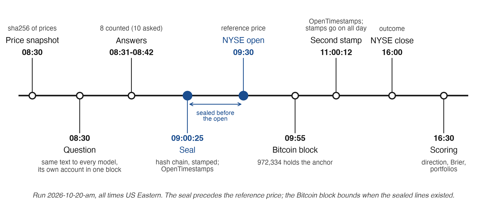

Note: Run `2026-10-20-am`, read from `council-book.jsonl` and the proof page of that day. Appendix I gives the exact times, stamps and blocks, and Table A4 gives the twelve markets with their price symbols, funds and crowd contracts.

The prices exist before the question, the question before the answers, the answers before the price they are scored from, and the outcome after all of them. Each "before" is written into the book as a hash, and the head of the book is anchored outside the operator's control.

Follow one morning through the record. On 21 October the run and its first eight answers occupied lines 214 to 222 of the book. Two independent authorities signed the stamped list that covered those lines at 13:00:19 UTC, 29 minutes 41 seconds before the 13:30 reference. A ninth answer, line 224, entered the next list, which three authorities signed at 13:23:37, also before the open. So every counted answer can be followed from its text to a book line, from that line to an outside signature, and from the signature to the price that came after it. Appendix B reproduces the commands.

### 3.2 What a seal is

The book is a sequence of JSON lines $\ell_1, \ell_2, \dots, \ell_m$, written once and kept as written. Every line has four bookkeeping fields: its position `n`, the hash of the previous line `prev`, its own content hash `seal`, and its chained hash `link`. Let $H$ be SHA-256 (National Institute of Standards and Technology, 2015) and let $J(\cdot)$ be the serialisation of a JSON object with sorted keys exactly as Python's `json.dumps(o, sort_keys=True, ensure_ascii=False)` writes it, encoded as UTF-8 (Appendix B, Step 4). Then for line $i$ with content $c_i$ (every field except the four):

$$
s_i = H\big(J(c_i)\big), \qquad
\lambda_i = H\big(J(c_i \cup \{n{=}i,\ \mathit{prev}{=}\lambda_{i-1},\ \mathit{seal}{=}s_i\})\big), \qquad \lambda_0 = \text{""}.
$$

The seal $s_i$ fixes what the line says. The link $\lambda_i$ fixes what it says, where it stands and everything before it. I recomputed both hashes for all 211 lines of the book as of 20 October 2026: every `seal` and every `link` reproduces, and every `prev` equals the `link` of the line before it.

Three kinds of line share the book. The run line holds the question, the snapshot and the roster, the answer line holds one model's whole answer, and the score line holds the outcome (Appendix A).

A chain alone proves order and content. An operator who controls the file could rebuild a whole chain in an afternoon, so I take time from outside. At each run the engine stamps a short list that names each book's length, the hash of exactly those lines and the last link, and OpenTimestamps (Todd, 2016) commits that list to a Bitcoin block. It is the linked timestamping of Haber and Stornetta (1991), with the Bitcoin chain (Nakamoto, 2008) as the witness. A line is *sealed* when it enters the chain, the head is *stamped* when it goes to the calendars, and it is *anchored* when it reaches a block. Because the book only grows, a stamp taken at line 159 still verifies on today's file: its first 159 lines hash to what was stamped that morning.

Three layers vouch for a seal: the chain, a Bitcoin anchor and signatures of independent clocks (Section 3.12). The texts become public after the day's score, the seals and times before it, so nobody can trade on a sealed probability in the open (Sornette et al., 2010). Appendix G gives each layer, its providers and the byte rule.

### 3.3 Reference price after the seal

The reference price is the first price after the seal by each market's rule. A forecast is scored only on the price path that begins after it was fixed. Information that exists before the reference is allowed: the question can carry the pre-open futures (on 20 October, the S&P 500, Nasdaq-100, Dow and Russell 2000 futures against the previous close), and a model may search for news up to its answer. What the protocol excludes is the reference price and everything after it.

A line sealed after the open is kept, and it gets a reference of its own, the first price after its own seal. It answers a different question, and not by a little. In the book of 20 October such a reference reversed the sign of the scored move in six of nine one-day cells. So the late line stays out of everything that compares models on a common event, from the consensus to the effective number of voices (requirement 4). Bitcoin follows the same rule with one clock for all twelve markets: a line joins the common event only if it was sealed before the session's 09:30 ET reference (Appendix A).

### 3.4 One counted run per session

The league asks more than once a day, in a morning run, an evening run, a weekend Bitcoin run and a Sunday radar. If I could choose afterwards which run counts, I could ask until one looked good. A rule like "the run sealed last before the open" sounds neutral, but it is applied after the fact and still lets me send one more run before the bell. So I made the schedule the rule. The scheduled morning run counts, every other run is a reference calculation, and the declaration is sealed as the first line of the chain of outgoing questions and archived outside the operator (Figure 4). The other runs stay in the book, labelled `not_counted`, and anyone can apply the declared rule to the sealed times. The two development sessions, 19 and 20 October, counted under the development rule and form their own segment outside the primary comparison (Section 8, Appendix F).

### 3.5 Direction, probability and the draw

The model gives `prob_up`, its probability from 0 to 100 that the indicator is higher at the end of the horizon than at its reference price. For the 10-year yield a "buy" is a bet that the yield rises; for VIX, that expected volatility rises.

Small moves are draws, by a band fixed in advance from the day's minute bars, about 0.08 of a session's standard deviation (Appendix A). Here I had to choose, because a draw band and a proper score do not go together for free. The models are asked for the probability of a strict rise and are not told the draw rule, so the score must be on the event asked. The main Brier score runs over all rows, a rise meaning any change above zero, and the score without draws comes second with the number of rows it drops (requirement 7, Figure 4). The development sessions keep the score they were published with, as a separate segment. A league that wants a draw band can ask for three probabilities and score them by the three-outcome Brier score (Brier, 1950; Gneiting & Raftery, 2007), set out in Appendix H.

### 3.6 "Buy on dips" as a level fixed in advance

"Buy on dips" without a level cannot be scored, so an answer with the action `buy_dips` must give an entry level below the reference. If the price touches it, the portfolio buys there, and otherwise nothing is bought. The probability is scored either way. Five actions are allowed: `buy_strong`, `buy_dips`, `hold`, `trim` and `sell`.

Each answer cell thus carries two sealed answers on one event, a word and a number, and I wanted to know whether they agree. They do on the development morning of 20 October and on the first morning of the counted record, 21 October (Figure 2). The median probability climbs with the action, from 35 and 38 for sell through 52 for hold to 60 and 63 for buy strong, and every sell and trim stands below 50. The four buys on dips beside a probability below 50 are not contradictions, since the order fills only below the reference. Table I1 counts the actions by horizon.

**Figure 2.** *Stated probability of a rise by the action sealed in the same answer cell: runs 2026-10-20-am (eight seats sealed before the reference) and 2026-10-21-am (nine seats), all four horizons.*

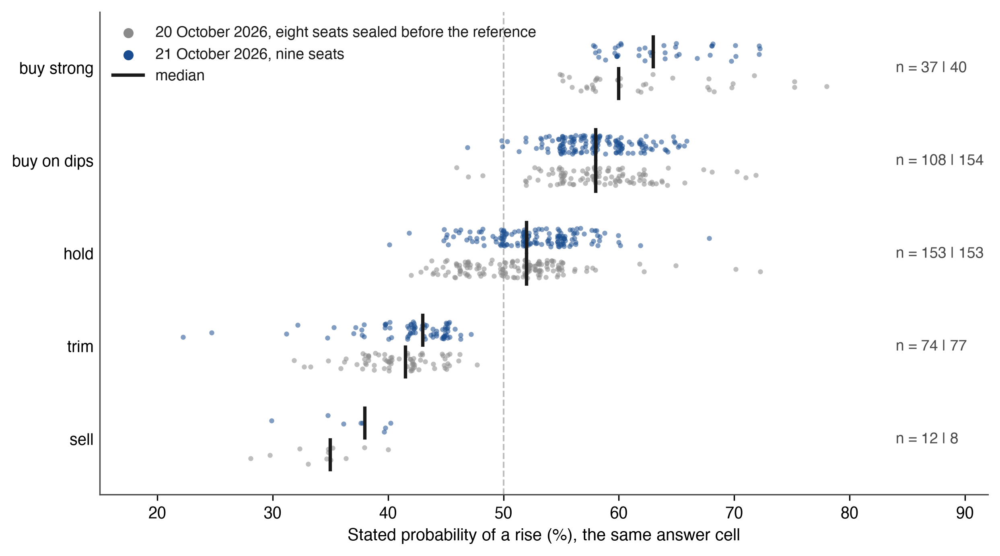

Note: Each point is one answer cell (seat × market × horizon), slightly jittered, and bars mark the medians. Appendix I gives the medians, fields and source. Like every figure and table of Sections 3 to 5 built from sealed answers, it shows no outcome.

### 3.7 Four horizons and the year

Every answer covers four horizons for every market: the next trading day (1d), the week (1w), the month (1m) and six months (6m), plus one unscored sentence on the year (`years`). For the eleven exchange-hour markets the longer horizons are 5, 21 and 126 sessions; for Bitcoin they are 7, 30 and 182 calendar days, and its day runs from the seal minute to the 16:00 ET close of the scoring session, about seven hours for the morning run. I compare horizons within each definition. One model on one morning therefore gives 48 probabilities, each resolved on its own window and all sealed in one minute on one set of information.

### 3.8 Target and "wrong if"

For each market and horizon the model also gives a target and the level at which it would admit the view was wrong, shown as "Wrong if", with its main risk and what would make it revise. All are sealed with the probability, so the forecast can be refuted in the model's own terms. On the morning of 19 October ChatGPT gave the S&P 500 a 54% chance of rising on the day, with a target of 7,678.59 and "Wrong if" at 7,560, and it said why: "I put more weight on AI spending's immediate inflation effects than its eventual productivity dividend." Each of these levels can be checked against the price path without asking the model what it meant. Figure 3 draws the whole answer across the four horizons (Appendix I).

**Figure 3.** *One sealed answer: ChatGPT on the S&P 500, run 2026-10-19-am (`council-book.jsonl`, line 83), with probability, action, target, "Wrong if" level and entry level at each horizon.*

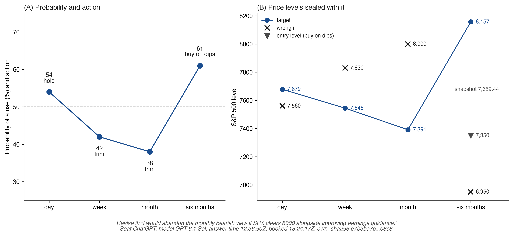

Note: All values as sealed in the answer line, before the 09:30 ET reference. Appendix I gives times and fields.

### 3.9 Empty cells

Every cell of an answer is scored. An empty cell counts as 50%, Brier 0.25, with no side. It cannot beat the coin, but it can hide worse-than-coin judgement on a hard market, so I print the number of empty cells beside every score (requirement 8). Each seat gets three results at each horizon, ranked apart: the Brier score on the probabilities it stated, the share of cells it answered by the deadline, and a service score with the empty cells filled. One combined score would hide whether a seat lost on judgement, on punctuality or on trading. The expected cells are fixed before the question by a sealed roster (requirement 13, Appendix A).

### 3.10 A change of model version, a correction, a change of rules

A seat is a participant and a model version is a dated implementation, and the record keeps both. When a version changes, the account runs on, the change is dated and the result since the new version is shown apart. Nothing is rewritten. A correction is a new line that names the lines it corrects, and prices follow the same rule (Appendix A). A change of methodology opens a new measurement segment, and confirmatory scores are computed inside one segment (requirement 15).

### 3.11 Proof-of-before: three properties

Put together, these rules let a reader establish three properties of a forecast record, the first in two parts, without trusting me. I call such a record *proof-of-before*.

*P1a. No reconstruction after the anchor.* Once the head of the book reaches a Bitcoin block, nobody, me included, can add, remove or rewrite a line of the stamped prefix without the proof failing. A forecast cannot have been written after an outcome that came hours after the anchor.

*P1b. Commitment before the reference.* The forecast was sealed before the price it is scored from. In the counted record two independent authorities sign the list that holds the counted answers before the open, so a reader who trusts either of them needs nothing from me (Figure 4).

*P2. No substitution.* Changing any field of a sealed line changes its seal, every later link and the stamped digest. Swapping a forecast would take a second preimage of SHA-256 or a rewrite of Bitcoin.

*P3. No selection among disclosed sealed runs.* The run that counts was fixed by a rule declared before the runs, every other run stays in the book, and a reader can recompute which line counts.

The weak point is an operator who hosts both the book and the proofs. It could stamp two books at each run and later swap book and proof together. Requirement 3 closes that door by putting each stamped digest, at the moment of stamping, on a channel I do not control, the Sigstore Rekor log. The Bitcoin bound is practical, hours rather than seconds, because a miner sets the header time. Appendix G gives the formal statement, Table G1 and the threat model in full.

### 3.12 The ladder of the standard

Requirement 3 shows what a climb looks like. On 16 October the head of the book went to Bitcoin, and a reader could check that nothing was rewritten after the anchor. On 21 October two independent time-stamping authorities began to sign every stamped list, so the order of seal and open no longer rested on my clock. On 22 October each list began to enter a public log at the moment of stamping, which closes the last door, an operator who stamps two books. Three days, three steps, each visible in the files. The standard named all three before the league had any of them, and that is the point. It asks more than any one implementation has, so another league can adopt it without adopting mine.

I sort the seventeen requirements into three rungs. Requirement 6 has two halves on two rungs, the declaration itself (L2) and its copy off the operator (L3), so the figure has eighteen rows. Each rung is one check a reader can make, and each needs a clock level, the level of trust in the clock. The rungs are cumulative, so a claim to follow the standard at L2 means that every requirement of L1 and L2 is in place.

- *L1 Recorded* (clock level 1, the operator's record). The reader recomputes every score from the operator's chained record and sees every run, every empty cell and every change of method. The record proves that a later text matches an earlier hash, not when the hash was made.
- *L2 Anchored* (clock level 2, an anchor outside the operator). The order of seal and reference, and the choice of the counted run, are checked against a clock and a record the operator does not hold. Every score stands beside fair benchmarks and the number of independent voices behind it.
- *L3 Witnessed* (clock level 2+, signed time). Every answer and every question is signed by independent clocks when it arrives or leaves, and the declaration of the counted run sits on a channel the operator does not control.

Below L1 lies clock level 0, where the reader simply trusts the operator. Public claims of "verified" AI forecasts can be placed on the same rungs, and Section 7 places the work I compare with by clock level, the part of a rung that public materials let one check.

Two other ladders appear in this paper, and I keep them apart by name. The *clock levels* 0, 1, 2 and 2+ (Figure G1) say only whom a reader trusts for time; they are the "clock" in brackets above. The *ladder of claims* (Table B1) says what a reader may conclude about skill. A rung of the standard needs its clock level and more: Foresight Arena reaches clock level 2, yet without benchmarks and a count of voices it does not stand on L2.

Figure 4 is the league's own diary on this ladder. Rows are requirements, columns are days, and the weekend is pale because only Bitcoin runs then. The ladder is the reason this paper carries so few dates in its prose: a claim that rests on a requirement holds from the date the requirement is met. A reader who wants to know whether a statement covers 20 October looks down that column. The unfilled cells are not exceptions to the standard. They are the point of publishing the ladder: the specification stays fixed while an implementation shows what it has reached, what it has not, and the date of its next check. A league can therefore adopt the standard before it can claim its highest rung.

**Figure 4.** *The league on the ladder of the standard, day by day.*

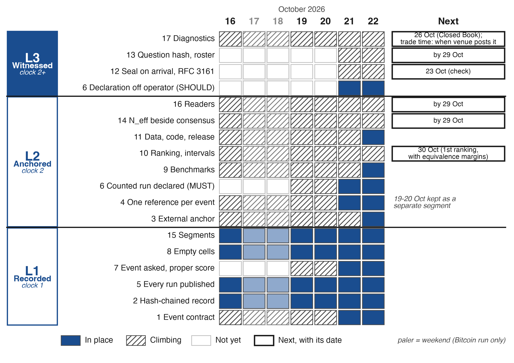

Note: Each row is a requirement of the standard, grouped by rung; requirement 6 has a row on L2 and on L3. Filled: in place; hatched: climbing; empty: not yet. The column on the right gives each Next with its date, and a Next without a date depends on a venue, not on the league. Paler columns are the weekend, when only Bitcoin runs. Dates, files and hashes for every cell: Table F2. The 19-20 October runs stay a separate segment. Empty and hatched cells are a public implementation queue, not waivers from the standard.

Read the figure rung by rung. On 22 October the league holds L1 in full. Of the eight requirements of L2 it holds five, and the other three each carry a date: N_eff beside every consensus and the reader labels by 29 October, the first ranking with its equivalence margins on 30 October, the tenth session. On that day the league claims L2. Of L3 it already holds the off-operator declaration, and the rest is climbing. I publish the climb rather than wait for the top, because a standard that one league could meet on day one would be too weak for the others.

Not every step opens a new segment of the score. A climb that changes what is scored opens one (requirement 15): methodology m2 opened a segment on 20 October, m3 on 21 October and m4 on 22 October (`method_segments`). But a segment is a separate breakdown of the Brier score beside the continuous one, and ranks are not reset. The 30/10 rule counts sessions without a break from 19 October, the development segment included (19, 20, 21, 22, 23 and 26 to 30 October), so the first one-day ranking falls on 30 October whatever the segments (`ranks.horizons.1d.basis` in `council-stats.json`). Rows scored before 21 October enter that count as published, on their stated probabilities with empty cells at 50%.

What a reader may claim about prices or skill climbs the ladder of claims (Table B1, Appendix B), which ends in the registered comparisons of Section 8.

### 3.13 Checklist of the proposed standard

A reader should not have to take the word *verified* on trust. The seventeen requirements below turn it into checks that an arena, a benchmark or a fund can sign and pass one by one. MUST marks what the claim cannot stand without, and SHOULD marks the witnessed specification. One MUST sits on L3, sealing each answer on arrival (12), because a batch seal cannot be witnessed answer by answer; a league that claims L3 meets it with the SHOULDs. Each requirement is one sentence here, grouped by rung, and Appendix F gives the full text with every condition and the conformance checker any league can run on its own export.

*L1 Recorded*

- \(1) MUST define each task by an event contract fixed before the question (Table 1), forecast outcomes in the future, and seal model, version and mode in the answer line.
- \(2) MUST keep an append-only, hash-chained record, with question and snapshot hashed in and corrections as new lines.
- \(5) MUST publish every run, counted or not, with its label.
- \(7) MUST score the event asked by a strictly proper rule, the Brier score of a strict rise over all rows first (Section 3.5).
- \(8) MUST report empty cells and missing answers beside each score, and keep stated quality, coverage and service apart.
- \(15) MUST treat a change of methodology as a new segment and compute confirmatory scores within one segment.

*L2 Anchored*

- \(3) MUST anchor the head of the record outside the operator at every run, publish the proofs and the bound, and post each stamped digest on a channel the operator does not control.
- \(4) MUST take one reference price per common event, after the seal, and pool forecasts only when every field of their contracts agrees.
- \(6) MUST fix the counted run of each session by a rule declared before the runs.
- \(9) MUST report the 50% benchmark and a sealed climatology of the same event, and seal a market price used as a benchmark with its volume and a declared floor.
- \(10) MUST rank only after a minimum number of sessions, with session-clustered intervals and declared equivalence margins (Section 4.6).
- \(11) MUST publish data and scoring code so a third party can recompute every score, and cite an immutable release in each revision.
- \(14) MUST print, beside any published consensus, how many stated probabilities entered it and their $N_{\text{eff}}$ (Section 5.1).
- \(16) MUST, where readers forecast, assign each once and at random, count first forecasts only, close them at the reference and store no address (Section 6).

*L3 Witnessed*

- \(6) SHOULD publish the declaration of the counted run with its hash on a channel the operator does not control.
- \(12) MUST seal each answer on arrival, and SHOULD obtain an RFC 3161 token on each seal.
- \(13) SHOULD seal the hash of each outgoing question when it is sent, and the roster of expected answers before the first question.
- \(17) SHOULD report the diagnostics of Sections 4 to 6 beside the scores.

Table 2 is the same list turned on my own league, the reader's snapshot: one current status and, where needed, one next date per requirement. In place means a reader can see it in the public files today. Climbing means part is visible and the rest has a date I can be held to. Table F1 is the evidence ledger behind the snapshot, with what I saw for each requirement and when I read it, and Table F2 and Figure 4 add the time axis, the day on which each status changed.

**Table 2.** *Where the reference implementation stands on the ladder (detail in Table F1, day by day in Figure 4 and Table F2).*

| Req. | Rung | Status | Next (by) |
|---|---|---|---|
| 1 Event contract | L1 | In place since 21 Oct (22:33 UTC; an event identifier on every row, Appendix F.4) | - |
| 2 Hash-chained record | L1 | In place since 16 Oct | - |
| 5 Every run published | L1 | In place since 16 Oct | - |
| 7 Event asked, proper score | L1 | In place since 21 Oct | - |
| 8 Empty cells | L1 | In place since 16 Oct | - |
| 15 Segments | L1 | In place since 16 Oct | - |
| 3 External anchor | L2 | In place since 22 Oct | - |
| 4 One reference per event | L2 | In place since 21 Oct | - |
| 6 Counted run declared (MUST) | L2 | In place since 21 Oct | - |
| 9 Benchmarks | L2 | In place since 22 Oct | - |
| 10 Ranking, intervals | L2 | Climbing | First 1d ranking, with equivalence margins and overlapping-window intervals (30 Oct) |
| 11 Data, code, release | L2 | In place since 22 Oct | - |
| 14 N_eff beside consensus | L2 | Climbing | N_eff beside every displayed consensus (29 Oct) |
| 16 Readers | L2 | Climbing | Blind-group label and share of resets (29 Oct) |
| 6 Declaration off operator (SHOULD) | L3 | In place since 21 Oct | - |
| 12 Seal on arrival, RFC 3161 | L3 | Climbing | Seal on arrival with its token, checked on the run of 23 Oct |
| 13 Question hash, roster | L3 | Climbing | Deadline and retry policy in the roster (29 Oct) |
| 17 Diagnostics | L3 | Climbing | Both Closed Book arms, prices-only and packet × search, from the 26 Oct runs; bid and ask in place; last-trade time recorded as each venue publishes it |

Note: Status as read on 22 October 2026, about 19:45 ET (Table F2). Requirement 6 appears twice because its MUST clause fixes the counted run in advance at L2, while its SHOULD clause publishes that declaration off the operator at L3. Requirement 11 reads the analysis release 10.5281/zenodo.23552700. The runs of 19 and 20 October form the development segment and stand under their published rules.

## 4. Measures

The protocol fixes what was said and when. The measures turn that record into scores, and together they are the forecast evaluation the standard requires. Each measure answers one question a reader would ask, and Appendix H gives formulas, files and field names. Section 5 reports the dependence values on live data, and accuracy results arrive as dated revisions of this paper.

### 4.1 Direction

Was the indicator higher or lower at the end of the horizon than at its reference, and did the model's probability back that side? Above 50 backs a rise, below 50 a fall, exactly 50 neither. A call of 51% and a call of 95% earn the same hit, so direction cannot tell a confident model from a hesitant one, and the main measure is the Brier score.

### 4.2 Brier score

For a forecast with stated probability $p$ (in percent) of a rise and outcome $o \in \{0, 1\}$,

$$
B = \left(\frac{p}{100} - o\right)^2 ,
$$

and a model's score over $n$ resolved forecasts is the mean $\bar B = \frac{1}{n}\sum_{j=1}^{n} B_j$ (Brier, 1950), from 0 for a perfect forecast to 1 for the worst. The Brier score is strictly proper for the event it is computed on (Gneiting & Raftery, 2007), and for the league's question that event is a strict rise over all rows (Section 3.5, requirement 7).

### 4.3 The uninformative 50% benchmark and climatology

A forecaster who always says 50% scores 0.25 on every forecast. This is the league's neutral reference, the "coin" of its files, and beating it can be an accident: a forecaster who knows how often an asset rises can score below 0.25 with no skill about the day, and at long horizons the base rate can be far from one half. So I add a climatological benchmark (requirement 9), the frequency of a strict rise of the same event for each asset and horizon, estimated on a fixed window that ends before the season and sealed in the methodology. The Brier skill score measures a model against it on the same rows,

$$
\mathrm{BSS} = 1 - \frac{\bar B}{\bar B_{\text{clim}}} .
$$

The same event is the one the contract scores, since a base rate of a different event would bias the benchmark. Appendix H gives the window and the sealing hash.

### 4.4 Calibration and sharpness

Calibration asks whether stated probabilities come true at the stated rate. The league folds each probability to the side it backs and shows, in four confidence bins, the mean stated probability beside the share that came true. Bins need many forecasts, so every seat also gets a logistic calibration fit on all rows (Cox, 1958): a slope below 1 means probabilities stand too far from one half, above 1 too close, as in the fit applied to Polymarket prices (Walker, 2026).

Calibration is judged together with sharpness, since a forecaster who always says 50% is calibrated and uninformative (Gneiting et al., 2007). My sharpness measure K runs from 0, always 50%, to 100, always certain, and needs no outcome. It gave the first finding of the league. On the 20 October 2026 development run, counted under the development rule, the eight seats sealed before the reference had K of 9.2 at one day, 14.1 at a week, 13.9 at a month and 20.3 at six months (Figure 5). They stood about five points from an even chance for the day and were most decided at the horizon that resolves last, partly through base rate (Appendix H). On 21 October the nine seats gave 10.1, 12.5, 14.6 and 19.9. Most stated probabilities lay between 40 and 60, with 93% of them at one day on 20 October and 95% on 21 October, and even at six months more than half (58% and 61%).

**Figure 5.** *Stated probabilities of a rise by horizon: runs 2026-10-20-am (eight seats sealed before the reference) and 2026-10-21-am (nine seats).*

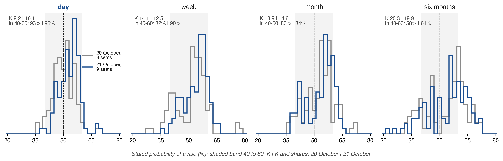

Note: Histograms in steps of 2 points, scaled to equal area, and the shaded band runs from 40 to 60. On 21 October the four Bitcoin cells of the ninth answer carry a reference of their own (Section 3.3) and are left out (428 of 432 cells). Source: Appendix J.

### 4.5 Baselines

The league scores the same rows against fixed baselines, the coin, a momentum rule, buy and hold, the S&P 500, a 60/40 mix, cash at the Treasury bill and random choice within the rules, all defined in Appendix H. The consensus of the Council is a baseline too, and it has a mechanical advantage. On a common event its Brier score cannot exceed the average of its members' scores, whatever their skill (Krogh & Vedelsby, 1995). Beating its average member is therefore expected, and its skill is judged against the coin, climatology, the crowd and the best single model, with the spread term reported beside it (Section 5.3).

### 4.6 The 30/10 rule: 30 forecasts on at least 10 trading days

Twelve forecasts made on one morning do not give me twelve independent trials: markets move together. The sealed methodology says so in one field: "the 12 indicators of one day move together: the league shows the trading days next to the forecasts, and a model is ranked after 30 resolved forecasts on at least 10 trading days" (`independence`). If forecasts within a session share a correlation $\rho$, then $k$ of them carry the information of about $k/(1 + (k-1)\rho)$ independent ones (Kish, 1965); with $k = 12$ and $\rho = 0.2$, a whole session is worth 3.75 independent forecasts. So a model enters the table of a horizon only when it has at least 30 resolved forecasts at that horizon on at least 10 trading sessions, the table prints its sessions beside its score, and the session is the unit of resampling. Intervals appear from 5 scored sessions, and longer horizons must allow for overlapping windows (requirement 10, Newey & West, 1987; Künsch, 1989). A season of 126 sessions gives none at six months, so confirmatory claims rest on the day and, where the rule is met, the week and the month.

Power decides whether the season can say anything at all. At 126 sessions the Brier calculation in the file detects a drop below the coin of 0.0105, and the hit-rate calculation needs 209 sessions to tell 55% from 50% at an assumed $\rho = 0.2$ (Diebold & Mariano, 1995). An independent analysis of prediction-market questions reaches the same order (Nechepurenko & Shuvalov, 2026a). A negative result needs its own rule. A small estimated difference, an interval too wide to decide and evidence of no difference are three findings, so I declare one equivalence margin, ±0.01 Brier, and read "no material difference" only when the 90% interval of the paired difference lies wholly inside it. I chose the margin, and it is a scoring tolerance, not an economic threshold.

### 4.7 The portfolio league

Probabilities measure judgement. A portfolio, a secondary measure, shows what a model does with it. Each of the 14 models manages $100,000 of simulated money under the same rules: long only, every dollar that changes costs 0.1%, cash earns the 13-week Treasury bill, and a decision trades at the first open after its seal. The account scores the instrument, so a lower Brier score does not establish a higher account value, and it is compared instead with the passive baselines under the same costs, within one rules version.

### 4.8 The Pro league

Each model holds a second $100,000 account, a long-short book with leverage up to 2×. Appendix H has its rules and baselines.

### 4.9 AI against the crowd

For up to eight of the 12 markets, prediction markets trade a daily question close to the league's. Each run's question asks every model for its own probability of "Up" on each. The crowd's prices and volumes are sealed in the run line before the first model begins its answer. I hide the price by design. A model that is shown the market price and asked to revise it can beat the market on some contracts (S. Kim et al., 2026), but its answer is then no longer evidence independent of the crowd. The league keeps the two apart: the sealed answer is blind to the price, and any combination with the crowd is a separate strategy, sealed before it is scored (Section 5.3).

On 20 October Polymarket listed six daily "Up or Down" questions and Kalshi five: eight markets, three of them on both venues. Where both list a market I use the Polymarket contract, the one the models answered. A Kalshi question is set at a strike, so I turn its price into "above the previous close" by interpolating between the two adjacent strikes. A contract enters the primary comparison when at least $1,000 had traded on it as the question went out, and thinner ones are reported apart. Requirement 17 asks for bid, ask and last-trade time, since spreads are wider on unlikely outcomes (Dubach, 2026).

The crowd's questions are close to the league's, and their clocks differ. The league's day runs from the 09:30 reference to 16:00 ET, while the crowd's run close to close and several resolve at other hours and from other sources. I therefore compare question by question, on the crowd's own terms, with the separately elicited probability. Prediction-market prices are a strong baseline (Wolfers & Zitzewitz, 2004; Berg et al., 2008), and Kalshi's macroeconomic contracts forecast about as accurately as the Survey of Market Expectations and the Bloomberg consensus (Diercks et al., 2026).

How far a mismatch of events can move a score can be stated exactly. Suppose an index closed yesterday at 100, opens at 98 and closes at 99: it fell from the previous close and rose from the open. If two versions of an event resolve with opposite outcomes on a share $d$ of the rows, a mean Brier score moves by at most $d$ and the gap between two forecasters by at most $2d$, the forecasts being fixed. Two rules follow. Forecasts enter a common score only on one event, with one reference price (requirement 4). And each comparison with the crowd reports its share $d$ of market-sessions on which the two questions resolve with opposite signs, and a gap no larger than $2d$ is not read as an advantage of either side.

### 4.10 The grid: model × market × horizon

Every counted answer fills one cell of a grid of up to ten Council models (a spare fills a seat on a morning it is out), 12 markets and four horizons (Figure H1). It answers which markets are predictable at which horizon, which a single leaderboard cannot.

Day forecasts resolve each session. The first week forecasts of the scored league resolve from 26 October 2026, the first month forecasts around 19 November 2026 and the first six-month forecasts in April 2027.

### 4.11 Reproducibility

I did not want a reader to take a single score on my word, so I recounted them twice from the open files. One script rebuilt all 253 published rows of 145 accounts within the publication rounding, and the other recomputed the Brier score of every counted forecast and matched all 9,318 published numbers exactly. Every forecast row names the book line that seals it, so any score walks back to a sealed answer, a stamped prefix and a Bitcoin block (Appendix B). The live files change with every run, so each revision cites a frozen analysis release on Zenodo (10.5281/zenodo.23552700) with the hash of every file (Appendix C); file names and dates of the recounts are in Appendix H.

## 5. How many independent voices

The Council of ten models looks like ten opinions. It is not, and the league is built to say how many it is. If the errors of N forecasters correlate at a common ρ, their average carries the evidence of

N_eff = N / (1 + (N − 1)ρ)

independent forecasters. As N grows, N_eff approaches 1/ρ and stops there. This is the design effect of cluster sampling (Kish, 1965), and the companion paper applies it to panels of AI models (Chernets, 2026a). The ceiling does not care how many models were asked. At ρ = 0.5 a thousand models are worth two witnesses, and once a council is larger than 1/ρ, lowering ρ buys more than adding members. Language models give it reason to bite. When two of them are wrong they often give the same wrong answer, more so within one architecture or provider (Kim et al., 2025).

So a consensus of models printed without its effective number of voices is a poll printed without its sample size. The reader sees the share who agree and cannot tell how much evidence the agreement holds. Requirement 14 makes the count a MUST wherever a consensus is shown, and a market league can supply it, because every trading day brings an outside ground truth and up to ten live streams of probabilities. Others have found the same likeness in frontier forecasters (Spiro, 2026; Aitchison et al., 2026), shown that sharing one good algorithm can make a group decide worse (Kleinberg & Raghavan, 2021), and argued that similar trading models shorten the life of their signals (Meng & Chen, 2026), while Clemen and Winkler (1985) showed long ago that dependent experts saturate. Appendix H keeps that thread in full.

Here is what I found on the first mornings. The seven and eight seats whose answers were sealed before the open on the two development mornings spoke with about 1.6 independent voices, and on the first counted morning nine seats spoke with 2.23. Ten seats looked like ten opinions, and on no morning did they carry even a quarter of that. The voices were fewest at six months, where the models fell back on the same long-run drift. And the herd did not split by country: on 20 October three of the four closest pairs joined a US and a Chinese laboratory. The rest of this section shows how I counted and what the count means for anyone who reads "the AI models agree."

### 5.1 How the league estimates ρ

The rule fits in two sentences. For each run and horizon I take the mean, over pairs of seats, of the Pearson correlation of their probabilities across the 12 markets, and put that run's own n and ρ into the formula. I admit counted runs alone, and within them the answers sealed before the 09:30 ET reference price, so that an answer that could have seen the opening move does not enter.

One number can hide several kinds of likeness, so I give it two companions. The first asks whether a single common factor carries the likeness at all: beside the count I publish the share of the largest eigenvalue. On 20 October that factor carried 68% of the trace (5.47 of 8), so one common ρ is a fair summary of that morning. The second asks whether the models also err together, which only resolved sessions can tell: the correlation of errors, computed from scored sessions, is the second count (`n_eff_errors`), kept apart from the count of stated probabilities. The open file council-stats.json publishes the first series under `n_eff.counted`, with the rule stated in it. Because N_eff is convex in ρ, the mean of the per-run counts sits at or above the count at the mean ρ, and a reading below a threshold is the conservative one. Table I2 follows the 3,792 rows of the open file to the counted record, and Appendix I gives the variants and the fields for recomputation.

### 5.2 A first reading of the method

I read the method first on the development sessions of 19 and 20 October 2026 (Section 8). On 19 October seven seats sealed before the reference, and their one-day pictures were as alike as those of 1.74 independent forecasters (ρ = 0.505). On 20 October eight seats gave 1.46 (ρ = 0.64). Averaged over the two mornings, a council that looked like seven or eight opinions held about 1.6. Keeping one market per group, so that the three US equity indices and the two oils cannot inflate the likeness, gives 1.69 and 1.57, so market co-movement does not explain it. The first run of the counted record, on 21 October, gave 2.23 with nine seats (ρ = 0.379).

The count changes with the horizon (Table I3). On all three runs the voices are fewest at six months and more numerous at a week and a month than at a day. Figure 6 shows why, market by market. On 20 October the eight seats put five markets below an even chance for the day and near 60% at six months. The S&P 500 went from 48 to 62 and gold from 48 to 61, while WTI went from 55 to 40. The council saw a short shock that fades. At six months it converged on the long-run drift. On 21 October the short end moved and the long end held. Part of that six-month likeness is shared base rates, equities and gold drift up over six months, which is why the long horizon is also read against climatology (Section 4.3).

**Figure 6.** *Mean stated probability of a rise at one day and at six months, by market: (A) run 2026-10-20-am, eight seats sealed before the reference; (B) run 2026-10-21-am, nine seats.*

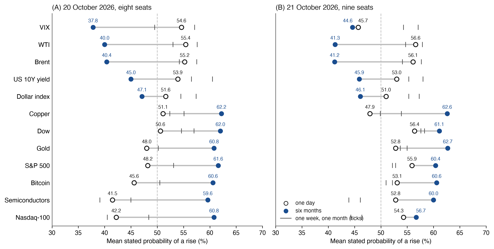

Note: Mean of the seats' `prob_up`; ticks mark one week and one month. Markets are ordered by the change from one day to six months on 20 October. Six-month probabilities include the base rate of each market (Section 4.3); the same reading against climatology is $K_{\text{clim}}$. On 21 October the Bitcoin mean leaves out the ninth answer's cells, which carry their own reference. Source and reading time: Appendix J.

Figure 7 puts these mornings on the curves of the formula. The two development runs sit on the curve for their mean ρ of 0.57, whose ceiling is under two voices. Adding a twelfth or a twentieth model at that ρ would barely move the count. The spread of probabilities across seats, which Section 8 uses, is drawn cell by cell in Figure I1.

**Figure 7.** *Effective number of independent voices against the number of models, with the per-run readings of the first sealed runs and the first counted run.*

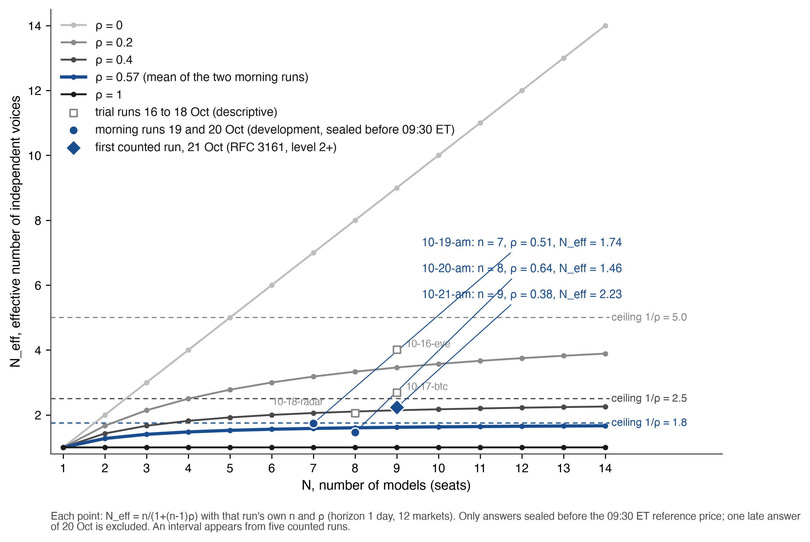

Note: N_eff = N / (1 + (N − 1)ρ) for N = 1 to 14 and ρ of 0, 0.2, 0.4, 0.57 and 1; dashed lines mark the ceilings 1/ρ. Filled circles: the morning runs of 19 and 20 October at one day, answers sealed before the reference (1.74, n = 7, ρ = 0.505; 1.46, n = 8, ρ = 0.64); the highlighted curve is their mean ρ, 0.57. Filled diamond: the first run of the counted record, 21 October 2026 (2.23, n = 9, ρ = 0.379). Open squares: the three trial runs (4.01, 2.69, 2.06). Source and reading time: Appendix J.

What does this mean for an "AI consensus"? A headline that eight models agree tells the reader almost nothing until it says how alike the eight are. On the development mornings the agreement of the seats sealed before the open carried the evidence of fewer than two careful forecasters working apart. The useful lever is ρ, and a league that lowers it, by adding seats that think differently, gains more than one that adds seats. Predictions F1 to F3 and F9 (Section 8) state what the counted runs after registration should show.

### 5.3 The consensus, and why it discounts families

The consensus for a market is the mean of the seats' probabilities under three rules. When at least five seats answer, the lowest and the highest are dropped. A second model from the same family counts one third, and so does each further one, so a laboratory that fields several models cannot outvote the others by number. The result is clamped to 2 to 98%. Today every seat comes from a different laboratory (Table 3), so every family weight is 1, and the rule is written into the open methodology before any laboratory holds two seats.

Skill is judged against references outside the council: the coin, the climatological base rate and the crowd. I also seal one test of this section's own thesis. If correlated voices are worth less, discounting them should help, so a shadow consensus weights each seat by the inverse of its mean correlation with the others, frozen for the season and scored beside the published one (Section 8). The seats already differ. On 20 October Claude agreed with the majority of the others in 70% of its directional cells at a mean correlation of 0.47, and DeepSeek in 88% at 0.71. Claude stood alone in four of the 48 cells, among them semiconductors and the Nasdaq-100 at a week, which it gave 54 while the seven others gave 28 to 43. The league also counts unanimous error directly (F6). Appendix H gives the weights, the identity behind the trim and the counts.

### 5.4 Shared sources

Do the models agree because they read the same pages? Every forecast row carries the domains and links its model cited. In the one-day answers sealed before the reference from 16 to 21 October 2026, Reuters drew 21.7% of 1,875 citations and was cited by ten of the eleven seats that answered in those runs (the ten Council seats and ERNIE as a spare), all but Claude (Figure I2). Shared sites were common, yet shared links were rare (mean Jaccard 0.006), and pairs that shared a link did not agree more often than chance would give (permutation p = 0.14). A cited link is what a model says it read, so requirement 17 asks for a fetch record before a link counts. Appendix H gives the protocol, and F5 states what it should show.

### 5.5 The closed book: the same question without search

News does not make a model forecaster better by default (Karkar & Chopra, 2025). So after each run the Closed Book league asks the same models again with a sealed packet of the run's prices and dated headlines in place of the open web, and a third arm gives prices alone. The three arms separate three sources of likeness. Agreement that remains without news comes from shared priors, agreement added by the packet comes from shared news, and agreement added by the open web comes from search. If the closed council agrees less, search is what pulls the models toward the same pages. The arms run on their own $100,000 accounts outside the daily table, and Appendix H gives the packet, the search states and the scoring (F20, F21).

### 5.6 Discussion against plain consensus

The daily forecasts are blind-parallel, so each model answers without seeing the others and agreement keeps its evidential weight (Chernets, 2026a). Majority voting alone explains most of what multi-agent debate is credited with (Choi et al., 2025), so a weekly discussion track, kept apart from the daily record, has to beat the plain vote before it earns a place (F22, F23).

### 5.7 One model, asked again

Once a week a few models answer the same question three times in fresh contexts. Their disagreement with themselves is the noise floor against which disagreement between models is read (F24). Appendix H gives the track.

### 5.8 Laboratory of origin: the same conditions

All fourteen seats trade in the portfolio league. Ten Council seats give probabilities, five from US laboratories and five from Chinese laboratories, and four seats are spares, two per side, which trade, take a seat when they pull ahead on public benchmarks, trends or the news, and answer in a seat's place on any morning that seat is out (Table 3). ERNIE did so for the Chinese side on 18 and 20 October. Every model receives one question, built on one price snapshot and published under its SHA-256, within a fraction of a second of the others. Every answer is sealed by one deadline and scored by one set of rules, and every seat holds the same $100,000, costs and limits. Earlier comparisons did not put the two sides on one question and one snapshot. Cao et al. (2025) found a US model more optimistic and less accurate on Chinese firms than a Chinese model, with the gap gone once Chinese news was added. Appendix I gives the timing of each ask.

**Table 3.** *Seats of the league as sealed in the roster of every run from 16 to 22 October 2026 (`issue.json`, `roster`), and the version string sealed on each seat's answer lines through 21 October 2026.*

| Seat | Laboratory | Side | Role | Version sealed |
|---|---|---|---|---|
| ChatGPT | OpenAI | US | Council | GPT-6.1 Sol |
| Claude | Anthropic | US | Council | Claude Opus 5.5 |
| Gemini | Google | US | Council | Gemini 4 Argon |
| Grok | xAI | US | Council | Grok 4.7 |
| Meta AI | Meta | US | Council | Muse Spark 1.3 |
| Nemotron | NVIDIA | US | Spare | portfolio only |
| Amazon Nova | Amazon | US | Spare | portfolio only |
| DeepSeek | DeepSeek | CN | Council | DeepSeek V4.1 |
| ERNIE (Wenxin) | Baidu | CN | Spare (answered 18 and 20 Oct) | ERNIE |
| StepFun | StepFun | CN | Council | Step 5 Preview |
| MiMo | Xiaomi | CN | Council | MiMo-V2.6-Pro |
| Kimi | Moonshot AI | CN | Council | Kimi K3 |
| Z.ai | Zhipu | CN | Council | GLM-5.3 |
| Qwen | Alibaba | CN | Spare | portfolio only |

Note: the mode sealed beside each version is in the answer line (Appendix C), and each version is the string the provider's interface returns, for ERNIE its name alone; every seat comes from a different laboratory, so every family weight is 1 (Section 5.3). F8 and F25 count eleven seats, the ten Council seats and ERNIE as the spare that answered, and resolve as registered (Appendix D).

If the herd divided by country, the closest pairs would sit within a side. They do not. On 20 October, across the 48 cells of the eight seats sealed before the reference, the mean correlation was 0.66 within the sides and 0.61 between them, and three of the four closest pairs joined them: ChatGPT and MiMo (0.88), Gemini and DeepSeek (0.86), DeepSeek and Grok (0.77). The widest single cell, gold at one month, put the four US seats at 56 and the four Chinese seats at 44. Yet a widest cell out of 48 is wide by construction, 26 of the 70 four-and-four splits of the seats give one at least as wide (p = 0.37), and DeepSeek itself gave gold 56. On 21 October, with nine seats, the mean correlation was 0.43 within the sides and 0.48 between, the closest pair was again cross-border, Meta AI and DeepSeek (0.87), and the gold gap had shrunk to 0.1 points. Figure 8 shows both matrices.

**Figure 8.** *Three of the four closest pairs join a US and a Chinese laboratory on 20 October 2026, and the closest pair does again on 21 October: pairwise correlation of the sealed probabilities, (A) 20 October, eight seats sealed before the reference; (B) 21 October, nine seats; with each seat's mean correlation and agreement with the majority, and the eigenvalues of each matrix.*

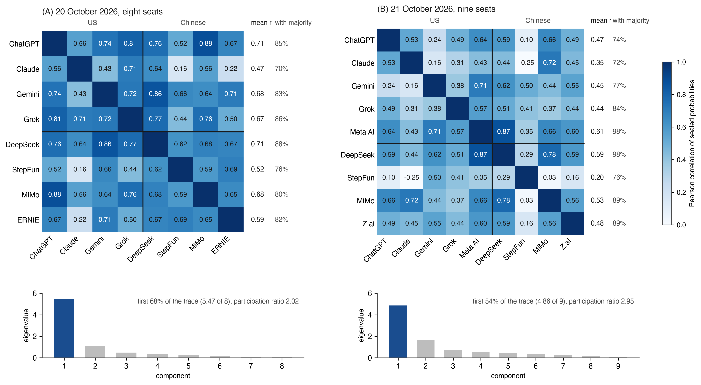

Note: Pearson correlation over the 48 cells (12 markets × 4 horizons) of runs `2026-10-20-am` and `2026-10-21-am`, over the cells both seats answered on a common event (on 21 October the Bitcoin cells of Meta AI carry their own reference, so its pairs use 44 cells); US seats first, with a rule between the sides. Mean r is the seat's mean correlation with the other seats, and with majority is the share of the seat's directional cells on the same side of 50 as the majority of the other seats, ties and stated 50s left out. Below each matrix, its eigenvalues, with the share of the first and the participation ratio (Σλ)²/Σλ² (requirement 17). Mean within the sides 0.66 and 0.43, between them 0.61 and 0.48. Source and reading time: Appendix J.

So whatever makes these models alike crosses the border between the two AI industries. The two seats furthest from the rest on both mornings were Claude and StepFun, one from each side. For a reader of an "AI consensus", the lesson is that adding a model from another country buys no independence by itself. What buys it is a model that thinks differently, and the league can now say which ones do. The comparison is between laboratories as they serve their models, with provider, language and tools travelling with the label (Section 10). F18 and F19 decide over the season whether a gap between the sides exists, with each seat in turn left out. The permutation test and the side-by-side gaps are in Figure I3 and Appendix I.

## 6. Humans before AI

The league measures models. The page that shows them also asks a human question: does seeing the models help a person forecast, or only pull the person toward them? Language-model advice has raised human accuracy by roughly a quarter (Schoenegger et al., 2025), and a crowd of models has matched a crowd of people (Schoenegger et al., 2024). Yet people abandon an algorithm once they see it err (Dietvorst et al., 2015), weight it above human advice elsewhere (Logg et al., 2019), and pick the models that agree with them (Abeliuk et al., 2020). Designs in which the advice arrives first cannot easily separate help from anchoring.

### 6.1 Design

Any visitor can mark each of the 12 markets up or down for the session, with a confidence from 55 to 95%, without registering. Each reader is assigned once and for good, at random, to one of two groups. The seeing group sees the models' answers at once, and the blind group sees them only after its first forecast of the session.

### 6.2 What is measured

The primary outcome is the Brier score of the first forecast in a session, on the same markets for both groups. Beside it I read time to decide, overconfidence, and anchoring as the share of first forecasts that side with the consensus. The experiment opened with the counted record on 21 October, and F28 and F29, registered on OSF with the predictions of Section 8, fix its two outcomes at 200 matched first forecasts per group. Appendix H gives the full outcome list and the open counts.

### 6.3 Protection against stuffing

Only first forecasts count, one per market per identifier per session, and no names or contact details are collected (Appendix F, requirement 16).

### 6.4 What the comparison shows

Random assignment makes the two groups comparable, so a difference between them is an effect of access to the models among visitors of a public page. A second protocol in the standard measures revision directly: a reader records a private forecast, then sees the council or a control display, then records a final one. Movement toward the council on sessions where it was right and where it was wrong tells learning from copying (Appendix H).

## 7. A dated map of AI market arenas

### 7.1 What the map records

I began the map with a practical question: if an AI market result looks impressive, what can a reader prove from its public materials? Between 2023 and 2026 the question "can AI models forecast markets?" was asked in four forms: backtests of model judgements on historical prices, benchmarks on questions still open, arenas in which models traded real or virtual money, and prediction markets used as a baseline or a venue. I put each effort on a dated map, who introduced it, when, and what it measured, and asked it the six questions a reader of a "verified" AI forecast should ask (Table 4): how is the time of a forecast secured, is the probability scored by a proper rule, are several horizons compared on the same assets, is agreement read against correlation, does a human forecast before seeing the AI, and are the data open. In Appendix E I compare the reference implementation with the closest efforts feature by feature (Table E1).

The first question is answered by a clock level, which says only whom a reader trusts for the time. The clock levels run from level 0, the operator's record of arrival, to level 2+, an outside fingerprint plus a third-party signed time on each seal (Appendix E and Figure G1 give the definitions). A clock level is one part of a rung of the standard (rungs L1 to L3, Section 3.12), the part that public materials let me check for every effort, so the map places the others by clock level and leaves the full rungs to Table 2. I built the map from published papers, project pages, repositories and press reports, and closed the search on 21 October 2026. "ND" means not documented publicly as of that date, which does not prove absence. I record what each effort can prove from its public materials and leave their quality unranked.

### 7.2 The timeline

**2023 to 2024.** Lopez-Lira and Tang (2023) showed that GPT scores of news headlines predicted subsequent stock returns, which opened the field and its central doubt (Section 2.1). In 2024 live questions arrived. A retrieval-augmented system approached the human aggregate on questions published after the models' cutoff (Halawi et al., 2024), an ensemble of twelve models matched a crowd of 925 people (Schoenegger et al., 2024), Metaculus ran quarterly tournaments of bots against professionals, who led in every quarter through mid-2025 (Metaculus, 2025a, 2025b), and ForecastBench asked about a thousand generated questions at eight horizons and found experts still ahead of the best model (Karger et al., 2025).

**2025.** Finance benchmarks and money arenas followed. InvestorBench offered simulated financial decisions on historical data (H. Li et al., 2025), and evidence on memory and look-ahead in backtests accumulated (Lopez-Lira et al., 2025; W. W. Li et al., 2025; Paleka et al., 2026; Gao et al., 2025). FutureX ran a daily live benchmark of agents (Zeng et al., 2025). AI-Trader set three Chinese and three US models trading live on US stocks, A-shares and crypto (Fan et al., 2025), and RockAlpha ran six Chinese and four US models in live stock trading with 2× leverage (Rockflow, n.d.). In October, Alpha Arena gave six models real money, per press reports (Forklog, 2025a, 2025b; Yahoo Finance, 2025), StockBench back-traded Dow stocks (Y. Chen et al., 2025), Agent Market Arena traded live (Qian et al., 2025), and Prophet Arena scored live Kalshi and Polymarket questions by calibration and simulated returns (Yang et al., 2025). LiveTradeBench (Yu et al., 2025), Rallies AI Arena (Rallies.ai, 2025-2026), the AIA Forecaster, which matched superforecasters and, combined with the market, beat it (Alur et al., 2025), and KalshiBench, which found five frontier models overconfident (Nel, 2025), closed the year.

**2026, first half.** Prediction markets became a venue. FinDeepForecast ran deep-research agents weekly (X. Li et al., 2026). A dataset of Gemini stock forecasts, GlassBallAI, was called "time-locked" without a documented mechanism (louidev, 2026). PredictionMarketBench replayed Kalshi order books (Arora & Malpani, 2026). Prediction Arena gave six models real capital on Kalshi and Polymarket and scored account value from the operator's logs (Zhang et al., 2026). PolyBench scored 36,165 predictions on Polymarket snapshots (Cheng et al., 2026). PolySwarm proposed a swarm of 50 language-model personas whose probabilities are blended with Polymarket prices and scored by the Brier score (Barot & Borkhatariya, 2026). In May, Foresight Arena proposed a permissionless benchmark in which agents commit hashed forecasts of Polymarket events through a keccak256 commit-reveal on Polygon before a deadline, one commit per agent and round enforced at the relayer, scored by the Brier score and an Alpha score against the mid-price at the deadline. Its paper reports simulated results, and a companion study runs live agents on it (Nechepurenko & Shuvalov, 2026a, 2026b).

**2026, second half.** MarketMania (15 July) gives seven models one disclosed payload, scores stated probabilities on five cryptocurrencies at five horizons, measures herding as the lift of agreeing with the majority, and re-asks identical questions, with no commitment of answers documented (MarketMania, 2026). NeuPortal anchors one unnamed AI's football probabilities in Bitcoin through OpenTimestamps (NeuPortal, 2026). LLM Trading Arena (20 July) commits every fill and rationale to a public git history (MaxWellApexLab, 2026). LiveMacroEval ran hourly macroeconomic nowcasts (Zhao et al., 2026), TradeRank opened its tenth season on 10 October (TradeRank, 2026), and Prophet Arena documented a register of salted SHA-256 hashes on the operator's clock (Prophet Arena, 2026). AI Council · Markets sealed its first run on 16 October 2026, scored its first development session on 19 October and began its counted record, under a rule declared in advance, on 21 October 2026.

What I follow through this timeline is how each effort secures the time of a forecast. Live benchmarks supply it through the operator's records, and Prophet Arena adds a salted SHA-256 seal of each forecast, with optional signed receipts, timed by the platform's own clock (Prophet Arena, 2026). Foresight Arena commits hashed forecasts of Polymarket events, some of them on asset prices, to the Polygon chain before a deadline and scores them against the market price. Its revised version reports simulated results and defers live ones (Nechepurenko & Shuvalov, 2026a). Prediction Arena gave frontier models real capital on Kalshi and Polymarket and kept operator logs without a commitment (Zhang et al., 2026). Outside AI, forecasts of financial bubbles were sealed by checksum with delayed disclosure as early as 2010 (Sornette et al., 2010), and, outside markets, one AI's football probabilities have been anchored in Bitcoin since July 2026 (NeuPortal, 2026).

### 7.3 What each can prove

**Table 4.** *AI market arenas and forecasting benchmarks, 2023 to 2026: what each can prove from its public materials.*

| Arena or benchmark (first public) | What is forecast or traded | Time of forecast secured by (clock level) | Probabilities scored by a proper rule | Several horizons on the same assets | Agreement discounted for correlated voices | Human forecasts before seeing the AI | Open data |
|---|---|---|---|---|---|---|---|
| Lopez-Lira & Tang (Apr 2023) | Stock returns from headline scores | Backtest, no submission time | No (scores used as signals) | No | No | No | ND |
| Metaculus AI benchmark (Q3 2024) | Metaculus questions, bots against professionals | Platform record (0) | Yes (head-to-head scoring) | No | ND | Separate pool of professionals | Partly |
| ForecastBench (Sep 2024) | About 1,000 generated questions, unresolved at submission | Operator record (0) | Yes (Brier) | Yes (eight horizons on dataset questions, 7 days to 10 years) | ND | Separate pools of superforecasters and public | Yes |
| InvestorBench (ACL 2025) | Decisions on stocks, crypto, ETFs in simulation | Backtest, no submission time | ND | No | ND | No | Yes |
| FutureX (Aug 2025) | Broad future events, agents with search | Operator record (0) | No (answer accuracy) | No | ND | No | Yes |
| Alpha Arena (Oct 2025) | Real-money trading, crypto then US equities | Operator record (0); organiser states trades are verifiable | No (returns) | No | ND | No | Stated by organiser |
| StockBench (Oct 2025) | Back-trading on Dow stocks, March to June 2025 | Backtest, no submission time | No (return, drawdown, Sortino) | No | ND | No | Yes |
| Agent Market Arena (Oct 2025) | Live trading by LLM agents, stocks and crypto | ND (0) | No (trading results) | No | ND | ND | ND |
| Prophet Arena (Oct 2025) | Kalshi and Polymarket events | Salted SHA-256 register on arrival, optional platform-signed receipt; operator's clock (1) | Yes (1 − Brier); calibration as diagnostic | Horizon views in archive; boundaries ND | ND | No; market price as baseline | Yes |
| LiveTradeBench (Nov 2025) | Allocations on US equities and Polymarket, 50 days | ND (0) | No (allocations, returns) | No | ND | No | Yes |
| Rallies AI Arena (Nov 2025) | Virtual $100,000 per model in US stocks, eight models (press) | ND (0) | No (returns) | No | ND | ND | ND |
| AI-Trader (Dec 2025) | Live trading agents on US stocks, A-shares and crypto, three Chinese and three US models | Operator record (0) | No (returns) | No | ND | No | Repository open |
| KalshiBench (Dec 2025) | 300 resolved Kalshi questions after cutoff | Static set after cutoff | Yes (Brier; skill score against climatology); ECE as diagnostic | No | No | No | Yes |
| PredictionMarketBench (2026) | Replayed Kalshi order books with fees | Backtest replay | No (trading P&L) | No | ND | No | ND |
| Prediction Arena (Jan to Mar 2026) | Real-capital trading on Kalshi and Polymarket, financial contracts among seven categories | Operator logs (0) | No (account value, return, win rate) | No | No | No | ND (no repository given) |
| PolyBench (Apr 2026) | Polymarket snapshots, 6 to 12 Feb 2026 | ND (0) | No (directional accuracy, confidence-weighted return) | No | ND | No | Code open; dataset by download link (not retrieved) |
| Foresight Arena (May 2026) | Binary Polymarket events, some on asset prices | keccak256 commit-reveal per agent and round on Polygon PoS before the deadline (2; block time); paper results simulated, live agents in a companion study | Yes (Brier; Alpha against the market mid-price) | No | No (outcomes of markets assumed independent) | No | Contracts and analysis code open; data on-chain, licence ND |
| MarketMania (Jul 2026) | Five cryptocurrencies at five horizons, seven models, one disclosed payload | ND (0) | Yes (Brier on the stated probability; calibration gap) | Yes (1 hour to 1 month) | Partly (herding measured; agreement not discounted) | ND | API exports, licence ND |
| NeuPortal (Jul 2026) | Football match probabilities of one unnamed AI (not financial) | SHA-256 of each forecast file, timestamped in Bitcoin via OpenTimestamps (2) | Yes (three-outcome Brier) | No | No (one model) | ND; Polymarket price at or before the lock as baseline | Yes (GitHub, Zenodo) |
| LLM Trading Arena (Jul 2026) | Paper trading of crypto and S&P 100 stocks, $100,000 per model | Public git history of every fill and rationale, orders filled at the next open (1; time rests on the git host) | No (account value) | No | ND | ND | Yes (MIT, full ledger, accounts recomputable) |
| LiveMacroEval (Aug 2026) | Hourly nowcasts of 16 US macroeconomic indicators before release | ND (0) | No (return-based and betting scores) | No | ND | No; institutional nowcasts as comparators | Paper CC BY 4.0; data licence ND |
| RockAlpha (n.d.) | Live AI stock trading, six Chinese and four US models, 2× leverage | ND (0) | No (returns) | No | ND | No | ND |
| TradeRank (season 10, Oct 2026) | Daily decisions of 22 models on crypto and US large caps, $10,000 simulated | ND (0) | ND | No | ND | ND | Open JSON dataset, licence ND |
| AI Council · Markets (Oct 2026) | Fixed panel of 12 financial indicators, daily | 2+ for the counted record from 21 Oct; 2 for the Bitcoin anchor from 16 Oct; seal before the reference on 19 and 20 Oct at 1 (Figure 4, Table J1) | Yes from 21 Oct (all-rows Brier primary, Section 3.5; Brier against coin and baselines; calibration bins as diagnostic); 19 and 20 Oct a separate development segment, scored without draws as published | Yes (day, week, month, six months) | Yes (N_eff by a stated eligibility rule; second model of a family weighs one third) | Yes (two permanent groups, Section 6) | Yes (CC BY 4.0, scoring code, recount script) |

Note: ND = not documented publicly as of 21 October 2026, meaning that the property was not found in the public description and the code was not inspected. "Proper rule" counts only a strictly proper score of the forecast probability (Brier, log score). Accuracy, ECE and returns are marked No. "Separate pool" means humans forecast the same questions independently, not that a human forecasts first and then sees the AI. Alpha Arena and Rallies AI Arena rest on press reports. NeuPortal is not a market arena. I list it because its seal is the closest to the one standardised here. The AIA Forecaster, FinDeepForecast and the GlassBallAI dataset are in the timeline only. Sources are given in Section 7.2. The row of AI Council · Markets gives its status of 22 October 2026 (Table 2, Table F2).

### 7.4 Reading the map

I read the clock column as the field moving from backtests, which cannot secure time, to live questions secured by the operator's record, and to operator registers of salted hashes with signed receipts (Prophet Arena). Clock level 2 exists outside a fixed panel of financial indicators. Foresight Arena commits forecasts of Polymarket events, some of them on asset prices, to Polygon (Nechepurenko & Shuvalov, 2026a, 2026b). Competing weather forecasts are committed on-chain in the Zeus subnet (Ørpheus AI, n.d.), and NeuPortal anchors football probabilities in Bitcoin. Sealed financial forecasts with delayed disclosure go back to the Financial Bubble Experiment (Sornette et al., 2010), and a non-AI forecast record is anchored in Bitcoin and graded by the Brier score (Jyotish, 2026). Free public timestamping exists (Todd, 2016), so any league can afford the anchor. The rules around it make it a fair test.

Probabilities and portfolios seldom meet. Most arenas that trade score returns or account value, and most benchmarks that score probabilities do not trade. Prophet Arena joins the two through simulated returns, MarketMania paper-trades the forecasts it scores, and Foresight Arena scores probabilities against the market price. A standard for financial markets needs both. I take the portfolio to answer the question users ask, and the probability is the part a proper rule can score on a short record (Section 2.4). One column is empty: no effort in Table 4 discounts agreement for correlated voices in its public materials. MarketMania measures herding but does not turn agreement into a count of voices, and Foresight Arena treats market outcomes as independent. The evidence that models err together is strong offline (Section 5).

**What is new.** Six designs in the league have no match among the systems reviewed as of 21 October 2026 (Table E1, Table 4). The first three set it apart from every system on the map:

1. AI Council · Markets is the first live league of AI forecasts on a fixed panel of financial indicators that anchors its forecast ledger outside the operator, scores each forecast from a reference price taken after its seal, fixes the counted run by a rule declared in advance with every other run published and labelled, and reports a daily effective-voice count. The counted run is declared in advance and sealed in the chain of questions, and independent RFC 3161 authorities place the counted answers before the reference price (Figure 4). Foresight Arena is the nearest conjunction: an external anchor, one relayer-enforced commit per agent and round and a benchmark price at the commit deadline, on Polymarket events rather than a fixed indicator panel forecast daily.
2. It is the first live league of AI forecasts on financial indicators that reports, every run, the effective number of voices by a stated eligibility rule (counted runs, answers sealed before the reference), beside family weights in the consensus and counts of unanimous error and of right minorities. The formula is classical (Kish, 1965; Clemen & Winkler, 1985), the correlation of model errors is established offline (Kim et al., 2025; Spiro, 2026; Aitchison et al., 2026), and herding has been measured live (MarketMania, 2026). The claim is the count inside a live league.
3. It proposes a standard that separates content integrity, externally bounded existence, commitment before the reference price and identification of the forecast that counts, written as numbered MUST and SHOULD requirements with checks a reader can run (Appendix F, Appendix B). Appendix F gives the status of each requirement for the reference implementation. Neither Foresight Arena nor Prediction Arena proposes a standard for others to adopt.

Three further designs (readers who forecast before or after seeing the models, a roster of seven US and seven Chinese models under one question, and thirty dated predictions about the league itself, priced by blind votes and registered before the data exist) set it apart from every AI market arena on the map (Section 5.8, Section 6, Section 8; Appendix E gives the three in full).

**What the league builds on.** Commitment of a hashed forecast before the outcome (Foresight Arena; NeuPortal and Jyotish through OpenTimestamps) and sealing of financial forecasts with delayed disclosure (Sornette et al., 2010) precede this league. NeuPortal, the closest seal, differs in four ways: one unnamed model, football, a crowd benchmark taken at or before the lock, and no counted-run rule or hash chain documented. The league also uses the daily money leagues, third-party recomputation, market-price comparison and probability scoring of earlier efforts, and it complements event questions, real-money trading and breadth of thousands of questions (Appendix E lists them).

## 8. Registered predictions

I now put the protocol under its own rule. The models are judged only on statements fixed before their outcomes, so I fix mine too: I state here, with dates, thresholds and probabilities, what the league will show, and its open files will decide. This version reads two scored development sessions, 19 and 20 October 2026, and the sealed answers of the first counted run, 21 October; none of them enters a registered estimate. Each prediction names its measure, the open field or filed script that resolves it, a check date, the result that confirms it and the result that refutes it, and a probability that makes my own error scorable (Brier, 1950; Gneiting & Raftery, 2007), following Chernets (2026c). The protocol does this for the models every morning; this section does it once for the protocol.

**The primary endpoint.** One comparison is primary, and the league's claim of skill rests on it alone: does the council's consensus forecast the day better than the base rate? For each session $s$ from session 11 (2 November 2026) to session 126, the end of the season, the paired gain is

$$
G_s = \frac{1}{|E_s|}\sum_{e \in E_s}\left[(q_e - y_e)^2 - (p_e - y_e)^2\right],
$$

where $E_s$ is the set of the session's one-day market events that the consensus answered, $p_e$ is the published consensus (Section 5.3) built only from answers sealed before the event's reference price, $y_e$ is 1 for a strict rise and 0 otherwise over all rows, draws included (Section 3.5), and $q_e$ is the 2016 to 2025 frequency of a strict rise of the event's market at one day, all rows counted. Appendix D holds the sealed climatology file, its hash and the filed script. Where daily history does not cover the live window, the frequency uses the nearest daily event (Section 10). A positive $G_s$ means the consensus had the smaller loss. Each event weighs equally within a session and each session equally across the window. The estimate is the mean of $G_s$. Its interval is a moving-block bootstrap over sessions, blocks of five, 10,000 resamples, seed 20261102, percentile intervals (Künsch, 1989; Diebold & Mariano, 1995). The verdict is read in order on 30 April 2027. The primary claim is confirmed if the 95% interval lies wholly above zero. Otherwise, if the 90% interval lies wholly inside the equivalence zone of ±0.01 Brier, the margin the standard declares for every confirmatory comparison (Section 4.6), the result reads as no gain of practical size. Any other result is inconclusive, and a non-significant gain is not read as equivalence. A confirmed gain whose 90% interval also lies inside the zone is reported as confirmed and smaller than the margin. At the open file's current loss standard deviation and correlation (`power_brier` in council-stats.json), 126 sessions can tell apart a gap of about 0.01, so the zone matches what the season can resolve. A registered sensitivity analysis on the four exact US indices is reported beside the verdict (Appendix D). The registered probability that the primary claim is confirmed is 0.08. The estimate holds for the path the season takes, and the scorecard reports the mean and dispersion of daily changes by market over the window.

I have already seen the first sessions, so they cannot test anything. Sessions and runs before session 11 form the design window. They include the two scored development sessions of Section 5.2, they informed the design and some thresholds, and no confirmatory estimate reads them. The sessions are numbered without a break from 19 October, the development segment included, so the tenth, 30 October, brings the first one-day ranking under the 30/10 rule and session 11 opens the confirmatory window. The methodology segments opened on 20, 21 and 22 October split the Brier score into separate readings; they do not reset the continuous score or the ranks (`method_segments` and `ranks.horizons.1d.basis` in council-stats.json). So a climb of the ladder can open a segment (requirement 15) without cutting the record into pieces.

The thirty predictions below are secondary bets, scored together by their own Brier score, and none of them alone confirms skill. The daily tables on the league's pages describe; a claim is read only at a registered check date. Two secondary questions are asked without a bet. Does disagreement help? The test splits one-day events by the spread of the seats' probabilities and compares the consensus's gain over climatology between the top and bottom tercile, two-sided. The literature behind it and the exact rule are in Appendix D. Does discounting correlated voices help? I compare the published and the shadow consensus by their paired Brier difference (Appendix D). Neither secondary question carries a registered probability, so the number of predictions stays thirty. Both are reported without a multiplicity adjustment. A further scientific comparison would be a new registration.

### 8.1 Rules for writing the predictions

Each prediction resolves from the league's open data, under CC BY 4.0, at <https://trends.polyhelper.ai/api/v1/>, and none needs data I hold privately. Set A (10 predictions, listed in Appendix D) is defined by one published field, or a comparison of two, which anyone can read in a browser; the filed script applies the field to the window. Set B (20 predictions) needs a computation over the open raw files. For each, the script is filed with the registration, with its SHA-256, before the data it will read exist, and the script is the definition.

Every prediction is computed on the sessions from session 11 to its check date, on counted lines sealed before the reference, with Brier scores over all rows, draws included. A session is a day the New York Stock Exchange is open, and the season of 126 sessions is checked on 30 April 2027. The session calendar, the four details that the resolvers fix and the window rules per row are in Appendix D.

Like is compared with like: a model against the coin, the momentum rule, the consensus and the crowd on the same sessions and markets.  I set the thresholds of F1 to F5 and F9 after the first sealed runs were visible to me. Their windows start at session 11, so none of those runs decides them. Several predictions state the expectation that no skill is measurable at these sample sizes. Table D1 gives the value expected without skill beside them, and a success there does not show that skill is absent. Each prediction concerns what the league will measure, not which way a market will move.

### 8.2 The predictions

All thirty predictions stand here, one line each; Table 5 gives the ten core ones with thresholds and Table D1 (Appendix D) gives every resolver and window. I group them by the question each asks.

Do the models think alike, and where do the voices separate?

- F1: the council stays below two independent voices at one day (30 Nov 2026).
- F2: market co-movement does not explain the likeness (31 Dec 2026).
- F3: errors are shared too (31 Dec 2026).
- F5: shared links mean shared calls (31 Dec 2026).
- F6: all models are wrong together at least twice as often as independence predicts (31 Dec 2026).
- F7: a right minority is more common than a unanimous error (31 Dec 2026).
- F9: independence is greater at the month than at the day (31 Dec 2026).

Are they sharp, and do they beat the leader, a simple rule or the crowd?

- F4: the models are less sharp than the crowd (31 Dec 2026).
- F10: averaging beats following the leader (31 Dec 2026).
- F11: no single model shows a detected daily advantage (31 Dec 2026).
- F12: the crowd beats the council (31 Dec 2026).
- F13: the combination of crowd and council beats the crowd (31 Dec 2026).
- F14: models are overconfident (31 Dec 2026).
- F15: the council does not beat a simple rule by a clear margin (31 Dec 2026).
- F16: no horizon carries a detected signal over a season (30 Apr 2027).
- F17: relative to climatology, the day is the hardest horizon (30 Apr 2027).

Do country, search and discussion matter?

- F18: country is a small factor (31 Dec 2026).
- F19: the US side scores better over a season (30 Apr 2027).
- F20: the same news means less dispute in the Closed Book (30 Nov 2026).
- F21: search adds little accuracy (31 Dec 2026).
- F22: discussion finds real risks (31 Dec 2026).
- F23: heeding the critique pays (31 Dec 2026).
- F24: a model disagrees with itself a lot (30 Nov 2026).

Does the table fill, and do leaders last and good forecasters trade well?

- F8: the table fills on schedule, an operational check (30 Nov 2026).
- F25: leaders do not last (30 Apr 2027).
- F26: the index is hard to beat (30 Apr 2027).
- F27: good forecasters are not the best traders (30 Apr 2027).

Do readers who see the models get better, or just closer to them, and does style give a model away?

- F28: access to the models before the first forecast does not improve readers' Brier score by 0.01 or more (31 Dec 2026).
- F29: access moves readers toward the council (31 Dec 2026).
- F30: style gives the model away once names are hidden (30 Apr 2027).

**Table 5.** *Ten core predictions, with thresholds, check dates and probabilities (all thirty in Table D1).*

| # | Prediction | Refuted if | Check date | p |
|---|---|---|---|---|
| F1 | The council stays below two independent voices: mean one-day N_eff over counted runs of sessions 11 to 30, by the rule of Section 5.1, below 2.0 | mean ≥ 2.0 with at least 10 runs | 30 Nov 2026 | 0.50 |
| F3 | Errors are shared too: N_eff on the seats' one-day error indicators, averaged over at least 30 scored sessions from session 11, below 4.0 | value ≥ 4.0 with at least 30 sessions | 31 Dec 2026 | 0.74 |
| F6 | Unanimous error is at least twice as frequent as the product of the answering seats' own error rates on the same rows predicts | observed share < 2 × expected | 31 Dec 2026 | 0.92 |
| F10 | Averaging beats following the leader: in December 2026 the consensus scores better at one day than the model that led November | consensus Brier ≥ November leader's Brier on the same December market-sessions | 31 Dec 2026 | 0.64 |
| F11 | No single model shows a detected daily advantage over the coin, over all rows from session 11 | some ranked model's 95% session-cluster interval lies wholly below 0.25 | 31 Dec 2026 | 0.79 |
| F12 | The crowd beats the council on at least 100 one-day market-sessions with a contract of at least $1,000 sealed volume | crowd Brier ≥ council Brier | 31 Dec 2026 | 0.83 |
| F13 | The mean of crowd and council beats the crowd alone on the same contracts | combination Brier ≥ crowd Brier | 31 Dec 2026 | 0.30 |
| F18 | Country is a small factor: the gap between the US and Chinese sides is smaller than the range of ranked-model Brier inside each side | gap ≥ range within either side | 31 Dec 2026 | 0.80 |
| F20 | The same news means less dispute: Closed Book heat below open heat | closed heat ≥ open heat | 30 Nov 2026 | 0.70 |
| F30 | Style gives the model away in the blind season: a fixed guesser identifies the model at three times chance or better | mean top-1 accuracy < mean of 3/k over items | 30 Apr 2027 | 0.46 |

Note: p is the registered probability that the prediction comes true, given that it is resolved: the median of three blind votes from models of three families, cast from the statement, measure, date and threshold alone. Brier scores are one-day unless stated; intervals are 95% by sessions. Section 8.4 gives the rule for unresolved predictions.

### 8.3 Probabilities

I asked three models from three families, Claude Opus 5.5 (Anthropic), GPT-6.1 (OpenAI) and Grok (xAI; the version is filed with the votes), to price the clean list (statement, measure, check date and threshold, with no estimate of mine), each without seeing the others' numbers, and each registered probability is the median of the three. The three families also hold league seats, and F18, F19 and F30 concern those seats. Each voter priced the statements before any session of their windows existed. Panels of model verifiers fail in measurable ways when their members see one another (Chernets, 2026b), so each voter priced the list alone. All probabilities are conditional on resolution; the share resolved is reported beside the score.

### 8.4 Freezing and scoring

I register the predictions and the primary endpoint on OSF (10.17605/OSF.IO/9Q86N) before posting, as an open-ended registration, public at once, with the clean list, votes, scripts and manifest (Appendix D). Every check date and every window falls after the registration timestamp. An OSF registration cannot be edited, and a withdrawal leaves a public record with its reason, so the predictions live there. SSRN replaces the preprint on revision.

Nothing is deleted. Every prediction appears on every scorecard as came true, did not, not yet due, or unresolved. A prediction that could not be computed by its date stays unresolved and is never counted as a success. Each scorecard reports the Brier score over resolved predictions, the share resolved, a worst bound for unresolved predictions, and the Brier skill score against a flat 0.5. Scorecards follow the check dates (30 November 2026, 31 December 2026, 30 April 2027), each published as a dated revision of this paper on SSRN and Zenodo and registered on OSF, and each verdict cites the field or script it rests on.

## 9. Objections and the rule that answers each

Five objections press hardest on the design. Each is answered below by a rule of Section 3 or by a registered test of Section 8.

**Pre-open information leads the forecast.** The reference price is the first price after the seal, so a counted answer cannot use the 09:30 print, and a late answer gets its own later reference. Information available before the reference, such as the pre-open futures quoted in the question, is allowed and is part of the forecast; a forecaster that reads the futures can lean the right way without any judgement of its own. Skill is measured against the climatological base rate and the crowd, whose prices hold the same pre-open information, as well as against the coin. Memorised history cannot help a model forecast a close that has not happened (Lopez-Lira et al., 2025; Paleka et al., 2026).

**Draws and the event asked.** The question asks for the probability of a strict rise and does not state the draw band. The primary score counts all rows, the score of the event asked (Section 3.5). The development sessions stand as published, without draws, and every registered comparison uses one event inside one methodology segment (Section 8.1).

**Who holds the register.** I operate the league and wrote the predictions (Declarations). One run counts per session, and other runs are published as `not_counted`. In the counted record the order of seal and reference price rests on RFC 3161 tokens of at least two independent authorities, and for the development sessions of 19 and 20 October on the chained record (Table J1). The standard also controls selection among runs by a hash of each outgoing question, a counted run declared in advance and a public transparency log (Appendix F, Figure 4). The predictions resolve from public files by a named field or a script filed before its data exist, the registration cannot be edited, and the probabilities were set blind.

**Compressed probabilities.** The models' probabilities stay close to 50%. On 20 October the separately elicited probabilities of the eight seats sealed before the reference for the contracts listed on eight markets (`crowd_up`) stood on average 5.9 points from 50%, and the crowd's prices on the same contracts 20.7 points (where both venues listed a market, the Polymarket contract, which is the one the models answered). Part of the crowd's distance is the pre-market move already in a close-to-close contract, so I compare contract by contract on the event each contract resolves. On the five contracts with a sealed volume of at least $1,000 (Table I4) the seats' mean leaned the same way as the crowd's price every time, and the seats stood on average 7.5 points from 50% against the crowd's 28.1. The league can tell apart two readings of compression. The Murphy decomposition (Appendix H) tells caution from poor translation of a view into a probability. F4 states the sharpness gap, F12 and F13 the comparison with the crowd, and F14 the calibration, each on a season after registration.

Figure 9 draws the five contracts seat by seat (numbers in Table I4, Appendix I). Beside each seat's probability for the crowd's contract it marks the same seat's probability for the league's own one-day event, which is a different event (Table 1). I find that the two can part. Claude gave the yield's contract 20 and the league's yield question 47, and WTI 74 against 52, and Gemini gave WTI 76 against 58. The crowd's contract starts from the previous close and the league's question from the 09:30 reference, so one model can answer the two differently on the same morning.

**Figure 9.** *The seats' separately elicited probabilities and the crowd's price on the same five contracts, 20 October 2026 (eight seats sealed before the reference; contracts with a sealed volume of at least $1,000).*

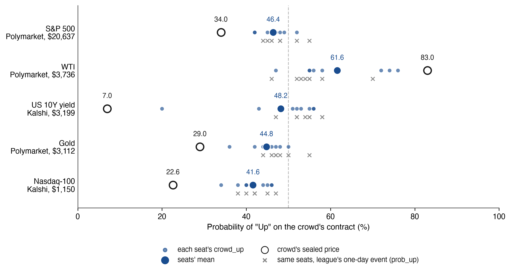

Note: Crowd prices and volumes recorded at 12:30:06Z and sealed in run line 151 of `council-book.jsonl` (`crowd.odds`, `crowd.kalshi`); `crowd_up` and `prob_up` from answer lines 152 to 159. Kalshi prices are interpolated to "above the previous close" (Section 4.9). Grey crosses mark the same seats' probability of a rise on the league's own one-day event, a different event (Table 1). Means and ranges as in Table I4, and over the five contracts the seats stood 7.5 points from 50 on average and the crowd 28.1.

**Daily index moves are close to random, so the league measures noise.** At one day that is the expectation: the 50% benchmark (Brier 0.25) and the momentum rule are the yardsticks, and the standard adds a climatological base rate with a Brier skill score (Section 4.3). The league's power calculation, run on hit rates as a proxy for Brier, puts about 209 sessions between a 55% hit rate and a coin (Section 4.6), so the 30/10 rule admits a model to a provisional table and claims nothing about significance. The four horizons exist because a signal absent at a day may exist at a month (F16, F17). A measurement that can return "no detected skill" is what the protocol is for.

## 10. Scope and boundary conditions

Table J1 in Appendix J states what each claim rests on and how far it reaches; here is the short version.

**Time.** The counted run is sealed and signed by independent authorities (clock level 2+), and the development sessions of 19 and 20 October stand at clock level 1, outside every confirmatory estimate (Figure 4). Appendix J gives the reading times and the dated evidence for each level.

**Models.** Ten forecasting seats and the spare ERNIE, which answered in a seat's place on 18 and 20 October, of which the seats whose answers were sealed before the reference (seven on 19 October, eight on 20 October, nine in the first counted run of 21 October) enter the readings of this version; all fourteen seats trade (Table 3). The findings describe these models in the modes sealed on their answer lines.

**Markets.** Twelve indicators span US equities, semiconductors, rates, the dollar, volatility, metals, oil and Bitcoin, with the day from 09:30 to 16:00 ET, the 10-year yield to 15:00 ET and Bitcoin from the seal minute. Single stocks, outside the separate S&P 100 track, and intraday trading are out of scope. The climatological benchmark approximates the live event where no matching window exists, and the approximation moves $q_e$, not the forecasts. Instrument, roll and crowd-row rules are in Appendix J.

**Independence, countries, readers, portfolios.** N_eff summarises how alike the probability pictures are under one common correlation, run by run and horizon by horizon, and it does not rank models. The reader experiment compares randomised groups of self-selected visitors. Accounts are simulated, $100,000 each, with costs of 0.1% and execution at the first open after the seal, and they exclude market impact and taxes (Appendix J).

**Status of claims.** The protocol and its measures are proposed, and AI Council · Markets is the reference implementation, whose status against each requirement is published in Appendix F. On 22 October it holds rung L1 in full and climbs toward L2, which it claims when the first ranking of 30 October puts requirement 10 in place (Table 2, Figure 4). The one confirmatory test is the primary endpoint, and the thirty statements of Section 8 are registered secondary predictions.

This paper describes a measurement protocol and is not investment advice.

## 11. Conclusion

A person who asks an AI model on Monday morning whether to buy gold cannot tell by evening whether the answer was right for a reason, or even that it existed before the close. I wrote the standard so that a reader, and not the operator, can check when a forecast of a financial market was fixed, which event it was scored on and which run counted. AI Council · Markets, run by PolyHelper, is its reference implementation on twelve indicators at four horizons, with its status against each requirement published and dated (Appendix F). From 21 October 2026 the run that counts is declared in advance and sealed, and independent time-stamping authorities sign the record of the counted answers before the 09:30 ET open (Figure 4). The order of forecast and reference then rests on clocks outside the operator. This is the piece I recommend other leagues adopt first: a third party's timestamp turns an operator's assurance into a record a reader can check. Among the arenas mapped in Section 7 (Table 4) the league is the first to combine these elements on a fixed panel of financial indicators, and the first AI market arena to set seven US and seven Chinese models on the same question, snapshot, deadline and rules beside readers randomised to forecast before or after seeing them. Beside its consensus the league reports the number of independent voices behind it, because a share of agreeing models means little without that count. On the two development mornings the probability pictures of the seven and eight seats sealed before the reference were as alike as those of fewer than two independent forecasters at one day, and the first run of the counted record gave 2.23 from nine seats.

None of these rules depends on the league that implements them. An arena that trades real money can seal its decisions before it executes them. A benchmark of event questions can stamp its forecasts in a public ledger at no cost beyond a hash. A fund or a newsroom that publishes AI forecasts can adopt the 30/10 rule before it reports a winner. The three rungs give the order. L1 needs nothing but discipline: a chained file, every run published, empty cells printed. L2 adds a free public anchor, a declared counted run and a count of voices beside the consensus. L3 adds signed time on every answer. My league holds L1 and five of the eight requirements of L2 within a week of its first run, and the dated rest is on Figure 4, so the climb is short and can be taken in public.

One primary test and thirty secondary predictions are registered on OSF before posting. Dated revisions will score them, and the resolver filed with each prediction lets any reader score it first, from data open under CC BY 4.0 at <https://trends.polyhelper.ai/api/v1/>. The history that began on 16 October 2026 grows by one sealed session each trading day, and once anchored, no part of it can be rewritten by anyone, its operator included.

If you run a benchmark, adopt the event contract and the counted-run rule before your next question goes out. If you study model agreement, take the sealed panel and report independent voices beside the headcount. If you doubt my claims, start with the three verification commands of Appendix B, then run the filed resolvers on their check dates. The standard is useful only when a reader can do all three without asking the operator.

## Declarations

**Funding.** No external funding supported this work.

**Competing interests (conflict of interest).** I founded and operate PolyHelper, which runs the AI Council · Markets league described here, and develops multi-model orchestration methods, with related patent applications pending.

**Tools and verification.** I used AI assistants as instruments under my direction. The ideas, research and conclusions are mine. I checked quantitative claims and citations against primary sources or archived copies as of 20 October 2026, and the prior work of Section 7 and Appendix E as of 21 October 2026. I read the numbers from the league in its open files on 21 October 2026 (Appendix J gives the generation time of each file), and I recomputed the per-run and per-horizon independence values of Section 5.2 from council-forecasts.csv and council-book.jsonl of the same day with a script filed with the registration. I read the conformance evidence of Table F1 and the seals of 21 October 2026 from the live files and the proof page on 21 October 2026 at 15:05 UTC, and the statuses of Table 2, Table F1 and Table F2 on 22 October 2026 at about 19:45 ET, and checked the RFC 3161 tokens with OpenSSL against the authorities' certificates. Three models of three families set the probabilities of the registered predictions, each blind to the others and to my estimates (Section 8.3).

**Data and code availability.** The filed scripts, the event-contract checker and both recount scripts use Python 3.9 or later with no package beyond its standard library and run under `python3 -I`; I ran them with Python 3.15.0 on macOS. The checks of Appendix B need `shasum`, the OpenTimestamps client for Step 6 and OpenSSL 3 or later for Step 9. Nothing is trained, so no result depends on hardware; the models run at their providers, and the version and mode each returned are sealed on its answer line (Table 3). The league's data are open under CC BY 4.0 at <https://trends.polyhelper.ai/api/v1/>, including the sealed book (council-book.jsonl), the forecasts (council-forecasts.csv), the question texts under their hashes (`asks/<sha256>.md`), the statistics (council-stats.json), the protocol and its versions (arena-protocol.json), the portfolio engine's code with SHA-256 hashes (arena-code.json), a recount of every forecast score (`tools/replay_brier.py`) and a recount script that recomputes every published league account from the published trades and prices within the stated publication rounding tolerance (`python3 replay.py https://trends.polyhelper.ai/api/v1/`, Appendix B). The live endpoints change every session, so the analysis does not rest on them: an immutable release of the open files as of the date of each version of the paper, with a manifest of their SHA-256 hashes, is archived on Zenodo (10.5281/zenodo.23552700), and every number in the paper is computed from that release; the filed scripts run on it offline (`--data`). This version reads the analysis release (Zenodo 10.5281/zenodo.23552700, created 22 October 2026). A reader who downloads the live files later can check the archived prefix of the sealed book against them (Appendix B). The primary endpoint with its script, the registered predictions with a resolver for each (resolve.py), the clean list priced by the blind forecasters with all three votes, the Set B scripts, the content SHA-256 of the sealed climatology and a manifest of filed files with their SHA-256, with a README that lists the requirements and the command for each script, are registered on OSF (10.17605/OSF.IO/9Q86N). The paper is archived on Zenodo (10.5281/zenodo.23552697) and its preferred citation is the SSRN preprint (https://ssrn.com/abstract=7653679).

**Ethics.** The reader experiment of Section 6 collects anonymous up or down forecasts with a stated confidence from visitors of a public page. Readers are assigned to a group by an anonymous random identifier. The experiment collects no names, accounts or contact details. The league does not store or log a reader's IP address. A salted hash of it with the day is kept only to cap votes per address, and no personal data are published or used in the analysis. The results are reported as aggregate counts, and the first forecasts that F29 reads are published under the anonymous identifier alone. I carried out the work as an independent researcher, outside an institutional ethics committee. The forecasters in the league are software models.

**Author contributions.** Sole author.

**Correspondence.** vadimchernets9@gmail.com · ORCID: 0009-0007-4845-3163

## References

Abeliuk, A., Benjamin, D. M., Morstatter, F., & Galstyan, A. (2020). Quantifying machine influence over human forecasters. *Scientific Reports, 10*, 15940. <https://doi.org/10.1038/s41598-020-72690-4>

Adams, C., Cain, P., Pinkas, D., & Zuccherato, R. (2001). *Internet X.509 public key infrastructure time-stamp protocol (TSP)* (RFC 3161). Internet Engineering Task Force. <https://doi.org/10.17487/RFC3161>

AI Council · Markets. (2026). *Open data of the AI Council · Markets league: sealed book, forecasts, statistics, protocol, event-contract schema and league accounts* [Data set]. CC BY 4.0. Data as of 20 October 2026 (generated 21 October 2026, 02:42 UTC); conformance status read 21 October 2026, 15:05 UTC. Retrieved 20-21 October 2026, from <https://trends.polyhelper.ai/api/v1/>

Aitchison, M., Jeen, S., Shevlane, T., & Day, B. (2026). *Diversity is the strength of the AI crowd* (arXiv:2606.29661). arXiv. <https://arxiv.org/abs/2606.29661>

Alur, R., Stadie, B. C., Kang, D., Chen, R., McManus, M., Rickert, M., Lee, T., Federici, M., Zhu, R., Fogerty, D., Williamson, H., Lozinski, N., Linsky, A., & Sekhon, J. S. (2025). *AIA Forecaster: Technical report* (arXiv:2511.07678). arXiv. <https://arxiv.org/abs/2511.07678>

Arora, A., & Malpani, R. (2026). *PredictionMarketBench: A SWE-bench-style framework for backtesting trading agents on prediction markets* (arXiv:2602.00133). arXiv. <https://arxiv.org/abs/2602.00133>

Bali, T. G., Kelly, B. T., Mörke, M., & Rahman, J. (2023). *Machine forecast disagreement* (NBER Working Paper No. 31583). National Bureau of Economic Research. <https://doi.org/10.3386/w31583>

Barber, B. M., & Odean, T. (2000). Trading is hazardous to your wealth: The common stock investment performance of individual investors. *The Journal of Finance, 55*(2), 773-806. <https://doi.org/10.1111/0022-1082.00226>

Barot, R. M., & Borkhatariya, A. S. (2026). *PolySwarm: A multi-agent large language model framework for prediction market trading and latency arbitrage* (arXiv:2604.03888). arXiv. <https://arxiv.org/abs/2604.03888>

Berg, J., Nelson, F., & Rietz, T. (2008). Prediction market accuracy in the long run. *International Journal of Forecasting, 24*(2), 285-300. <https://doi.org/10.1016/j.ijforecast.2008.03.007>

Bitcoin Developer Documentation. (n.d.). *Block chain: Block headers*. Retrieved 20 October 2026, from <https://developer.bitcoin.org/reference/block_chain.html>

Brier, G. W. (1950). Verification of forecasts expressed in terms of probability. *Monthly Weather Review, 78*(1), 1-3. <https://doi.org/10.1175/1520-0493>(1950)078<0001:VOFEIT>2.0.CO;2

Cao, S., Wang, C. C. Y., & Yi, X. (2025). *When LLMs go abroad: Foreign bias in AI financial predictions* (Harvard Business School Working Paper No. 26-013). Harvard Business School.

Chambers, C. D. (2013). Registered Reports: A new publishing initiative at Cortex. *Cortex, 49*(3), 609-610. <https://doi.org/10.1016/j.cortex.2012.12.016>

Chen, Y., Yao, Z., Liu, Y., Xin, A., Ye, J., Yu, J., Hou, L., & Li, J. (2025). *StockBench: Can LLM agents trade stocks profitably in real-world markets?* (arXiv:2510.02209). arXiv. <https://arxiv.org/abs/2510.02209>

Cheng, P., Liu, J., & Long, Y. (2026). *PolyBench: Benchmarking LLM forecasting and trading capabilities on live prediction market data* (arXiv:2604.14199). arXiv. <https://arxiv.org/abs/2604.14199>

Chernets, V. (2026a). *Agreement is not independent evidence: Auditable multi-model synthesis without an API*. Zenodo. <https://doi.org/10.5281/zenodo.22683716> (also SSRN Working Paper No. 7390698, <https://ssrn.com/abstract=7390698>)

Chernets, V. (2026b). *Verification theater: Measured failure modes of AI verifier panels*. Zenodo. <https://doi.org/10.5281/zenodo.23197641>

Chernets, V. (2026c). *After the programmer divide: One measure for people who build through AI agents* (SSRN Working Paper No. 7589918). SSRN. <https://ssrn.com/abstract=7589918>

Choi, H. K., Zhu, X., & Li, S. (2025). *Debate or vote: Which yields better decisions in multi-agent large language models?* (arXiv:2508.17536). Advances in Neural Information Processing Systems 38 (NeurIPS 2025). <https://arxiv.org/abs/2508.17536>

Chu, G., Shen, D., & Zhu, Z. (2025). *Machine forecast disagreement in the cryptocurrency market* (SSRN Working Paper No. 5230677). SSRN. <https://doi.org/10.2139/ssrn.5230677>

Clemen, R. T., & Winkler, R. L. (1985). Limits for the precision and value of information from dependent sources. *Operations Research, 33*(2), 427-442. <https://doi.org/10.1287/opre.33.2.427>

Cox, D. R. (1958). Two further applications of a model for binary regression. *Biometrika, 45*(3-4), 562-565. <https://doi.org/10.1093/biomet/45.3-4.562>

Diebold, F. X., & Mariano, R. S. (1995). Comparing predictive accuracy. *Journal of Business & Economic Statistics, 13*(3), 253-263. <https://doi.org/10.1080/07350015.1995.10524599>

Diercks, A. M., Katz, J. D., & Wright, J. H. (2026). *Kalshi and the rise of macro markets* (Finance and Economics Discussion Series 2026-010). Board of Governors of the Federal Reserve System. <https://doi.org/10.17016/FEDS.2026.010>

Diether, K. B., Malloy, C. J., & Scherbina, A. (2002). Differences of opinion and the cross section of stock returns. *The Journal of Finance, 57*(5), 2113-2141. <https://doi.org/10.1111/0022-1082.00490>

Dietvorst, B. J., Simmons, J. P., & Massey, C. (2015). Algorithm aversion: People erroneously avoid algorithms after seeing them err. *Journal of Experimental Psychology: General, 144*(1), 114-126. <https://doi.org/10.1037/xge0000033>

Dubach, P. D. (2026). *The anatomy of a decentralized prediction market: Microstructure evidence from the Polymarket order book* (arXiv:2604.24366). arXiv. <https://arxiv.org/abs/2604.24366>

Fan, T., Yang, Y., Jiang, Y., Zhang, Y., Chen, Y., & Huang, C. (2025). *AI-Trader: Benchmarking autonomous agents in real-time financial markets* (arXiv:2512.10971). arXiv. <https://arxiv.org/abs/2512.10971>

Fassbender, J. (2026). *Bitcoin-anchored temporal proof for transparency services* (Internet-Draft draft-fassbender-scitt-time-anchor-07). Internet Engineering Task Force. <https://datatracker.ietf.org/doc/html/draft-fassbender-scitt-time-anchor-07>

Forklog. (2025a). *Four out of six AI models suffer losses in trading tournament*. <https://forklog.com/en/four-out-of-six-ai-models-suffer-losses-in-trading-tournament/>

Forklog. (2025b). *AI model Grok 4.2 triumphs in trading tournament*. <https://forklog.com/en/ai-model-grok-4-2-triumphs-in-trading-tournament/>

Gao, Z., Jiang, W., & Yan, Y. (2025). *Detecting lookahead bias in LLM forecasts* (arXiv:2512.23847). arXiv. <https://arxiv.org/abs/2512.23847>

Glasserman, P., & Lin, C. (2023). *Assessing look-ahead bias in stock return predictions generated by GPT sentiment analysis* (arXiv:2309.17322). arXiv. <https://arxiv.org/abs/2309.17322>

Gneiting, T., Balabdaoui, F., & Raftery, A. E. (2007). Probabilistic forecasts, calibration and sharpness. *Journal of the Royal Statistical Society: Series B (Statistical Methodology), 69*(2), 243-268. <https://doi.org/10.1111/j.1467-9868.2007.00587.x>

Gneiting, T., & Raftery, A. E. (2007). Strictly proper scoring rules, prediction, and estimation. *Journal of the American Statistical Association, 102*(477), 359-378. <https://doi.org/10.1198/016214506000001437>

Guan, M., & Chen, Q. (2026). *Leakage-aware benchmarking of LLM forecasting: Real-time nowcasts as the decision-time input for macro factor ranking* (arXiv:2606.22719). arXiv. <https://arxiv.org/abs/2606.22719>

Haber, S., & Stornetta, W. S. (1991). How to time-stamp a digital document. *Journal of Cryptology, 3*(2), 99-111. <https://doi.org/10.1007/BF00196791>

Halawi, D., Zhang, F., Chen, Y.-H., & Steinhardt, J. (2024). Approaching human-level forecasting with language models. In *Advances in Neural Information Processing Systems 37 (NeurIPS 2024)*. <https://arxiv.org/abs/2402.18563>

He, S., Lv, L., Manela, A., & Wu, J. (2025). *Chronologically consistent large language models* (arXiv:2502.21206). arXiv. <https://arxiv.org/abs/2502.21206>

Jyotish, V. (2026). Sealed before the event: A publicly verifiable, Bitcoin-anchored forecast record of 92 graded outcomes [Version 1; awaiting peer review]. *F1000Research, 15*, Article 1322. <https://doi.org/10.12688/f1000research.186752.1>

Karger, E., Bastani, H., Chen, Y.-H., Jacobs, Z., Halawi, D., Zhang, F., & Tetlock, P. E. (2025). ForecastBench: A dynamic benchmark of AI forecasting capabilities. In *International Conference on Learning Representations (ICLR 2025)*. <https://arxiv.org/abs/2409.19839>

Karkar, C., & Chopra, P. (2025). *Future is unevenly distributed: Forecasting ability of LLMs depends on what we're asking* (arXiv:2511.18394). arXiv. <https://arxiv.org/abs/2511.18394>

Kim, E. M., Garg, A., Peng, K., & Garg, N. (2025). Correlated errors in large language models. In *Proceedings of the 42nd International Conference on Machine Learning* (PMLR 267, pp. 30038-30066). <https://proceedings.mlr.press/v267/kim25e.html>

Kim, S., Kwon, J., Kim, Y., Kagan, N., Khatchadourian, R., Ahn, W., Lopez-Lira, A., Lee, J., Hwang, Y., Levy, O., Lee, Y., & Choi, C. (2026). *Forecasting future language: Context design for mention markets* (arXiv:2602.21229). arXiv. <https://arxiv.org/abs/2602.21229>

Kish, L. (1965). *Survey sampling*. Wiley.

Kleinberg, J., & Raghavan, M. (2021). Algorithmic monoculture and social welfare. *Proceedings of the National Academy of Sciences, 118*(22), e2018340118. <https://doi.org/10.1073/pnas.2018340118>

Krogh, A., & Vedelsby, J. (1995). Neural network ensembles, cross validation, and active learning. In *Advances in Neural Information Processing Systems 7 (NIPS 1994)*. <https://papers.nips.cc/paper_files/paper/1994/hash/b8c37e33defde51cf91e1e03e51657da-Abstract.html>

Künsch, H. R. (1989). The jackknife and the bootstrap for general stationary observations. *The Annals of Statistics, 17*(3), 1217-1241. <https://doi.org/10.1214/aos/1176347265>

Li, H., Cao, Y., Yu, Y., Javaji, S. R., Deng, Z., He, Y., Jiang, Y., Zhu, Z., Subbalakshmi, K. P., Huang, J., Qian, L., Peng, X., Suchow, J. W., & Xie, Q. (2025). INVESTORBENCH: A benchmark for financial decision-making tasks with LLM-based agent. In *Proceedings of the 63rd Annual Meeting of the Association for Computational Linguistics (Volume 1: Long Papers)* (pp. 2509-2525). <https://aclanthology.org/2025.acl-long.126/>

Li, W. W., Kim, H., Cucuringu, M., & Ma, T. (2025). *Can LLM-based financial investing strategies outperform the market in long run?* [FINSABER] (arXiv:2505.07078). arXiv. <https://arxiv.org/abs/2505.07078>

Li, X., Yao, X., Qi, G., Zhu, F., Koa, K. J. L., Ng, X. Y., Liu, Z., Ni, X., Liu, C., Yang, Y., Zhang, Y., Wang, W., Feng, F., Wang, C., Luan, H., Xing, X., Xu, X., Chua, T.-S., & Huang, K.-W. (2026). *FinDeepForecast: A live multi-agent system for benchmarking deep research agents in financial forecasting* (arXiv:2601.05039). arXiv. <https://arxiv.org/abs/2601.05039>

Logg, J. M., Minson, J. A., & Moore, D. A. (2019). Algorithm appreciation: People prefer algorithmic to human judgment. *Organizational Behavior and Human Decision Processes, 151*, 90-103. <https://doi.org/10.1016/j.obhdp.2018.12.005>

Lopez-Lira, A., & Tang, Y. (2023). *Can ChatGPT forecast stock price movements? Return predictability and large language models* (SSRN Working Paper No. 4412788). <https://doi.org/10.2139/ssrn.4412788>

Lopez-Lira, A., Tang, Y., & Zhu, M. (2025). *The memorization problem: Can we trust LLMs' economic forecasts?* (arXiv:2504.14765). arXiv. <https://arxiv.org/abs/2504.14765>

louidev. (2026). *GlassBallAI: A dataset of LLM market predictions (made with Google Gemini models)* (Version 1.2) [Data set, CC BY-NC 4.0]. Hugging Face. Retrieved 21 October 2026, from <https://huggingface.co/datasets/louidev/glassballai>

MarketMania. (2026). *Live LLM crypto forecasting benchmark* and *Benchmark methodology* [Web pages]. Retrieved 21 October 2026, from <https://marketmania.ai/llm-financial-market-benchmark> and <https://marketmania.ai/benchmarks/methodology>

MaxWellApexLab. (2026). *llm-trading-arena: LLM Trading Arena* [Computer software and live ledger, MIT licence]. GitHub. Retrieved 21 October 2026, from <https://github.com/MaxWellApexLab/llm-trading-arena>

Meng, S., & Chen, X. (2026). *AI-driven alpha decay: Algorithmic homogenization, reflexive signal erosion, and the paradox of intelligent markets* (arXiv:2605.23905). arXiv. <https://arxiv.org/abs/2605.23905>

Metaculus. (2025a). *Q1 AI benchmarking results: Human pros crush bots*. Effective Altruism Forum. <https://forum.effectivealtruism.org/posts/mwcWxwdsEMexm98GF/q1-ai-benchmarking-results-human-pros-crush-bots>

Metaculus. (2025b). *Q2 AI benchmark results: Pros maintain clear lead*. LessWrong. <https://www.lesswrong.com/posts/Surnjh8A4WjgtQTkZ/q2-ai-benchmark-results-pros-maintain-clear-lead>

Miller, E. M. (1977). Risk, uncertainty, and divergence of opinion. *The Journal of Finance, 32*(4), 1151-1168. <https://doi.org/10.1111/j.1540-6261.1977.tb03317.x>

Murphy, A. H. (1973). A new vector partition of the probability score. *Journal of Applied Meteorology, 12*(4), 595-600. <https://doi.org/10.1175/1520-0450>(1973)012<0595:ANVPOT>2.0.CO;2

Nakamoto, S. (2008). *Bitcoin: A peer-to-peer electronic cash system*. <https://bitcoin.org/bitcoin.pdf>

National Institute of Standards and Technology. (2015). *Secure hash standard (SHS)* (FIPS PUB 180-4). <https://doi.org/10.6028/NIST.FIPS.180-4>

Nechepurenko, M., & Shuvalov, P. (2026a). *Foresight Arena: An on-chain benchmark for evaluating AI forecasting agents* (arXiv:2605.00420v2). arXiv. <https://arxiv.org/abs/2605.00420>

Nechepurenko, M., & Shuvalov, P. (2026b). *Coordination as an architectural layer for LLM-based multi-agent systems* (arXiv:2605.03310). arXiv. <https://arxiv.org/abs/2605.03310>

Nel, L. (2025). *Do large language models know what they don't know? KalshiBench: A new benchmark for evaluating epistemic calibration via prediction markets* (arXiv:2512.16030). arXiv. <https://arxiv.org/abs/2512.16030>

NeuPortal. (2026). *NeuPortal: AI forecasts vs prediction markets (Bitcoin-timestamped)* (Version 1) [Data set; Zenodo record by A. Bilous]. Zenodo. <https://doi.org/10.5281/zenodo.21294229> . Proofs: <https://github.com/neuportalai-ui/experiment-proofs>

Newey, W. K., & West, K. D. (1987). A simple, positive semi-definite, heteroskedasticity and autocorrelation consistent covariance matrix. *Econometrica, 55*(3), 703-708. <https://doi.org/10.2307/1913610>

Nosek, B. A., Ebersole, C. R., DeHaven, A. C., & Mellor, D. T. (2018). The preregistration revolution. *Proceedings of the National Academy of Sciences, 115*(11), 2600-2606. <https://doi.org/10.1073/pnas.1708274114>

Numerai. (n.d.). *Meta Model Contribution (MMC)* [Technical documentation]. Numerai Docs. Retrieved 21 October 2026, from <https://docs.numer.ai/numerai-tournament/scoring/meta-model-contribution-mmc>

Rockflow. (n.d.). *RockAlpha: AI stock*. Retrieved 21 October 2026, from <https://rockalpha.rockflow.ai/ai-stock>

Ørpheus AI. (n.d.). *Zeus: Environmental forecasting subnet* [Source code and README]. GitHub. Retrieved 21 October 2026, from <https://github.com/Orpheus-AI/Zeus/blob/main/README.md>

Paleka, D., Goel, S., Geiping, J., & Tramèr, F. (2026). Pitfalls in evaluating language model forecasters. In *International Conference on Learning Representations (ICLR 2026)*. <https://arxiv.org/abs/2506.00723>

Prophet Arena. (2026). *Verify a forecast*, *Verify* (documentation) and *How scoring works* [Web pages]. Retrieved 20-21 October 2026, from <https://www.prophetarena.co/verify> , <https://www.prophetarena.co/docs/verify> and <https://www.prophetarena.co/research/how-scoring-works>

Qian, L., Peng, X., Wang, Y., Zhang, V. J., He, H., Smith, H., Han, Y., He, Y., Li, H., Cao, Y., Yu, Y., Lopez-Lira, A., Lu, P., Nie, J.-Y., Xiong, G., Huang, J., & Ananiadou, S. (2025). *When agents trade: Live multi-market trading benchmark for LLM agents* (arXiv:2510.11695). arXiv. <https://arxiv.org/abs/2510.11695>

Rallies.ai. (2025-2026). *AI Arena* [Website feature]. Retrieved 21 October 2026, from <https://rallies.ai/>

Schoenegger, P., Park, P. S., Karger, E., Trott, S., & Tetlock, P. E. (2025). AI-augmented predictions: LLM assistants improve human forecasting accuracy. *ACM Transactions on Interactive Intelligent Systems, 15*(1). <https://doi.org/10.1145/3707649>

Schoenegger, P., Tuminauskaite, I., Park, P. S., Bastos, R. V. S., & Tetlock, P. E. (2024). Wisdom of the silicon crowd: LLM ensemble prediction capabilities rival human crowd accuracy. *Science Advances, 10*(45), Article eadp1528. <https://doi.org/10.1126/sciadv.adp1528>

Sharpe, W. F. (1994). The Sharpe ratio. *The Journal of Portfolio Management, 21*(1), 49-58. <https://doi.org/10.3905/jpm.1994.409501>

Sornette, D., Woodard, R., Fedorovsky, M., Reimann, S., Woodard, H., & Zhou, W.-X. (2010). *The financial bubble experiment: Advanced diagnostics and forecasts of bubble terminations, volume II, master document* (arXiv:1005.5675). arXiv. <https://arxiv.org/abs/1005.5675>

Sortino, F. A., & Price, L. N. (1994). Performance measurement in a downside risk framework. *The Journal of Investing, 3*(3), 59-64. <https://doi.org/10.3905/joi.3.3.59>

Spiro, T. (2026). *The oracle's fingerprint: Correlated AI forecasting errors and the limits of bias transmission* (arXiv:2605.00844). arXiv. <https://arxiv.org/abs/2605.00844>

Todd, P. (2016, September 15). *OpenTimestamps: Scalable, trust-minimized, distributed timestamping with Bitcoin*. <https://petertodd.org/2016/opentimestamps-announcement>

TradeRank. (2026). *TradeRank.ai: Live AI trading leaderboard* [Website and open JSON data set]. Retrieved 21 October 2026, from <https://traderank.ai/>

Walker, A. (2026). *The price is (almost) right: A calibration analysis of Polymarket pricing data* [Senior thesis, Princeton University]. Princeton University Senior Theses. <https://theses-dissertations.princeton.edu/handle/88435/dsp01mw22v8973>

White, H. (2000). A reality check for data snooping. *Econometrica, 68*(5), 1097-1126. <https://doi.org/10.1111/1468-0262.00152>

Wolfers, J., & Zitzewitz, E. (2004). Prediction markets. *Journal of Economic Perspectives, 18*(2), 107-126. <https://doi.org/10.1257/0895330041371321>

Yahoo Finance. (2025). *Elon Musk's Grok 4.20 beats OpenAI, Google models in live stock trading contest*. <https://finance.yahoo.com/news/elon-musks-grok-4-20-123855766.html>

Yang, Q., Mahns, S., Li, S., Gu, A., Wu, J., & Xu, H. (2025). LLM-as-a-prophet: Understanding predictive intelligence with Prophet Arena. In *International Conference on Learning Representations (ICLR 2026)*. <https://arxiv.org/abs/2510.17638>

Yu, H., Li, F., & You, J. (2025). *LiveTradeBench: Seeking real-world alpha with large language models* (arXiv:2511.03628). arXiv. <https://arxiv.org/abs/2511.03628>

Zeng, Z., Liu, J., Chen, S., He, T., Liao, Y., Tian, Y., Wang, J., Wang, Z., Yang, Y., Yin, L., Yin, M., Zhu, Z., Cai, T., Chen, Z., Chen, J., Du, Y., Gao, X., Guo, J., Hu, L., . . . Huang, W. (2025). FutureX: An advanced live benchmark for LLM agents in future prediction. In *International Conference on Learning Representations (ICLR 2026)*. <https://arxiv.org/abs/2508.11987>

Zhang, J., Liu, G., Johansson, O., Yitayew, H., Ohly, K., & Li, G. (2026). *Prediction Arena: Benchmarking AI models on real-world prediction markets* (arXiv:2604.07355). arXiv. <https://arxiv.org/abs/2604.07355>

Zhang, O., & Zhang, Z. (2026). *A review of large language models for stock price forecasting from a hedge-fund perspective* (arXiv:2605.05211). arXiv. <https://arxiv.org/abs/2605.05211>

Zhao, X., Zhang, R., Ye, L., Cao, R., Xie, P., & Chava, S. (2026). *Can LLMs take the pulse of the economy? A real-time evaluation of LLM nowcasts on macroeconomic indicators* (arXiv:2608.30110). arXiv. <https://arxiv.org/abs/2608.30110>

## Appendix A. Protocol fields

The specification is the file itself: `arena-protocol.json` for the leagues (Table A1) and the `methodology` field sealed in each run line for the forecast score (Table A2). Both are versioned. Each change is dated and each seal carries the version in force, so a change reaches nothing sealed before it (requirement 15). The tables below list the keys needed to resolve a score as of 20 October 2026.

**Table A1.** *Keys of `arena-protocol.json` needed to resolve an account (version `arena-3`, 20 October 2026).*

| Key | What it fixes |
|---|---|
| `version`, `pro_version`, `history` | Rules in force (`arena-3`, Pro league `pro-1`) and each version with its start date |
| `assets`, `indicators_only` | The instrument each market trades as (the yield as IEF, Bitcoin as BTC-USD and so on); VIX not held |
| `prices` | Price source and rule of the accounts: first minute bar of 09:30-09:45 ET for execution, the close for value |
| `execution`, `cost` | A decision trades at the first open after its seal; 0.001 on every dollar that changes |
| `limits`, `cash` | 5% to 25% per position, sum to 100%, long only; cash at the 13-week Treasury bill by calendar days over 360 |
| `missing_answer`, `refused`, `asked_again` | No decision or a refused one leaves positions unchanged; retries are sealed with their question's hash |
| `pro_league` | Signed weights, gross exposure up to 2×, borrowing costs, margin cut |
| `new_model_version` | The account goes on; the change is dated; the result since the version is shown apart |
| `formulas` | Return, maximum drawdown, Sharpe, Sortino, dividends from the ex-date, splits applied once |
| `question`, `replay` | The portfolio question's template hash; how to recount every account from the open files |

The shadow tracks (`f12`, `closed_book`, `repeats`, `sp100`, `council_talk`, `modalities`, `roles`) carry their own rule versions in the same file and do not enter the forecast score.

**Table A2.** *Fields of the scoring methodology sealed in each run line (`methodology`, version 2).*

| Field | What it fixes |
|---|---|
| `reference` | The first price after the seal by each indicator's rule (`ref_rule`); late answers get their own reference |
| `counted` | The answer line sealed last before the reference counts; from session 11 (2 November 2026), each seat's first well-formed answer line sealed before the reference counts and a later line of the same seat is a labelled retry (`asks.jsonl`, line 74); a line after the close is not scored for that session |
| `league` | One score per session: the run sealed last before the open (`session_run`); others shown apart. From 21 October 2026 the counted run is the scheduled morning run, declared in advance on the proof page (Section 3.4) |
| `direction` | Up or down of the indicator from its reference; a move inside the draw band is a draw (band defined in `council-stats.json`, `draw_band`); 50 backs no side |
| `brier`, `calibration` | $(p/100 - o)^2$, coin 0.25; folding to the backed side, bins [50, 60), [60, 70), [70, 80), [80, 100] |
| `independence` | Ranking after 30 forecasts on at least 10 trading days |
| `missing` | An unanswered cell in a given answer counts as 50% |
| `btc` | Bitcoin's day from the seal minute, capped at 16:00 ET of the scoring session |
| `consensus` | Mean probability; extremes dropped at five or more answers; a family's second seat weighs 1/3; held within 2-98% |
| `together` | `all_wrong` (every model wrong, at least 4 answered) and `minority_right` (consensus wrong, some model right) |
| `changes` | Dated changes to the methodology; nothing published before is recounted |

### A.1 From the Abstract and the Executive summary

Fourteen large language models, seven from US and seven from Chinese laboratories, answer the same question on a shared price snapshot, each with its own account.

Every question concerns an outcome still to come, which keeps it out of a model's memory. A market is a test that renews itself: it asks a new question every morning and answers it the same afternoon, so no model can have read the answer. Two forecasts compare only when they bet on the same thing, and the unit is therefore an event contract fixed in advance.

Seven US and seven Chinese models share the question, the snapshot, the deadline and the rules, so any difference between the sides is measured on one task.

### A.2 From Section 1, Introduction

Each morning before the New York open the Council forecasts 12 financial indicators, across stock indices, rates, the dollar, volatility, commodities and Bitcoin, at four horizons from one day to six months.

### A.3 From Section 3, The protocol

The word yield names three separate events in this league. The forecast is on the 10-year yield itself, in yield units, from its reference to its terminal price at 15:00 ET. The crowd contract, when the question lists one, resolves on the Treasury's 3:30 PM ET par yield, close to close, and is scored on those terms (Section 4.9). The portfolio holds a Treasury bond fund (IEF), which rises when the yield falls (Section 4.7). On 20 October the crowd priced the yield's contract at 7% against the previous par yield of 5.15%, a price that already held the pre-market fall; the league's own question on the yield starts from the 09:30 reference and asks something else. A correct call on one says nothing by itself about the others. VIX is split the same way: the forecast is on the index, the ordinary portfolio cannot hold it, the Pro league can.

**Table A3.** *Minimum fields of an event contract, and where the reference implementation fixes each (full version of Table 1).*

| Field | What it fixes | Reference implementation |
|---|---|---|
| Target | The indicator itself, not an instrument that tracks it | 12 indicators by code; traded funds appear only in the portfolio leagues (`assets`, `trades_as`) |
| Predicate and horizon | The event: a strict rise from the reference to the terminal price | `prob_up`; 1d; 1w, 1m, 6m as 5, 21 and 126 sessions (Bitcoin 7, 30 and 182 calendar days) |
| Price source | Vendor, symbol, bar size and timestamp rule for the reference and terminal price, per indicator | Provider, symbol and reference rule on every forecast row (`price_provider`, `price_symbol`, `reference_rule`; for the S&P 500, the one-minute bar of `^GSPC` at or after the reference time), declared per indicator in the contract schema; source of the portfolio prices in the protocol (`prices`) |
| Information cutoff | What a forecast may use: anything before the reference price, never the reference itself | Price snapshot and question hashed into the run line (`snapshot_sha256`, `ask_sha256`) |
| Deadline and counted run | Which answer counts for the session | From 21 October 2026, the scheduled morning run, declared in advance, sealed in `asks.jsonl` and published on the proof page; within it, the line sealed last before the reference (`counted`), and from session 11 (2 November 2026) each seat's first well-formed answer line sealed before the reference, later lines of the same seat being labelled retries, by a rule declared in `asks.jsonl`, line 74, text SHA-256 `0f42c93b…b0b6cd`. For 19 and 20 October, the run sealed last before the open (`session_run`), applied after the runs; in every counted run to date each seat sealed one answer line, so the first and the last line before the reference are the same |
| Reference price | One reference per event, taken after the seal | First price at or after 09:30 ET; Bitcoin, the close of the first one-minute bar starting at or after the line's seal (`reference`, `btc`) |
| Resolution | Terminal price, its time and its rule | Close of the horizon's last session at 16:00 ET; the 10-year yield at 15:00 ET; Bitcoin's day from the seal minute to 16:00 ET of the scoring session |
| Draw rule | Which small moves are draws and how they are scored | Band of 0.1 times a minute-bar scale of the day's move, about 0.08 of a session standard deviation; roll sessions left out (`direction`, `noise_rolls`) |
| Scoring rule and benchmarks | The proper score and what it is compared with | Brier score over all rows; 50% benchmark; fixed climatology of the event (`climatology_fixed`, Section 4.3) |
| Rules version | Which methodology applies | `methodology.version`, sealed in each run line; `methodology_version` on each forecast row |
| Event identifier | One key for "the same event" | `event_id_v2`, a hash of the nine keys of the full contract, with the five-key `event_id` beside it (`event-contract.schema.json`, Appendix F.4) |

Note: Field names in parentheses are those of the open files (`arena-protocol.json`, the `methodology` field of each run line, `council-stats.json`, `council-calibration.json` and the columns of `council-forecasts.csv`). The 15:00 ET window of the yield is stated in the sealed run line of 20 October.

### A.4 From Section 3.1, A day of the league

In Table A4 I give, for each market, the price symbol on which its event is resolved, the end of its one-day event, the fund through which the portfolio leagues hold it and the crowd contract sealed with the question on 20 October 2026.

**Table A4.** *The twelve markets: price symbol, reference and end of the one-day event, the fund each trades as in the portfolio leagues, and the crowd contract sealed on 20 October 2026.*

| Market | Code | Price symbol | Reference | End of the one-day event (ET) | Traded as | Crowd contract, 20 October 2026 (venue, sealed volume $) |
|---|---|---|---|---|---|---|
| S&P 500 | SPX | `^GSPC` | First 1-min bar at or after 09:30 ET | 16:00 | SPY | Polymarket, 20,637 (Kalshi also listed) |
| Nasdaq-100 | NDX | `^NDX` | Same | 16:00 | QQQ | Kalshi, 1,150 |
| Dow Jones | DJI | `^DJI` | Same | 16:00 | DIA | Polymarket, 20 |
| Semiconductors | SOX | `^SOX` | Same | 16:00 | SOXQ | None |
| US 10-year yield | US10Y | `^TNX` | Same | 15:00 | IEF | Kalshi, 3,199 |
| Dollar index | DXY | `DX-Y.NYB` | Same | 16:00 | UUP | Polymarket, 4 |
| VIX | VIX | `^VIX` | Same | 16:00 | Not held (`indicators_only`) | None |
| Gold | GOLD | `GC=F` | Same | 16:00 | GLD | Polymarket, 3,112 (Kalshi also listed) |
| WTI | WTI | `CL=F` | Same | 16:00 | USO | Polymarket, 3,736 (Kalshi also listed) |
| Brent | BRENT | `BZ=F` | Same | 16:00 | BNO | None |
| Copper | COPPER | `HG=F` | Same | 16:00 | CPER | None |
| Bitcoin | BTC | `BTC-USD` | Close of the first 1-min bar starting at or after the line's seal | 16:00 of the scoring session | BTC-USD | Polymarket, 38 |

Note: From the forecast rows of the runs of 20 and 21 October 2026 (`price_provider`, `price_symbol`, `reference_rule`, `event_end_at`), `arena-protocol.json` (`assets`, `indicators_only`) and run line 151 of `council-book.jsonl` (`crowd.odds`, `crowd.kalshi`). Every row names the provider `yahoo_finance_chart_v8_1m` and the rule `first_1m_bar_at_or_after_reference_at__last_1m_bar_at_or_before_end_at__v1`. Horizons of a week, a month and six months are 5, 21 and 126 sessions (Bitcoin 7, 30 and 182 days; Table A3). Draw bands are set per session (Table A3) and are not listed. The primary crowd comparison admits contracts with a sealed volume of at least $1,000 (Section 4.9).

### A.5 From Section 3.2, What a seal is

The **run line** carries the hash of the question, the hash of the price snapshot, the roster by side, the scoring methodology in force and the prediction-market prices recorded when the question went out. The **answer line** carries the model, its mode and its whole parsed answer for the 12 markets and four horizons, with `own_sha256`, the hash of the raw reply, and `ask_sha256`. The **score line** carries the outcome. All three are sealed the same way.

### A.6 From Section 3.3, Reference price after the seal

A line sealed after the open is kept. It receives its own reference, the first price after its own seal, and is marked as late (`late_ref` in the score line). A line sealed after the close is not scored for that session (`counted`). Such a line answers a different question: in the book of 20 October, the own reference of a line sealed after the open reversed the sign of the scored move in six of its nine one-day cells. I therefore keep it out of everything that compares models on a common event: the consensus, the counts of shared error, the closest model, the effective number of voices and every head-to-head comparison (requirement 4). The score line marks the line, and the counted series of the league's statistics leaves it out (Table 2).

The same rule fixes one reference per common event, Bitcoin included. In the reference implementation Bitcoin's reference is the close of the first one-minute bar that starts at or after the line's seal (`reference_rule`, Yahoo Finance BTC-USD), so the price is always later than the seal, while the open files write the seal second as `reference_at` and the start of the priced bar as `reference_price_at`. A line sealed in a later batch gets its own Bitcoin reference and is a separate event. On 21 October the eight answers sealed at 13:00:19Z share the reference 83,536.42, the close of the 13:01Z bar; the ninth, sealed at 13:23:37Z, has its own, 83,677.08, the close of the 13:24Z bar, and is scored apart (`own_event`, `same_event` false), outside the common Bitcoin event. Because `reference_at` equals the seal second, a cut at "sealed before `reference_at`" would drop every Bitcoin row. I use one clock for all twelve markets instead: an answer line enters the common-event statistics only if it was sealed before the session's 09:30 ET reference. Bitcoin lines follow the same 09:30 ET cut, while the Bitcoin price itself is referenced from the first minute after the run's seal. This is the rule of the published counted series (`n_eff.counted`) and of the filed resolution scripts. Once answers are sealed on arrival (requirement 12), the common reference for a market that trades around the clock is the price at the close of the run's intake, after every counted seal.

### A.7 From Section 3.5, Direction, probability and the draw

I treat small moves as draws by a rule fixed in advance. The band is $0.1 \times \overline{|r_{1\text{min}}|} \times \sqrt{390}$, with $\overline{|r_{1\text{min}}|}$ the mean absolute one-minute percent return over the four sessions of minute bars before the reference; for normal returns this is about 0.08 of a session's standard deviation (`council-stats.json`, `draw_band`). For the futures (WTI, Brent, gold, copper) minute moves across a recorded change of front-month contract are left out, because a roll is a jump between two contracts (`noise_rolls`). The standard requires the scored event to be the event asked (requirement 7). The primary Brier score is computed over all rows, a rise meaning a change above zero, and the score without draws is reported second with the number of rows it drops. The models are asked for the probability of a strict rise and are not told the draw rule. From the session of 21 October the all-rows score is the league's main score (field `pall`). The development sessions stand as published, a separate segment (requirement 15), on a score that leaves draws out. Such a score is minimised by the probability of a rise given a move outside the band, so for the question asked it is not strictly proper.

### A.8 From Section 3.6, "Buy on dips" as a level fixed in advance

"Buy on dips" without a level cannot be scored, so I require an answer with the action `buy_dips` to give `entry`, a level below the reference at which the model would add. If the price touches it during the session the portfolio buys at the entry, and otherwise nothing is bought. Either way the probability is scored. The five permitted actions are `buy_strong`, `buy_dips`, `hold`, `trim` and `sell`. A word outside the list is kept as `action_word`, its probability and levels are scored, and it does not trade.

### A.9 From Section 3.9, Empty cells

Every cell of an answer is scored. A cell a model leaves empty counts as 50%, Brier 0.25, no side (`counted_50`); it cannot beat the coin but can hide worse-than-coin performance on a hard market, so I report the count of empty cells beside each score (requirement 8). A seat that sends no answer line is recorded as `no_answer` and is absent from that run's scores. The filled 0.25 belongs to the seat's service score. The consensus and the agreement counts are formed from the probabilities actually given, and the field `of` counts them. Each seat therefore has three results at each horizon, each ranked on its own: the Brier score on stated probabilities, the share of expected cells answered by the deadline, and the service score. The portfolio is a fourth result in its own table. One combined score would hide whether a seat lost on judgement, on punctuality or on trading.

The expected cells must be known before the answers. The standard asks for a roster of expected answers, with the seats, markets, horizons, deadline and retry policy, sealed before the first question of a run (requirement 13), so that every expected cell resolves to one status (counted, `counted_50`, `no_answer` or refused). The run line carries the roster by side, and from 21 October 2026 the roster is sealed before the first question, in the chain of outgoing questions (`asks.jsonl`). The roster checks completeness against the declared schedule. The hash of each outgoing question, sealed when it is sent, checks the runs that were sent (requirement 13).

### A.10 From Section 3.10, A change of model version, a correction, a change of rules

A seat is an operational participant; a model version is a time-specific implementation, and the record keeps both. When a seat's version changes, its account runs on, the change is dated, the result since the new version is shown apart (`new_model_version`), each version gets its own account from the day it took over (`_ver:<model>:<n>`), and a run in which a version changed is flagged (`seat_versions_in_run`).

A correction is a new line that names the lines it concerns (`of`), and the line it corrects stays as written. Prices follow the same rule: the protocol declares that from 22 October 2026 a corrected reference or closing price enters as a sealed correction line with its source and reason, and the score line before it is not rewritten (`price_corrections` in `arena-protocol.json`). On 20 October 47 of the book's 211 lines were correction lines: some attach the model and mode from the run receipts to answers of the first runs, others link a re-sealed answer to the earlier line it equals (`same_as`, older copies in `council-forecasts-copies.csv`). The standard requires model, version and mode in the answer line itself, or, in a blind season, a salted commitment to them (requirement 1).

A change of the methodology changes the task and opens a new measurement segment (requirement 15). A confirmatory score, a paired gain or a portfolio comparison is computed inside one methodology version, or the versions are reported as separate segments; old forecasts rescored under a new rule are labelled an alternative analysis. A claim that rests on a level-2+ element covers the seals made after that element appears in the public files.

## Appendix B. Verify a seal yourself

The steps use only public files and standard tools. I ran Steps 1 to 8 on the evening of 20 October 2026 (ET) and Step 9 on 21 October, and the outputs shown are the ones I obtained. The example of Steps 1 to 8 is the stamp of 20 October 2026 at 13:00:25Z, one of four that day (Section 3.1). Steps 1 to 8 check level 1 (the chain) and level 2 (the anchor). Step 9 checks level 2+, the RFC 3161 tokens on the stamped list of 21 October 2026. The sessions of 19 and 20 October 2026 are the development sessions, and the counted record runs from 21 October 2026.

**Step 1. Download the book and the stamp.**

```sh
curl -sO https://trends.polyhelper.ai/api/v1/council-book.jsonl
curl -sO https://trends.polyhelper.ai/markets/proof/2026-10-20/130025Z.txt
curl -sO https://trends.polyhelper.ai/markets/proof/2026-10-20/130025Z.txt.ots
```

The proof page `https://trends.polyhelper.ai/markets/proof/2026-10-20/` lists every stamp of the day and every book line of the run, with its seal and link.

**Step 2. Read the stamped list.** `cat 130025Z.txt` shows, among other books, the line for this one:

```text
daily/council/book.jsonl: 159 lines, sha256 59673b9e21ac6d358e7dc3b811dc3d78f5286390094f7133e3704f57cac1a7d9, last link 378273fd057fcbf364746b032f67f42cd811d281da80f39ff0792c4047175b2c
```

**Step 3. Check that today's book begins with the stamped prefix.**

```sh
head -n 159 council-book.jsonl | shasum -a 256
# 59673b9e21ac6d358e7dc3b811dc3d78f5286390094f7133e3704f57cac1a7d9  -
sed -n 159p council-book.jsonl | python3 -c "import json,sys; print(json.load(sys.stdin)['link'])"
# 378273fd057fcbf364746b032f67f42cd811d281da80f39ff0792c4047175b2c
```

Both values match the stamped list, so the first 159 lines are exactly the lines it commits to. Line 151 is the run line of `2026-10-20-am` and lines 152 to 159 its answer lines. The same check with `150012Z.txt`, `153605Z.txt` and `165254Z.txt` covers 165, 167 and 173 lines.

A rule printed in every stamped list fixes the bytes. The file is taken as stored (UTF-8, no byte-order mark, nothing re-encoded or normalised) and each line ends with LF. The hash of N lines covers lines 1 to N, each with its LF, and a last line without LF is not yet counted. A mirror that rewrites line endings fails the check.

**Step 4. Recompute every seal and link.**

```python
import json, hashlib
H = lambda o: hashlib.sha256(json.dumps(o, sort_keys=True, ensure_ascii=False).encode()).hexdigest()
lines = [json.loads(l) for l in open("council-book.jsonl", encoding="utf-8")]
prev = ""
for i, x in enumerate(lines, 1):
    assert x["n"] == i and x["prev"] == prev
    assert x["seal"] == H({k: v for k, v in x.items() if k not in ("seal", "link", "prev", "n")})
    assert x["link"] == H({k: v for k, v in x.items() if k != "link"})
    prev = x["link"]
print("chain ok:", len(lines), "lines")
```

On the file of 20 October this printed `chain ok: 211 lines`.

**Step 5. Check the question a run answered.**

```sh
curl -s https://trends.polyhelper.ai/api/v1/asks/77d3c627c7c69d2f6e740ccd89113872b1ac08053554a4651bc2d3064b4e6f07.md | shasum -a 256
# 77d3c627c7c69d2f6e740ccd89113872b1ac08053554a4651bc2d3064b4e6f07  -
```

**Step 6. Verify the Bitcoin anchor.** Install the OpenTimestamps client (`pip install opentimestamps-client`). With a local Bitcoin node, `ots verify 130025Z.txt.ots` hashes `130025Z.txt`, follows the proof and checks it against the block header. Without a node, `ots info 130025Z.txt.ots` prints the file hash (`5c7d3a357f3cd8b9c27aa4c5d1e9e4750d522bd90b58ffe5193fc61356079d0f`, equal to `shasum -a 256 130025Z.txt`), the operations of the proof and its attestation, `BitcoinBlockHeaderAttestation(972334)`. Applying the operations to the file hash gives `74072ae1fdee72c9a3f749462490b46f896e0fab58f7d101dc1a403d967e5c30`, the Merkle root of block 972,334 as any block explorer shows it (header time 2026-10-20 13:55:20Z; median time of the previous 11 blocks 12:45:12Z). Both files can also be dropped on `https://opentimestamps.org`. A proof that shows only a pending calendar attestation is completed with `ots upgrade`. A pending attestation carries no time a reader can verify.

**Step 7. Recount the league.**

```sh
curl -s https://trends.polyhelper.ai/api/v1/arena-code-tools-replay.py.txt -o replay.py
python3 replay.py https://trends.polyhelper.ai/api/v1/
```

On the files as of 20 October 2026 the script printed (excerpt):

```text
replay: 253 published rows, 145 accounts, 2 sessions (2026-10-19 .. 2026-10-20), 1006 trades, rules arena-3
exact to the cent (|d| <= 0.01): 204; within the rounding of the published trades: 49; DIFFERENT: 0; not recounted (other price sets): 0
result: the published scores are reproduced
```

**Step 8. Check the engine's code.** `arena-code.json` lists each code file with its SHA-256; each file is published as `arena-code-<file>.txt`:

```sh
curl -s https://trends.polyhelper.ai/api/v1/arena-code-council_arena.py.txt | shasum -a 256
# 9ff5575c2b5c7736fba06bec1b63a608f5f290aacdee6df6b24a51381f22686c  -
```

which matches the entry for `council_arena.py`.

**Step 9. Verify the signed times of 21 October 2026 (level 2+).** Run on 21 October 2026, 09:10 ET, with OpenSSL 3 (both checks pass with OpenSSL 3.6 and 4.0). The FreeTSA certificates are copied under `tsa/` and published by the service (`https://freetsa.org/files/`); DigiCert's chain is in the system trust store.

```sh
P=https://trends.polyhelper.ai/markets/proof/2026-10-21
for f in 130019Z.txt 130019Z.txt.freetsa.tsr 130019Z.txt.digicert.tsr tsa/freetsa-cacert.pem tsa/freetsa-tsa.crt; do curl -sO $P/$f; done
curl -sO https://trends.polyhelper.ai/api/v1/council-book.jsonl
shasum -a 256 130019Z.txt
# 986bd13907397901ceed70131a70c3674eba05dfdcb9ededbc7cbc0e57bd3714  130019Z.txt
openssl ts -verify -data 130019Z.txt -in 130019Z.txt.freetsa.tsr -CAfile freetsa-cacert.pem -untrusted freetsa-tsa.crt
# Verification: OK   (after a warning that freetsa-tsa.crt is not a CA certificate, which is expected)
openssl ts -verify -data 130019Z.txt -in 130019Z.txt.digicert.tsr -CAfile /etc/ssl/cert.pem
# Verification: OK
openssl ts -reply -in 130019Z.txt.digicert.tsr -text | grep "Time stamp"
# Time stamp: Oct 21 13:00:19 2026 GMT   (the same for the FreeTSA token)
head -n 222 council-book.jsonl | shasum -a 256
# a9359a7741ef5f7aad7436e022a60813e2fc2f9ce76e130abe21dc820e59bd8c  -
```

The list states 222 lines with this hash. Lines 214 to 222 are the run line and the answers of `2026-10-21-am` booked in the first batch, and both authorities place them by 13:00:19 UTC, 29 minutes 41 seconds before the reference at 13:30:00 UTC. The tokens of `130035Z.txt`, which covers `asks.jsonl`, give 13:00:36 UTC. The same steps on `132337Z.txt` cover 224 lines. Line 224, an answer that arrived at 13:23:23 UTC, was booked 14 seconds later, and three authorities (FreeTSA, DigiCert and Sectigo) signed it at 13:23:37 UTC, before the reference. The first line of `asks.jsonl` declares which run counts from 21 October 2026. It was sealed at 04:16:39 UTC, before the run's question was sent, and its text hash is printed on the proof page.

**What the steps establish.** Steps 3 and 4 give P2 for every line up to the stamp. Step 6 places the stamped prefix no later than a few hours after the header time of block 972,334, and this practical bound, set out in Section 3.11 in place of a constant proved by the consensus rules, gives P1a for every outcome after it, against anyone who holds this proof or an independent copy of it.

The block fell after 09:30 ET. For 20 October the order of seal and reference price (P1b) is therefore read at level 1 from the line's seal time in the book, max(`at`, `booked_at`), against 09:30 ET of the session, and the `sealed_at` column of `council-forecasts.csv` gives the answer time. I checked P3 by applying the counted-run rule to those seal times. For the development sessions P3 rests on the operator's record that every run is published and labelled. In the counted record the counted run is the scheduled morning run, declared in advance and sealed in the chain of questions before the run (Step 9), so the reader checks P3 against a declaration that existed before the answers. Step 9 gives P1b at level 2+ for the session of 21 October, against anyone who accepts any one of the signing authorities and its certificate. In the blind season the same steps run on lines that seal the model as a salted commitment (requirement 1), and the identity is checked when the salts are published after the season.

**Table B1.** *The ladder of claims: what each level of checking supports, and what it leaves open.*

| Level of checking | Claim it supports | Claim it leaves open | In this paper |
|---|---|---|---|
| Rules published | A reader can state the event contract, the score and the counted-run rule | That the files follow the rules | Section 3; Appendix A |
| Files recomputed | The published scores and accounts follow from the published records | That the prices match an independent source; that the named model produced the answer | Steps 4, 7 and 8 |
| External commitment verified (clock level 2; clock level 2+ for the order of seal and reference) | The committed bytes existed by the stated bound, and a later rewrite of that prefix is detectable; at level 2+ (from 21 October 2026), before the reference price | That every expected forecast was disclosed; the provider's model identity; each answer's arrival time | Steps 3, 6 and 9 |
| Outcomes reconciled | Reference and closing prices match a second, named source at the named time | Any predictive advantage | Requirement of the standard; next rung, entered in a dated revision |
| Prospective paired evaluation, frozen before its window | A loss difference on the stated events, weights and comparator | Other markets, horizons and regimes | Section 8 |
| Independent replication | A second pipeline in other hands reproduces the scores from the same release | Performance in later seasons | Open to any reader (Appendix C) |

Note: The anchor certifies the record. A proof of the TLS session with the provider (TLSNotary) can extend the ladder to the claim that the named endpoint returned the sealed answer, and the protocol has room for it as a field of the answer line. Skill is settled by the registered comparisons of Section 8.

**Step 10. Check the stamp in an independent log.** Each stamped list is also entered in the Sigstore Rekor transparency log, which the operator does not run; the entry holds the list's SHA-256.

```
shasum -a 256 130025Z.txt
# 5c7d3a357f3cd8b9c27aa4c5d1e9e4750d522bd90b58ffe5193fc61356079d0f  130025Z.txt
curl -s "https://rekor.sigstore.dev/api/v1/log/entries?logIndex=3368351276"
# the base64 body holds spec.data.hash.value, the same SHA-256; integratedTime 1792626303 is 21 October 2026, 23:45:03 UTC
```

The list of 20 October 2026 stands in the log at index 3,368,351,276, entered on 21 October 2026. From 22 October 2026 each list is entered at stamping: the first, index 3,368,763,032, was integrated at 00:00:16 UTC, five seconds after its stamp.

### B.1 From the title-page notes

Without a Bitcoin node, `ots info 130025Z.txt.ots` shows the attestation to block 972,334, whose Merkle root any block explorer shows (Appendix B, Step 6). Step 10 checks the stamp in the Sigstore Rekor log.

## Appendix C. Data dictionary

All files are under `https://trends.polyhelper.ai/api/v1/`, published under CC BY 4.0 with attribution "AI Council · Markets, trends.polyhelper.ai/markets/". The index page of that address lists every file and how often it changes, and `arena-dataset.json` describes each file's columns; Table C1 lists the files that the predictions read, with column names as read on 21 October 2026 at 08:16 UTC. A reader-AI that cannot open large files starts from `markets-digest.json` (under 30 KB) or the per-run slices in `council-forecasts-index.json`.

**Table C1.** *Main files.*

| File | Content | Updated |
|---|---|---|
| `council-book.jsonl` | The sealed book: every run, answer, score, portfolio and league line, hash-chained | Each run |
| `council-forecasts.csv` | One row per sealed forecast cell with its outcome | Each run and score |
| `council-stats.json` | Brier intervals by sessions, draw band, power calculations, `n_eff` (with the counted series `n_eff.counted`), paired intervals (`pairs`), scores by methodology segment (`method_segments`), shared sources | Each build |
| `council-calibration.json` | Calibration, skill scores against the coin, the crowd and climatology, the method of each comparison (`method`); the fixed climatology `climatology_fixed` when published | Each build |
| `council-pairs.csv` | Paired losses of each two seats on the same events | Each build |
| `league-roster.json` | Every model, its side, Council or bench, its status in both leagues | Each build |
| `{lang}/council-league.json` | The league: models, baselines, calibration, horizons, the crowd, the portfolio league | Each run and score |
| `arena-protocol.json`, `arena-code.json` | The protocol (Appendix A); the engine's code with SHA-256 | Each build |
| `arena-trades.csv`, `arena-accounts.csv`, `arena-prices.json` | Executed trades; each account each session; execution and closing prices | Each session |
| `asks/<sha256>.md`, `asks/index.json` | The question text behind each `ask_sha256` | Each run |
| `event-contract.schema.json`, `tools/conformance.py` | The event contract as a JSON schema; the checker any league can run on its own forecast file (Appendix F.4) | With each change of the contract |

**`council-forecasts.csv`** (one row per model, run, market and horizon): `run_id`; `session`; `seat`; `model`, `mode`; `line` (position `n` of the sealing line); `sealed_at` (UTC); `status` (`counted`, `not_counted`, `counted_50`, `no_answer`, `refused_shape`); `asset`, `horizon`; `action`, `action_word`; `prob_up` (0-100); `exp_pct`; `target`, `invalidation`; `ref`, `close`, `actual_pct`; `draw`; `source_domains`, `source_urls`; `why_missing`; `run_role` (`session_run` or `earlier_run`); `seat_versions_in_run`; `line_kind` (`issue`, the cell as sealed in the answer line, or `correction`, a cell added by a later correction line); `reference_at` (time from which the row's reference rule takes the price; for Bitcoin the seal second, the price being the close of the first one-minute bar starting at or after it); `same_event` (false when the row is scored from its own reference); `cell_status` (`elicited`, `explicit_50` or `invalid`); `attempt`; `event_id`, `event_reference_at`, `event_end_at` (the event contract, Section 3.13); `methodology_version`. `sealed_at` is the answer time, the `at` of the answer line; the time the line was sealed in the book is max(`at`, `booked_at`) of that line (on 20 October, answers at 12:31Z to 12:42Z, seal at 13:00:25Z), which is the time basis of `council-stats.json` (`time_basis: book_sealed_at`) and of the filed scripts. For Bitcoin, `reference_at` is the seal second of the row's own line (13:00:19Z for the batch of 21 October, 13:23:37Z for the ninth answer), and `reference_price_at` is the start of the one-minute bar whose close is the reference (13:01:00Z and 13:24:00Z). A cell with `cell_status` `explicit_50` is a stated probability of 50; `counted_50`, `no_answer`, `refused_shape` and an empty `prob_up` are not stated and enter no Brier score of stated probabilities and no consensus. The model's answer to a crowd question, `crowd_up`, is not in this file; it is in the answer lines of the book.

**Book lines.** Every line has `n`, `at`, `kind`, `prev`, `seal` and `link`. The kinds that carry the forecasts are `run` (adds `run_id`, `ask_sha256`, `snapshot_sha256`, `roster`, `methodology` and `crowd`, with `crowd.at`, the Polymarket contracts under `crowd.odds` and the Kalshi contracts under `crowd.kalshi`, each with its `p_up` and `vol`), `answer` (adds `seat`, `model`, `mode`, `items`, `years`, and in later runs `own_sha256`, `ask_sha256`, `booked_at`; the model's probability for a crowd question is `items.<asset>.1d.crowd_up`), `score` and `score_h` (the day's and the horizons' outcomes, with `late_ref`, `noise` and `of`), `crowd` (resolves each contract: `rows.<code>` for Polymarket and `rows.<code>@kalshi` for Kalshi, with the outcome `up`; as of 21 October 2026 present for the run `2026-10-19-am` only), and `correction` (names the lines it concerns in `of`). Other kinds record the portfolio leagues and the shadow tracks.

**Fixed climatology.** In `council-calibration.json`, `climatology_fixed` holds `table[*]` with `asset`, `h`, `p_up`, `p_up_ex_draw`, `n`, `n_independent`, `window` and `rule`, plus `sha256` and `sha256_ok`. Its seal is the content hash of `council-clim-window.json` (under the data address), `2810d11e907bbaa1f311d06622c929c69e60cc81e558fdb78f5baa04113cabb7`, computed as in Section 4.3; the primary benchmark reads `p_up` at horizon `1d`. The field is in the live file from 21 October 2026, 08:54 UTC, after the 08:16 UTC reading of Table C1.

**Status values and the event contract.** `counted_50` marks a cell filled with 50% for the seat's service score; it is not a stated probability and does not enter the consensus or the agreement counts, whose number of contributing probabilities is `of`. A line with `late_ref` is a forecast on a separate event (Section 3.3); an analysis that pools models on a common event selects rows whose reference equals the session's common reference.

**Analysis release.** Each revision rests on an immutable release deposited on Zenodo (10.5281/zenodo.23552700): the book, the forecasts, the statistics, the protocol, the code files, the files of the recount, the published questions and every stamped list with its `.ots` proof, with a manifest of each file's SHA-256, size, retrieval time and, where stated, generation time. Files retrieved one by one form a collection of identified versions, and the release is the atomic snapshot. The book only grows, and the release's book is therefore a prefix of any later download (Section 3.2).

### C.1 From Section 3, The protocol

The protocol makes the moment of a forecast a fact that a third party can check, and it says which layer of that fact rests on whom. Everything below is published in the league's open files (AI Council · Markets, 2026): the protocol as `arena-protocol.json`, the sealed book as `council-book.jsonl`, the question texts under `asks/`, and the stamped lists with their OpenTimestamps proofs on one page per day (`/markets/proof/<day>/`). I describe the rules as they stood on 20 October 2026 (protocol `arena-3`, scoring methodology version 2) and use the run of that morning, `2026-10-20-am`, as the worked example; every time and hash quoted for it can be read back from the open files (Appendix B). Each seal carries the version of the methodology in force, and a later change of rules leaves everything sealed before it as it was.

## Appendix D. Registered predictions (full table)

Table D1 lists the thirty secondary predictions of Section 8 at a glance, and Table D2 gives their registered text. Three models of three families, each alone, priced the clean list blind, and the registered p is the median of the three. That list, the Set B scripts with their SHA-256 and the primary endpoint with its script are filed with the OSF registration (10.17605/OSF.IO/9Q86N).

**Rules that apply to every row.** Unless a row names another window, a prediction is computed on sessions from session 11 (2 November 2026) to its check date. It uses counted lines (one run per session) whose book seal time, max(`at`, `booked_at`), is before the session's 09:30 ET reference, and the same cut applies to Bitcoin, whose reference is the close of the first one-minute bar after the line's seal. Brier scores are one-day and over all rows, draws included. Where a published field also covers earlier sessions, the filed script applies the field's definition to the window.

Fields are those of the open files at <https://trends.polyhelper.ai/api/v1/> as documented on 21 October 2026, and a renamed field is replaced by its documented equivalent with the mapping logged. Where a row needs a value no open field carries, the field is to be published, and the resolver in the OSF scripts computes the value from council-forecasts.csv and council-book.jsonl by the row's rule. "Ranked" means 30 resolved forecasts on at least 10 trading days (the 30/10 rule, Section 4.6), applied within the prediction's window, except F8, which reads the league's flag. Crowd rows are market-sessions on which the sealed question lists a daily contract (Section 4.9), and the contract is the one the models answered with `crowd_up`, the Polymarket contract where Polymarket lists the market and otherwise the Kalshi contract, in both cases with a sealed volume of at least $1,000 (an admission threshold). Intervals are 95% with the session as the cluster, by a bootstrap of 10,000 resamples with seed 20261102 in the filed scripts.

A minimum sample not reached, a missing file or a field without a documented equivalent leaves the prediction unresolved and not a success. No prediction is deleted. p is the registered probability that the prediction comes true, given that it is resolved: the median of three blind votes. Six values (F5, F7, F20, F21, F23, F25) are the votes of 20 October 2026. The other twenty-four and the primary endpoint were voted on 21 October 2026, in three later rounds, each on the text of the predictions rewritten in that round. Wording fixed after the last round specifies how a row resolves and was not re-priced, and all rounds and votes are filed with the registration.

**Table D1.** *The thirty registered predictions at a glance.*

| # | Prediction (registered statement, up to the colon) | Set | Check date | p | P(true) without skill |
|---|---|---|---|---|---|
| F1 | The council stays below two independent voices at one day | A | 30 Nov 2026 | 0.50 |  |
| F2 | Market co-movement does not explain the likeness | A | 31 Dec 2026 | 0.50 |  |
| F3 | Errors are shared too | B | 31 Dec 2026 | 0.74 |  |
| F4 | Models are less sharp than the crowd | B | 31 Dec 2026 | 0.40 |  |
| F5 | Shared links mean shared calls | A | 31 Dec 2026 | 0.56 |  |
| F6 | All wrong together | B | 31 Dec 2026 | 0.92 |  |
| F7 | A right minority is more common than a unanimous error | A | 31 Dec 2026 | 0.63 |  |
| F8 | The table fills on schedule | A | 30 Nov 2026 | 0.88 | operational |
| F9 | Independence is greater at the month than at the day | B | 31 Dec 2026 | 0.30 |  |
| F10 | Averaging beats following the leader | B | 31 Dec 2026 | 0.64 |  |
| F11 | No single model shows a detected daily advantage | B | 31 Dec 2026 | 0.79 | at least about 0.78 |
| F12 | The crowd beats the council | B | 31 Dec 2026 | 0.83 |  |
| F13 | The combination beats the crowd | B | 31 Dec 2026 | 0.30 |  |
| F14 | Models are overconfident | B | 31 Dec 2026 | 0.80 |  |
| F15 | The council does not beat a simple rule by a clear margin | B | 31 Dec 2026 | 0.80 |  |
| F16 | No horizon carries a detected signal over a season | B | 30 Apr 2027 | 0.63 | at least about 0.93 |
| F17 | Relative to climatology, the day is the hardest horizon | B | 30 Apr 2027 | 0.37 |  |
| F18 | Country is a small factor | B | 31 Dec 2026 | 0.80 |  |
| F19 | The US side scores better over a season | B | 30 Apr 2027 | 0.57 |  |
| F20 | The same news means less dispute | A | 30 Nov 2026 | 0.70 |  |
| F21 | Search adds little accuracy | B | 31 Dec 2026 | 0.72 |  |
| F22 | Discussion finds real risks | A | 31 Dec 2026 | 0.30 |  |
| F23 | Heeding the critique pays | A | 31 Dec 2026 | 0.42 |  |
| F24 | A model disagrees with itself a lot | A | 30 Nov 2026 | 0.60 |  |
| F25 | Leaders do not last | B | 30 Apr 2027 | 0.62 | about 0.85 (eleven ranked seats), 0.82 (ten) |
| F26 | The index is hard to beat | B | 30 Apr 2027 | 0.60 |  |
| F27 | Good forecasters are not the best traders | B | 30 Apr 2027 | 0.83 |  |
| F28 | Access to the models before the first forecast does not improve readers' Brier score by 0.01 or more | A | 31 Dec 2026 | 0.46 |  |
| F29 | Access moves readers toward the council | B | 31 Dec 2026 | 0.41 |  |
| F30 | Style gives the model away | B | 30 Apr 2027 | 0.46 |  |

Note: One line per registered prediction; the full text of each, with its measure, source and resolution rules, is in Table D2. Set A is defined by one or two published fields, Set B by a script filed with the registration. p is the registered probability that the prediction comes true, given that it is resolved: the median of three blind votes. P(true) without skill is the probability that the prediction comes true if no model has skill, as derived in the note to Table D2; an empty cell means the row states no such value.

**Table D2.** *All thirty registered predictions in full: statements, measures, sources, sets, check dates, rules and probabilities.*

| # | Statement | Measure (open file) | Set | Check date | Came true if | Refuted if | p |
|---|---|---|---|---|---|---|---|
| F1 | The council stays below two independent voices at one day: over counted runs from session 11 to session 30, the mean N_eff of the one-day probability pictures, computed per run by the eligibility rule of Section 5.1, is below 2.0 | mean of `n_eff.counted.per_run[*].n_eff` over runs whose `run` id is dated 2 to 30 November 2026, council-stats.json | A | 30 Nov 2026 | mean < 2.0 with at least 10 counted runs | mean ≥ 2.0 with at least 10 counted runs; fewer = unresolved | 0.50 |
| F2 | Market co-movement does not explain the likeness: over counted runs from session 11 to session 52, the mean one-day N_eff with one market per group (Nasdaq-100, Dow and Brent dropped), by the rule of Section 5.1, is below 2.5 | mean of `n_eff.counted.one_per_group.per_run[*].n_eff` over runs whose `run` id is dated 2 November to 31 December 2026, council-stats.json | A | 31 Dec 2026 | mean < 2.5 with at least 20 counted runs | mean ≥ 2.5 with at least 20 counted runs; fewer = unresolved | 0.50 |
| F3 | Errors are shared too: over scored sessions from session 11 to session 52, N_eff computed on the seats' one-day error indicators (answers sealed before the reference, all rows, a stated 50% left out), averaged over sessions, is below 4.0 (the error count also carries the co-movement of outcomes across markets). Per session, the respondents are the seats with an eligible line, n is their number that session, ρ is the mean pairwise Pearson correlation of their 0/1 error indicators across the markets both answered (a pair with a constant indicator is left out, and so is a session with no computable pair), and the mean over sessions weighs each session equally | field to be published (the published `n_eff_errors` includes late lines); the resolver in the OSF scripts computes it from the counted 1-day rows of council-forecasts.csv and council-book.jsonl | B | 31 Dec 2026 | value < 4.0 with at least 30 scored sessions | value ≥ 4.0 with at least 30 scored sessions; fewer = unresolved | 0.74 |
| F4 | Models are less sharp than the crowd: on one-day crowd contracts with a sealed volume of at least $1,000 (the contract the models answered: Polymarket where it lists the market, otherwise Kalshi), from session 11 to session 52, the mean over seats of each seat's mean distance from 50% of its `crowd_up` answers is less than half of the crowd prices' mean distance from 50% on the same contracts | crowd prices and `vol` in the run lines of council-book.jsonl (`crowd.odds`, `crowd.kalshi`); `crowd_up` of answer lines sealed before the reference; filed script | B | 31 Dec 2026 | seats' mean distance < 0.5 × crowd's mean distance, on at least 100 contract-sessions | seats' mean distance ≥ 0.5 × crowd's mean distance; fewer than 100 contract-sessions = unresolved | 0.40 |
| F5 | Shared links mean shared calls: pairs of models citing the same link agree on the action class more often than pairs that do not, by at least 5 points within strata, permutation p < 0.05 | `sources.agreement_by_shared_link.diff_within_strata` and `p_permutation`, council-stats.json, applied to the window by the filed script (definition reproduced on the files of 21 October 2026) | A | 31 Dec 2026 | diff ≥ 0.05 and p < 0.05 | diff < 0.05 or p ≥ 0.05 | 0.56 |
| F6 | All wrong together: the share of resolved 1-day market-sessions with at least 4 answering models on which every answering model was wrong is at least twice the expected share under independence, where the expected share is the mean, over the same market-sessions, of the product of the error rates of the models that actually answered, each rate estimated on the same rows | `together.all_wrong` / `together.rows`, council-league.json; expectation by the filed script from council-forecasts.csv | B | 31 Dec 2026 | observed share ≥ 2 × expected share | observed share < 2 × expected share | 0.92 |
| F7 | A right minority is more common than a unanimous error: `minority_right` exceeds `all_wrong` | `together` definition (council-league.json), recomputed on the window by the filed script by the rule of this paper, from lines sealed before the reference and all rows; the published field, which also counts late lines and leaves draws out, is shown beside it | A | 31 Dec 2026 | minority_right > all_wrong | minority_right ≤ all_wrong | 0.63 |
| F8 | The table fills on schedule: after the scoring of session 30 (30 November 2026), at least 9 of the 11 Council seats meet the rank rule at one day (30 resolved forecasts on at least 10 trading days, all sessions from 19 October 2026 counted) | `ranked` flags, council-league.json `by_horizon.1d` | A | 30 Nov 2026 | 9 or more Council seats ranked | 8 or fewer Council seats ranked | 0.88 |
| F9 | Independence is greater at the month than at the day: over counted runs from session 11 to session 52, the run-by-run difference between the mean pairwise correlation ρ at one day and at one month (each by the rule of Section 5.1, so that a positive difference means more independent voices at the month) has a positive mean, with a 95% moving-block bootstrap interval (blocks of five runs) wholly above zero | counted rows of council-forecasts.csv at 1d and 1m, council-book.jsonl; filed script | B | 31 Dec 2026 | interval wholly above zero, with at least 20 counted runs | interval not wholly above zero, with at least 20 counted runs; fewer = unresolved | 0.30 |
| F10 | Averaging beats following the leader: the consensus 1-day Brier over sessions 31 to 52 (1 to 31 December 2026) is lower than that of the leader, the ranked Council model with the lowest 1-day Brier over sessions 11 to 30 (2 to 30 November 2026), on the December market-sessions both answered | counted 1-day rows of council-forecasts.csv; consensus by the published rule from answers sealed before the reference; filed script | B | 31 Dec 2026 | consensus Brier < leader's Brier | consensus Brier ≥ leader's Brier; no ranked model over sessions 11 to 30 = unresolved | 0.64 |
| F11 | No single model shows a detected daily advantage: no ranked Council model has a one-day Brier, over all rows from session 11, whose 95% session-cluster interval lies wholly below 0.25 (one uncorrected interval per ranked seat) | counted 1-day rows of council-forecasts.csv; filed script | B | 31 Dec 2026 | no seat's upper bound < 0.25 | at least one seat's upper bound < 0.25 | 0.79 |
| F12 | The crowd beats the council: on at least 100 distinct one-day market-sessions from session 11 with a crowd contract whose sealed volume is at least $1,000 (the contract the models answered: Polymarket where it lists the market, otherwise Kalshi), the crowd's Brier is lower than that of the council's trimmed consensus of `crowd_up`, both scored against that contract's own resolution | crowd prices and `vol` in the run lines of council-book.jsonl (`crowd.odds` for Polymarket, `crowd.kalshi`); resolutions in its `crowd` lines (`rows.<code>[@kalshi].up`); `crowd_up` in the answer lines of council-book.jsonl; filed script | B | 31 Dec 2026 | crowd Brier < council Brier on at least 100 market-sessions | crowd Brier ≥ council Brier; fewer than 100 market-sessions = unresolved | 0.83 |
| F13 | The combination beats the crowd: on the same contracts as F12 (at least 100 market-sessions, sealed volume at least $1,000), the simple mean of the crowd price and the council's trimmed consensus of `crowd_up` has a lower Brier than the crowd alone, scored against each contract's own resolution | as F12; filed script | B | 31 Dec 2026 | combination Brier < crowd Brier on at least 100 market-sessions | combination Brier ≥ crowd Brier; fewer than 100 market-sessions = unresolved | 0.30 |
| F14 | Models are overconfident: over all one-day rows from session 11, in the pooled 60 to 70% bucket on the backed side (at least 100 forecasts), the observed frequency is at least 5 points below the stated probability | counted 1-day rows of council-forecasts.csv; filed script | B | 31 Dec 2026 | gap ≥ 5 points with n ≥ 100 | gap < 5 points with n ≥ 100; n < 100 = unresolved | 0.80 |
| F15 | The council does not beat a simple rule by a clear margin: on the sessions both are scored, B(consensus) − B(momentum) at one day is greater than −0.01 | consensus and momentum 1-day Brier on common sessions, council-forecasts.csv; filed script | B | 31 Dec 2026 | B(consensus) − B(momentum) > −0.01 | B(consensus) − B(momentum) ≤ −0.01 | 0.80 |
| F16 | No horizon carries a detected signal over a season: for none of 1 day, 1 week and 1 month does the consensus Brier have a 95% interval wholly below 0.25, intervals by the rule of Section 4.6 (session clusters at 1 day; Newey-West with lag h − 1, or a block bootstrap with blocks of at least h sessions, at horizon h) | consensus Brier by horizon from council-forecasts.csv; filed script | B | 30 Apr 2027 | no horizon's upper bound < 0.25 | at least one horizon's upper bound < 0.25 | 0.63 |
| F17 | Relative to climatology, the day is the hardest horizon: among 1 day, 1 week and 1 month, the consensus Brier skill score against the climatological base rate (frequency of a strict rise per market and horizon over 2016 to 2025, all rows) is lowest at 1 day | consensus Brier by horizon from council-forecasts.csv; climatology `climatology_fixed.table[*].p_up` of council-calibration.json, seal checked by the filed script (Section 8); field published 21 October 2026 | B | 30 Apr 2027 | 1-day skill score is the lowest of the three | 1-day skill score is not the lowest | 0.37 |
| F18 | Country is a small factor: the absolute gap between the US-side and China-side 1-day Brier (each side the mean of its ranked models' Brier on common sessions) is smaller than the range (highest minus lowest ranked-model Brier) inside each side | `by_horizon.1d`, `side`, `ranked`, council-league.json; council-forecasts.csv; filed script | B | 31 Dec 2026 | gap < range within each side | gap ≥ range within either side; fewer than two ranked models on either side = unresolved | 0.80 |
| F19 | The US side scores better over a season: the US side's one-day Brier, the mean of its ranked models' Brier over all rows on common sessions from session 11, is lower than the China side's, computed the same way | counted 1-day rows of council-forecasts.csv, `side` and `ranked` in council-league.json; filed script | B | 30 Apr 2027 | US < China | US ≥ China; fewer than two ranked models on either side = unresolved | 0.57 |
| F20 | The same news means less dispute: in Closed Book runs (sealed packet, no search) the heat of disagreement is lower than in the open runs of the same models and days | mean of `heat_closed − heat_open` over `runs[*]` in the window, arena-cb-experiment.json | A | 30 Nov 2026 | closed heat < open heat | closed heat ≥ open heat | 0.70 |
| F21 | Search adds little accuracy: the next-day Brier of Closed Book calls is within 0.01 of the open calls of the same models and sessions | closed_book lines of council-book.jsonl, council-forecasts.csv; filed script. A closed call sealed after the common reference is scored only from its own reference price (Section 5.5). On the files of 21 October 2026 every Closed Book line was asked after the open (`asked_after_open`) and carries no outcome from its own reference, so the row cannot yet resolve; it resolves once the league publishes either closed calls sealed before the common reference or, for each closed call, its own reference price, close and outcome (for example a `score` field per market), which the resolver already reads | B | 31 Dec 2026 | absolute difference ≤ 0.01 | absolute difference > 0.01; no comparable pairs = unresolved | 0.72 |
| F22 | Discussion finds real risks: at least 55% of the chair's critiques with a resolved 5-session move are confirmed, "confirmed" meaning that the fund's return over the 5 sessions has the sign the critique predicted | `status`, council-talk-critiques.csv (recomputed from the critique's direction and the fund's 5-session return where the field differs) | A | 31 Dec 2026 | share ≥ 55% with at least 20 resolved critiques | share < 55% with at least 20 resolved critiques; fewer = unresolved | 0.30 |
| F23 | Heeding the critique pays: the critique-heeded shadows beat the kept portfolios on average | mean of `weeks[*].criticised[*].heed_minus_keep_pp` over the criticised portfolios of weeks whose sessions lie in the window, council-talk.json | A | 31 Dec 2026 | mean > 0 | mean ≤ 0 | 0.42 |
| F24 | A model disagrees with itself a lot: the mean heat among one model's own repeats is at least half the heat between models | means of `weeks[*].summary.noise_floor.heat_self` and `heat_between_models` over weeks from the radar of 1 November 2026, council-repeats.json | A | 30 Nov 2026 | heat_self ≥ 0.5 × heat_between_models, with heat_between_models > 0 | heat_self < 0.5 × heat_between_models; both zero = unresolved | 0.60 |
| F25 | Leaders do not last: of the top three ranked Council models by 1-day Brier over Q4 2026, at most one is in the top three over Q1 2027. Eligible are the seats with place `council` in league-roster.json that meet the 30/10 rule within each quarter, Q4 2026 meaning sessions 11 to 52 (after the development period) and Q1 2027 the sessions of 4 January to 31 March 2027; a seat stays one seat across a dated change of model version (Section 5.7); exact ties in Brier are broken by seat name in alphabetical order | council-forecasts.csv, counted 1-day rows by quarter; league-roster.json; filed script | B | 30 Apr 2027 | at most one stays in the top three | two or more stay in the top three; fewer than three ranked Council seats in either quarter = unresolved | 0.62 |
| F26 | The index is hard to beat: at the last session of the season, fewer than half of the 14 main-league model accounts have a higher value than the S&P 500 account | `value_usd` of the 14 model accounts and of `_spy`, arena-accounts.csv; filed script | B | 30 Apr 2027 | 6 or fewer above `_spy` | 7 or more above `_spy` | 0.60 |
| F27 | Good forecasters are not the best traders: over the Council seats ranked at 1 day that hold a main-league account, the Spearman correlation between the 1-day Brier rank and the main-league return rank is below 0.5, with rank 1 the lowest Brier and the highest return. Seats are those ranked by the 30/10 rule over sessions 11 to 126, Brier over all their counted 1-day rows in that window, return from the account's `value_usd` at the last session of the season; tied values take the mean of their ranks | counted 1-day rows of council-forecasts.csv, league-roster.json, arena-accounts.csv; filed script | B | 30 Apr 2027 | rho < 0.5 with at least 6 ranked seats | rho ≥ 0.5 with at least 6 ranked seats; fewer = unresolved | 0.83 |
| F28 | Access to the models before the first forecast does not improve readers' Brier score by 0.01 or more: on matched markets (at least 200 first forecasts per group), the Brier score of the group not shown the models exceeds that of the group shown them by less than 0.01 (an effect of access between groups; confidence c on a side read as probability c/100 of that side; hit rates reported beside it) | `experiment.g0.brier` and `experiment.g1.brier`, with `n` of each, council-league.json | A | 31 Dec 2026 | difference < 0.01 with at least 200 per group | difference ≥ 0.01 with at least 200 per group; fewer = unresolved | 0.46 |
| F29 | Access moves readers toward the council: the first forecasts of the group shown the models agree in direction with the council consensus at least 10 points more often than those of the group not shown them (an effect of access between groups; at least 200 first forecasts per group) | per-reader first forecasts of the experiment (field to be published and documented in arena-dataset.json) and the consensus per run; filed script | B | 31 Dec 2026 | difference ≥ 10 points with at least 200 per group | difference < 10 points with at least 200 per group; fewer = unresolved | 0.41 |
| F30 | Style gives the model away: in the blind season (from 2 November 2026), a fixed guesser (model, version and the SHA-256 of its prompt named in an addendum to the registration filed before 2 November 2026, temperature 0, from a family excluded from the candidates), shown one sealed answer text per item and the list of the k candidate seats that answered, identifies the model at least three times as often as chance | blind-season answer lines and the post-season reveal; filed script | B | 30 Apr 2027 | mean top-1 accuracy over items ≥ mean of 3/k | mean top-1 accuracy over items < mean of 3/k | 0.46 |

Note: Set A is defined by one or two published fields. Set B is defined by a script filed with the registration and run on the open raw files, and the script is the definition. The resolvers of every row are filed as resolve.py (rules version osf-rules-1), with the details of Section 8.1: the momentum rule of F15 is the direction of the indicator's league outcome in the previous session at 55%, on all rows. On the files of 21 October 2026, F21, F29 and F30 read unresolved, and each row names the data it needs. I set the thresholds of F1 to F5 and F9 after the first sealed runs were visible to me, and their windows start at session 11.

F14, F22 and F28 are the low-power rows: the standard error of F14 is about 5 points at 100 forecasts, of F22 about 11 points at 20 critiques and of F28 about 0.02 Brier at 200 per group. F15, F21 and F28 compare point estimates with a 0.01 threshold and are not equivalence tests.

Expected without skill: F11, at least about 0.78 for ten ranked models erring independently at a one-sided 2.5% each, higher if they score above 0.25 and higher again when their errors are correlated (F3). F16, at least about 0.93 over three horizons on the same assumption. F25, about 0.85 for eleven ranked models and 0.82 for ten under random rankings. F10 is open to either result: the leader is chosen on an earlier window, and averaging guarantees a win only over the mean of the members it keeps (Section 4.5). F8 is an operational forecast about the league. Calibration buckets are half-open, [60,70) on the backed side.

Check dates: 30 November 2026 (session 30), 31 December 2026 (session 52), 30 April 2027 (after the 126-session season, expected to end around 20 April 2027). The blind season begins on 2 November 2026. In it the answer line seals the model, its version and its mode as a salted SHA-256 commitment, H(salt || model || version || mode), so requirement 1 holds without showing the name. The salts are published after the season (Appendix F, requirement 1), and F30 is scored on the sealed answer lines once the commitments are opened. Scorecards are published as dated revisions of this paper and registered on OSF.

**Secondary analyses declared with the registration, without a probability.** (1) Does disagreement help: the consensus's paired gain over climatology in the highest against the lowest tercile of the seats' spread, market held fixed, two-sided (Section 8). (2) Does discounting correlated voices help: the paired one-day Brier difference between the published consensus and the shadow consensus of Section 5.3, sessions 11 to 126, moving-block bootstrap (blocks of five, 10,000 resamples, seed 20261102) and the equivalence zone of ±0.01; the shadow weights and the script that computes them are filed with the registration. Neither is an F-row, and neither enters the Brier score of the thirty predictions.

Sections D.1 to D.7 keep passages of the previous version that the main text of Section 8 now gives in short; each heading names the section where the passage stood.

### D.1 From the Abstract and the Executive summary

Thirty dated predictions, registered on OSF before posting, are scored in dated revisions.

They measure whether models help people or only pull them along (F28, F29).

### D.2 From Section 8, Registered predictions

: the field `p_up` of `climatology_fixed.table[*]` (horizon 1d) in council-calibration.json, not the draw-excluded `p_up_ex_draw` that the league uses as the reference of its own skill score

 The table is sealed by the file council-clim-window.json, published under the data address, whose content SHA-256 (of the JSON without its `sha256` key, keys sorted) is 2810d11e907bbaa1f311d06622c929c69e60cc81e558fdb78f5baa04113cabb7. The filed script reads the field and checks the seal. The field has been in the open files since 21 October 2026, 08:54 UTC, and the filed script reads it there.

 A registered sensitivity analysis is reported beside the verdict: the same paired gain on the S&P 500, Nasdaq-100, Dow and semiconductor index alone, whose base rate is computed on the event's own 09:30 to 16:00 ET session (`sensitivity_exact_window` in the filed script).

Dispersion among forecasters has carried economic meaning since Miller (1977): stocks on which analysts' forecasts disagree more earn lower returns afterwards (Diether et al., 2002). The seats' spread is the league's version of machine forecast disagreement, which in finance is measured as the dispersion of return forecasts across machine-learning models and predicts lower stock returns (Bali et al., 2023) and lower cryptocurrency returns (Chu et al., 2025). Here the forecasters are language models, the forecast is the probability of a fixed event, and the question is about accuracy. On counted one-day events after registration, the spread of the seats' probabilities (the population standard deviation of their stated probabilities for the event, in points) is split into terciles, with boundaries at the 33.3rd and 66.7th percentiles over sessions 1 to 10, computed by the filed script by this rule fixed in advance. The consensus's paired gain over climatology is compared between the highest and the lowest tercile with the market held fixed, two-sided. The statistic is the mean over markets of the difference in mean gain between the two terciles, with a moving-block bootstrap interval, and it is unresolved if either tercile has fewer than 30 events.

### D.3 From Section 8.1, Rules for writing the predictions

 (10 predictions: F1, F2, F5, F7, F8, F20, F22, F23, F24 and F28)

One window rule applies to every row unless the row names another: the prediction is computed on sessions from session 11 to its check date, on counted lines sealed before the session's 09:30 ET reference (the same cut applies to Bitcoin, whose reference is the close of the first one-minute bar after the line's seal), with Brier scores over all rows (draws included). Where a published field also covers earlier sessions, the filed script applies the field's definition to the window. A session is a day the New York Stock Exchange is open: session 1 is 19 October 2026, session 10 is 30 October, session 11 is 2 November, session 30 is 30 November and session 52 is 31 December 2026, with 26 November and 25 December closed. The season of 126 sessions ends around 20 April 2027 and is checked on 30 April 2027. Each prediction is checked on the first publication of the open files after its date. The resolvers in the OSF scripts (resolve.py, rules version osf-rules-1) fix four details the rows leave open. "Ranked" is the 30/10 rule applied within the prediction's own window, except F8, which reads the league's flag. The two quarters of F25 are sessions 11 to 52 (Q4 2026 after the development period) and the sessions of 4 January to 31 March 2027. The momentum rule of F15 is the direction of the indicator's league outcome in the previous session (reference price to close) at 55%, with no forecast after a zero move, scored on all rows. The spread used for the terciles above is the standard deviation of the seats' probabilities.

In comparisons between models each event weighs equally within a session and each session equally across the window, over the seats that answered that session, so the sample is the seats available.

 Where a prediction needs a minimum sample, a smaller sample on the check date leaves it unresolved. If a field is renamed, the resolver uses the documented equivalent in the data dictionary (arena-dataset.json and the published schemas) and logs the mapping.

 At their minimum samples three predictions are descriptive, with these standard errors: about 5 points for the F14 calibration gap at 100 forecasts, about 11 points for the F22 share at 20 critiques and about 0.02 Brier for the F28 difference at 200 first forecasts per group. F15, F21 and F28 compare point estimates with a 0.01 threshold, and the equivalence zone belongs to the primary endpoint.

### D.4 From Section 8.2, The predictions

Table 5 gives ten core predictions and Table D1 (Appendix D) all thirty. F1 to F3, F5 to F7 and F9 ask how alike the council's pictures and errors are and at which horizon the voices separate. F4 sets the models' sharpness against the crowd's, and F8 (operational) asks whether the table fills on schedule. F10 to F15 compare the consensus with an earlier leader, a simple rule and the crowd. Two predictions, F16, F17, ask where any signal sits among the horizons. F18 and F19 concern the US and Chinese sides, F20 and F21 the Closed Book, F22 to F24 discussion and repeats. F25 to F27 ask whether leaders last and good forecasters trade well, F28 and F29 what access to the models does to readers, and F30 whether style gives a model away once names are hidden.

 Six values (F5, F7, F20, F21, F23, F25) are the votes of 20 October 2026. The other twenty-four and the primary endpoint were voted on 21 October 2026, in three later rounds, each on the text of the predictions rewritten in that round, and each value is the median of the round's votes (all rounds are in the archive).

 Votes that spread by more than 0.15 are flagged in the archive.

### D.5 From Section 8.4, Freezing and scoring

, with the clean list, all votes, the Set B scripts and the resolvers of every row, the script of the primary endpoint, the content SHA-256 of the sealed climatology and a manifest of every filed file with its SHA-256.

, a worst bound in which every unresolved prediction past its date adds max[p², (1 − p)²] with all predictions past their date in the denominator,

### D.6 From Section 9, Objections and the rule that answers each

From 21 October 2026 the primary score counts all rows, the score of the event asked

### D.7 From Section 8, Registered predictions

 A second secondary question tests the thesis of Section 5 directly: does discounting correlated voices help? On the counted one-day events of sessions 11 to 126, the paired Brier difference between the published consensus and the shadow consensus of Section 5.3, whose weights are filed with the registration, is estimated by the same moving-block bootstrap as the primary endpoint and read against the same equivalence zone of ±0.01.

 Registering predictions before the data that resolve them separates the forecast from the evidence that tests it (Nosek et al., 2018); the design follows the logic of the Registered Report, in which methods and analyses are fixed before results exist (Chambers, 2013).

## Appendix E. Feature comparison with prior work (as of 21 October 2026)

Table E1 sets the features of the reference implementation against the closest efforts, read as listed in the note to Table 4. Yes means the property is documented; Partly, a weaker or different form, as stated in the cell; No, documented absence or a design that excludes it; ND, not documented publicly as of 21 October 2026, (Table 4). The column for the league uses three statuses of its own, as of 21 October 2026: Implemented means visible in the open files. Specified means written in the standard or the open methodology and absent from the files on that date. Operator-recorded means running, with a record that a third party checks by relying on the operator. A cell may give two statuses for two parts of a feature. Where Table F2 dates a later step (rows 10, 12, 16, 20 and 26), the cell adds the status, in the words of Table 2, or the date of 22 October 2026 and keeps the reading of 21 October beside it.

**Table E1.** *Features of AI Council · Markets against the closest prior work, from public materials as of 21 October 2026.*

| Feature | Ours (status) | Foresight Arena | Prediction Arena | NeuPortal | LLM Trading Arena | TradeRank | MarketMania | Others |
|---|---|---|---|---|---|---|---|---|
| 1. Daily live league | Implemented (from 16 Oct 2026) | Partly (rounds; paper results simulated, §6; live agents in Nechepurenko & Shuvalov, 2026b) | Yes (cycles every 15 to 45 min, Jan to Mar 2026) | No (per match) | Yes (crypto twice a day, stocks each trading day) | Yes (every 24 h) | Yes (from 15 Jul 2026) | Yes: Alpha Arena, Agent Market Arena, Rallies, FutureX |
| 2. Seven US-lab and seven Chinese-lab models | Implemented (14 trading seats, 7 US and 7 Chinese labs; 10 forecasting seats, 5 US and 5 Chinese, and 4 spares) | No (5 planned, 1 Chinese) | No (10 models, 1 Chinese lab) | No (one unnamed AI) | No (6 families, 2 Chinese) | No country design (22 models) | No (7 models, 2 Chinese) | No: Alpha Arena 2 of 6; Rallies 2 of 8 |
| 3. Probabilities from forecasting seats | Implemented (10 seats) | Yes | No (trades only) | Yes (three outcomes) | No (orders) | ND | Yes (stated probability) | Yes: Prophet Arena, ForecastBench |
| 4. Fixed panel of financial indicators across asset classes | Implemented (12) | No (Polymarket events) | Partly (Kalshi financial contracts among 7 categories) | No (football) | Partly (5 cryptocurrencies, S&P 100) | Partly (10 cryptocurrencies, 50 US stocks) | Partly (5 cryptocurrencies) | Partly: single stocks or crypto (StockBench, Agent Market Arena, GlassBallAI) |
| 5. Four fixed horizons on the same assets | Implemented | No | No | No | ND | ND | Yes (1 hour to 1 month) | Yes, not financial panels: ForecastBench eight horizons on dataset questions; Partly: GlassBallAI one 10-day horizon |
| 6. Answers sealed by hash before the reference | Implemented (SHA-256 chain booked before 09:30 ET); operator's record for 19 and 20 Oct 2026 (level 1); publicly verifiable from 21 Oct 2026 (at least two RFC 3161 tokens, level 2+, proof page); sealing on arrival specified | Partly (keccak256 commit per agent and round, §3.2; not a chain of all answers) | No | Partly (SHA-256 of each forecast file; no chain documented) | Partly (git history of fills and rationales before next-open fill) | ND | ND | Partly: Prophet Arena salted SHA-256 register, operator clock; Sornette et al. (2010) checksums, not AI |
| 7. Anchor outside the operator | Implemented (Bitcoin, OpenTimestamps: existence no later than a few hours after the block; on 20 Oct 2026 after the open) | Partly (Polygon PoS, §3.2) | No | Yes (Bitcoin; football, one AI) | No (time rests on git host) | ND | ND | Yes, not financial: Zeus on-chain commits of weather forecasts; Jyotish (2026), not AI; No: Prophet Arena (operator clock) |
| 8. Reference price taken after the seal | Implemented and publicly verifiable from 21 Oct 2026 (level 2+, Appendix B, Step 9); operator-recorded for 19 and 20 Oct 2026 (`booked_at`, level 1) | Partly (benchmark mid-price stored after the deadline; outcome binary, Fig. 3) | No | Partly (crowd price at or before the lock) | Partly (orders fill at the next open) | ND | Partly (entry at the first 1-minute candle after the answer) | ND |
| 9. One counted run by a rule written in advance; all runs published | Implemented (every run published, others labelled `not_counted`); counted run declared in advance and sealed in the chain of questions from 21 Oct 2026 (Section 3.4); the development sessions of 19 and 20 Oct 2026 follow the development rule of Section 3.4 (`session_run`) | Partly (one commit per agent and round, relayer-enforced, §4.3; all commits public on chain; off-chain runs not covered) | No (pre-window run of a hidden model, App. B.2) | ND | ND | ND | ND | ND |
| 10. Strictly proper score and calibration | In place from 21 Oct 2026 (all-rows Brier primary, Section 3.5; calibration bins); development sessions as published, without draws, a separate segment (Figure 4). As read 21 Oct 2026: all-rows Brier specified as primary from 21 Oct 2026 and computed by the filed scripts, beside the published Brier without draws and the calibration bins | Yes (Brier, Alpha, Murphy decomposition, §3.3 to §3.5) | No (return, win rate, §3.3) | Yes (three-outcome Brier) | No (account value) | ND | Yes (Brier, calibration gap) | Yes: Prophet Arena, ForecastBench |
| 11. Uninformative 50% and climatological benchmarks | Implemented (50%); implemented (2016 to 2025 frequencies sealed; field `climatology_fixed` in the open files from 21 October 2026, 08:54 UTC) | Partly (random and market baselines) | No | ND | ND | ND | ND | Partly: ForecastBench naive baselines; KalshiBench skill score against climatology |
| 12. Minimum-session rule before ranking | Implemented (30/10, `ranked` flags), with the first one-day ranking, with equivalence margins, on 30 Oct 2026 (Table 2) | Partly (power analysis, minimum rounds recommended, §3.6.2) | No | ND | ND | ND | ND | ND |
| 13. Simulated portfolio of $100,000 per model | Implemented | No | Partly (real $10,000 on event contracts) | No | Yes ($100,000, paper) | Partly ($10,000 simulated) | Partly (paper futures trades) | Yes: Rallies $100,000; Alpha Arena real $10,000 |
| 14. Short selling and 2× leverage | Implemented (Pro league) | No | No (no leverage, §4.5.1) | No | Partly (crypto leverage, no shorting) | ND | Partly (long or short, paper) | Yes: Alpha Arena leveraged perpetuals (press) |
| 15. Prediction-market price at answer time as comparison | Implemented (`crowd_up` against the contract price) | Yes (Alpha against mid-price, §3.4) | Partly (trades against prices) | Yes | ND | ND | ND | Yes: Prophet Arena, AIA Forecaster |
| 16. Agreement discounted for correlated voices, live | Implemented (N_eff by a stated eligibility rule, `n_eff.counted`; family weights; all-wrong and minority-right counts), and N_eff beside every displayed consensus by 29 Oct 2026 (Table 2) | No (market independence assumed, §7.5) | No | No (one model) | ND | ND | Partly (herding measured, not discounted) | Offline only: Kim et al. (2025), Spiro (2026), Aitchison et al. (2026) |
| 17. Closed book with a sealed news packet | Implemented (sealed packet with hash); absence of search operator-recorded where the line says instruction only | No (search optional, not ablated) | No (all models search) | ND | ND | ND | Partly (one disclosed payload with a news digest; search ND) | Partly: FinDeepForecast with and without search, offline; MarketMania common payload |
| 18. Council discussion mode | Implemented | No (blind by design) | No (future work) | ND | ND | ND | ND | Partly: coordination configurations, live on Foresight Arena (Nechepurenko & Shuvalov, 2026b) |
| 19. Repeated queries of one model | Implemented (portfolios); probability repeats specified | No | No | ND | ND | ND | Yes (stability runs) | Offline sampling studies (Aitchison et al., 2026) |
| 20. Readers forecast before seeing the AI, two permanent groups | Live and open to every visitor; outcomes registered as F28 and F29, read at 200 first forecasts per group; group label specified, in the open data by 29 Oct 2026 (Table 2) | No | No | ND | ND | ND | ND | Partly: separate pools (ForecastBench, Metaculus); assistance trial (Schoenegger et al., 2025) |
| 21. Blind season | Specified (from 2 Nov 2026; model, version and mode sealed as a salted SHA-256 commitment, salts published after the season) | No | Partly (one model under a hidden identifier) | ND | ND | ND | ND | ND |
| 22. Dated predictions about the league, priced blind | Implemented (30, priced blind; registered on OSF before posting) | No | No | ND | ND | ND | ND | ND |
| 23. Open data under a stated licence | Implemented (CC BY 4.0) | Partly (on-chain, no data licence stated) | ND (no repository given) | Yes (GitHub, Zenodo) | Yes (MIT, full ledger) | Partly (open JSON, licence not stated) | Partly (API exports, licence ND) | Yes: ForecastBench, LiveTradeBench, StockBench; GlassBallAI CC BY-NC |
| 24. Open scoring code with hashes | Implemented (engine code with hashes, arena-code.json; forecast-score recount, tools/replay_brier.py; resolvers filed on OSF) | Yes (on-chain contracts, analysis repository) | No | ND | Partly (code open) | ND | ND | Partly: PolyBench, ForecastBench code |
| 25. Recomputation of every account by third parties | Implemented (`replay.py`) | Yes ("replay the full history", Contributions 1) | No | ND | Yes (ledger recomputes every account) | ND | ND | ND |
| 26. RFC 3161 token at the seal | Implemented from 21 Oct 2026, publicly verifiable (FreeTSA and DigiCert; Sectigo added the same morning; proof page); sealing on arrival specified, with its token checked on the run of 23 Oct 2026 (Table 2) | No | No | ND | ND | ND | ND | Not AI: a general sealing tool for human predictions |

Note: § and App. numbers in the Foresight Arena and Prediction Arena columns refer to sections of those papers. Rows 5, 10, 13 to 15, 19 and 25 are features the league shares with earlier work. Rows behind the claims of Section 7.4: Claim 1: rows 4 and 6 to 9 (row 8 at level 1 for 19 and 20 October, level 2+ from 21 October). Claim 2: row 16. Claim 3: rows 6 to 12, 16 and 26, read with the status column of Section 3.13. Claim 4: row 20. Claim 5: row 2. Claim 6: row 22.

Sections E.1 to E.7 keep, word for word, passages of the previous version that the main text now gives in short; each heading names the section where the passage stood.

### E.1 From the Abstract and the Executive summary

It is also the first AI market arena where seven US and seven Chinese models trade under one protocol beside readers assigned once, at random, to forecast before or after seeing the models.

### E.2 From Section 2.1, What a model remembers

Gao et al. (2025) built a test for look-ahead bias, the lookahead propensity. In a replication of the result that model scores of news headlines predict stock returns (Lopez-Lira & Tang, 2023), predictive power was amplified on observations with high lookahead propensity. After the cutoff the raw signal remained, while the interaction associated with memorisation lost significance. Glasserman and Lin (2023) separated two in-sample biases of GPT sentiment backtests, look-ahead and a distraction by what the model knows about the named company, and found the second larger, most of all for large firms. On twenty years of data the FINSABER framework found that the advantages reported for LLM investing strategies shrink sharply once survivorship, data snooping and look-ahead are controlled (W. W. Li et al., 2025), and benchmarks built on historical simulation, such as InvestorBench (H. Li et al., 2025), inherit the same exposure.

### E.3 From Section 2.2, Routes of leakage

FutureX reports failure modes of the same family, including fake web pages and answers whose temporal validity is wrong (Zeng et al., 2025). In macro-financial forecasting, restricting a model's inputs to what was available at the time of decision removes much of the apparent skill that leaky benchmarks report (Guan & Chen, 2026). One named form is cross-day event drift: articles from the days after an earnings report already carry the market's reaction, and if they enter the inputs for an earlier day, the outcome leaks into the forecast (Zhang & Zhang, 2026).

### E.4 From Section 2.4, One trajectory is not a measurement

StockBench found that most agents trading Dow stocks for about four months did not beat buy and hold (Y. Chen et al., 2025), LiveTradeBench found over 50 live days that general chat leaderboards did not predict trading results (Yu et al., 2025), and PredictionMarketBench found that naive agents lose to fees and settlement on replayed Kalshi order books (Arora & Malpani, 2026).

On questions from a regulated prediction market that resolved after the models' training, five frontier models were overconfident, and more extended reasoning made calibration worse (Nel, 2025).

### E.5 From Section 7.1, What the map records

In Table 4 I ask six questions of each: how the time of a forecast is secured and at what level of trust, whether probabilities are scored by a strictly proper rule, whether several horizons are compared on the same assets, whether agreement among models is read against their correlation (a count of independent voices or a correlation weight), whether a human forecasts before seeing the AI, and whether the data are open. 

Clock levels follow Figure G1, and each is one part of a rung, L1 to L3, of Section 3.12 (Figure 4): 0, the operator's record of arrival; 1, an operator fingerprint or hash-linked record whose time rests on the operator or its host; 2, a fingerprint committed outside the operator, which bounds from outside when the record existed, within that record's tolerance (for Bitcoin, a few hours after the block's header time, because a header time must exceed the median of the previous eleven and may run ahead of real time); 2+, level 2 plus a third-party signed time (RFC 3161) on each seal. A backtest has no submission time to secure. I built the map from published papers, project pages, repositories and press reports, and closed the search on 21 October 2026. Every claim of priority in Section 7.4 is scoped to the efforts reviewed here. "ND" means *not documented publicly as of 21 October 2026*: not found in the public description, which does not prove absence. I record what each effort can prove from its public materials and leave their quality unranked.

### E.6 From Section 7.3, What each can prove

| AI Council · Markets (Oct 2026) | Fixed panel of 12 financial indicators, daily | From 21 Oct 2026, at least two RFC 3161 tokens per stamped list, signed before the open (2+); SHA-256 chain, head anchored in Bitcoin (2); 19 and 20 Oct 2026 at level 1 for seal before the reference (Table J1) | Partly (all-rows Brier primary from 21 Oct 2026, Section 3.5; Brier against coin and baselines; calibration bins as diagnostic) | Yes (day, week, month, six months) | Yes (N_eff by a stated eligibility rule; second model of a family weighs one third) | Yes (two permanent groups, Section 6) | Yes (CC BY 4.0, scoring code, recount script) |

I read Foresight Arena and Prediction Arena in full text (arXiv:2605.00420v2, arXiv:2604.07355v1), NeuPortal and LLM Trading Arena from their repositories, and MarketMania from its methodology and research pages. 

### E.7 From Section 7.4, Reading the map

 Outside language models, the Numerai tournament scores a model's contribution after neutralising its predictions against the meta model built from all submissions (Numerai, n.d.). That rewards distinct signal, and it leaves open how many independent voices a consensus holds.

 In the counted record, from 21 October 2026, the counted-run rule is declared in advance and sealed in the chain of questions, and at least two independent RFC 3161 authorities place the counted answers before the reference price (level 2+). Table J1 gives the level of each element for the development sessions of 19 and 20 October 2026, level 1 for the order of seal and reference price.

The other three set it apart from every AI market arena on the map:

4. Readers are assigned once, at random, and never reassigned, to one of two groups that forecast the same markets on the same day as the models: one sees the models at once, the other only after its first forecast, so it forecasts before seeing them (Section 6). The design is live and open to every visitor, with its two outcomes registered as F28 and F29 and read at 200 first forecasts per group. Earlier designs compare separate pools of humans (ForecastBench, Metaculus) or give people an AI assistant first (Schoenegger et al., 2025).
5. Seven models from US laboratories and seven from Chinese laboratories, each from a different laboratory, answer the same question, sent in one step, on the same snapshot under the same deadline, rules and accounts (Section 5.8, Table 3). The nearest rosters are RockAlpha's, six Chinese and four US models, one per laboratory, with 2× leverage (Rockflow, n.d.), and AI-Trader's, three and three, trading US stocks, A-shares and cryptocurrencies (Fan et al., 2025). Neither publishes a seal, a probability score or a reader design. Other rosters mix two Chinese models among six to eight (Alpha Arena, Rallies AI Arena, LLM Trading Arena, MarketMania), and TradeRank fields 22 models without a country design.
6. Thirty dated predictions about the league itself, each with a measure, a check date and a refutation rule, are priced by blind votes of models from three families and registered with their resolvers before the data that decide them exist (Section 8).

The Closed Book, scored critiques and repeated queries run in the league as well, and their predecessors appear in the timeline (Section 7.2, Table E1).

**What the league builds on.** Commitment of a hashed forecast before the outcome (Foresight Arena; NeuPortal and Jyotish through OpenTimestamps) and sealing of financial forecasts with delayed disclosure (Sornette et al., 2010) precede this league. NeuPortal, the closest seal, differs in four ways: one unnamed model, football, a crowd benchmark taken at or before the lock, and no counted-run rule or hash chain documented. Earlier efforts also supply daily multi-model money leagues (Alpha Arena, Agent Market Arena, Rallies AI Arena, LLM Trading Arena, TradeRank), $100,000 virtual accounts, third-party recomputation of accounts or scores (LLM Trading Arena, Foresight Arena) and leverage (Alpha Arena, RockAlpha). They also supply comparison with prediction-market prices at answer time (Foresight Arena, Prophet Arena, NeuPortal, the AIA Forecaster), a proper score with a power analysis (Foresight Arena), probability scores at several horizons with paper trades (MarketMania; ForecastBench for horizons), a climatological skill score (KalshiBench) and live coordination designs on an anchored arena (Nechepurenko & Shuvalov, 2026b). The league uses these features. Event questions, real-money trading and breadth of thousands of questions are other designs with their own strengths, and they complement a fixed daily panel.

## Appendix F. The standard in full and the ladder, day by day

Section 3 gives the standard in reading order; this appendix is its normative and auditable form, with the full requirements, the current conformance evidence and the dated diary of the climb. The main text speaks in the present tense and leaves dates to Figure 4. The paragraphs of F.1 to F.3 and F.5 are the dated forms of those statements, kept word for word from the previous version, so a reader can see what each sentence of the main text claimed on the day it was first written.

### F.1 From the Abstract and the Executive summary

From 21 October 2026 the counted run is declared in advance, and independent RFC 3161 authorities sign every stamped record, which also enters the Sigstore Rekor transparency log.

I did not want the record to rest on trust in its keeper, so the chain is anchored in Bitcoin and, from 21 October 2026, signed by independent time-stamping authorities. One run per session counts. From 21 October the rule that picks it is declared in advance and sealed, and the other runs stay published and labelled.

### F.2 From Section 1, Introduction

From 21 October 2026 independent RFC 3161 time-stamping authorities also sign each stamped record, so a reader can check against clocks outside the operator's control that the counted answers existed before the opening price they are scored from (Section 3.2).

Section 3 states the standard and Section 4 a scoring design for a live market setting. Section 5 measures the effective number of independent voices on live data, Section 6 sets out a design for humans before AI, and Section 7 draws a dated map of AI market arenas. Section 8 holds the registered predictions, Section 9 the strongest objections with the rule that answers each, and Section 10 the reach of each claim. Section 7.4 states what is new, in three claims and three further designs first among the AI market arenas reviewed, and what the league builds on, each with its nearest precedent. Appendix E gives the evidence cell by cell.

### F.3 From Section 3.4, One counted run per session

The league asks more than once a day (a morning run, an evening run, a weekend Bitcoin run and a Sunday radar), so several runs can aim at one session. Exactly one counts for each model and session, and the standard requires that run to be fixed by a rule declared before the runs (requirement 6). A rule of the form "the run sealed last before the open" is applied after the fact. It leaves the operator free to send a later run before the open, and so to choose among runs. I therefore made the schedule the rule. From 21 October 2026, the start of the counted record, the scheduled morning run counts and every other run is a reference calculation. The declaration is sealed as the first line of the chain of outgoing questions (`asks.jsonl`, 04:16 UTC on 21 October 2026, eight hours before the morning run) and published on the proof page with its SHA-256 (`c24b0d4f…5df5`) and an Internet Archive capture (05:35 UTC the same day); I read it there on 21 October 2026 at 15:05 UTC. In the two development sessions, 19 and 20 October, the sealed methodology counted the run sealed last before the session's open (`session_run`), a rule applied after the runs. Those sessions form a development segment outside the window of the primary comparison (Section 8). The other runs are scored on their own page (`not_counted`, `earlier_run`), kept, published and labelled, and anyone can apply the declared rule to the sealed timestamps (P3, Section 3.11). The retries of the portfolio leagues (`asked_again`, Appendix A) are sealed with their question hashes and stay out of every forecast score.

### F.4 From Section 3.13, Checklist of the proposed standard

I write the requirements below as what an arena, benchmark or fund adopts when it claims to follow the standard. MUST marks a requirement without which the claim does not hold; SHOULD marks the level-2+ specification.

1. **MUST** define each task by an event contract fixed before the question goes out, with at least the fields of Table 1, including the price source of each indicator (vendor, symbol, bar size and timestamp rule for the reference and terminal price); forecast outcomes that lie in the future; and seal the model, its version and its mode in the answer line itself. In a blind season the line carries them as a salted SHA-256 commitment, $H(\mathit{salt} \Vert \mathit{model} \Vert \mathit{version} \Vert \mathit{mode})$, and the salts are published after the season, so the identity is fixed at the seal and hidden until the season ends.
2. **MUST** keep an append-only, hash-chained record in which every line is sealed when it enters, the question text and the price snapshot are hashed into the run, the question is published, and a correction is a new line that names the lines it concerns.
3. **MUST** anchor the head of the record outside the operator at every run (level 2), publish the proofs, state the bound with its margin, and publish each stamped digest at the moment of stamping on at least one append-only channel the operator does not control.
4. **MUST** take one reference price per common event, after the seal, by a published rule for each instrument; a line sealed later receives its own reference and is a separate event. Forecasts are pooled (consensus, agreement, counts of shared error, comparisons between models) only when every field of their event contracts agrees.
5. **MUST** publish every run, counted or not, with its label.
6. **MUST** fix the counted run of each session by a rule declared before the runs (for example, a published schedule), and SHOULD publish the declaration with its hash on a channel the operator does not control. A rule applied afterwards to the runs that were made does not meet it.
7. **MUST** score the event asked by a strictly proper rule: the primary Brier score of a strict rise over all rows, with any filtered score second and the number of rows it drops; or, with a draw band, either ask for the probability of a rise given a move outside the band, or ask for three probabilities and score them by the three-outcome Brier score (Section 3.5).
8. **MUST** report empty cells and missing answers beside each score, keep a filled value out of the consensus and the agreement counts, and report quality on stated probabilities, coverage and any service score as separate results.
9. **MUST** report the uninformative 50% benchmark and a climatological base rate of the same event for each asset and horizon, estimated on a fixed window that ends before the season and sealed by a published hash, with the Brier skill score against it; a prediction-market price used as a benchmark is sealed with its traded volume, and a declared volume floor defines the primary comparison.
10. **MUST** rank only after a minimum number of sessions per horizon, with intervals clustered by session and, for horizons longer than a day, intervals that respect overlapping windows; a comparison is planned for precision on the paired session-level Brier difference, and a claim of no difference requires an interval inside a declared equivalence margin (Section 4.6).
11. **MUST** publish the data and the scoring code so that every score can be recomputed by a third party, and cite in each paper revision an immutable analysis release with a checksum for every file (Appendix C).
12. **MUST** seal each answer on arrival, without waiting for a batch, and SHOULD (level 2+) obtain an RFC 3161 token from a public time-stamping authority on each seal.
13. **SHOULD** (level 2+) seal the hash of each outgoing question when it is sent, and seal the roster of expected answers with its deadline and retry policy before the first question of a run.
14. **MUST** accompany any published consensus of models, on the same surface, with the number of stated probabilities that entered it, their mean pairwise correlation and the $N_{\text{eff}}$ of Section 5.1 for that run and horizon, so a reader sees how many independent voices stand behind the agreement.
15. **MUST** treat a change of methodology as the start of a new measurement segment and a correction as an appended line that leaves the original in place; confirmatory scores are computed within one segment (Section 3.10).
16. **MUST**, where readers forecast beside the models: assign each reader once and at random, never reassigned; count one first forecast per market, identifier and session; close reader forecasts at the reference time; treat a reset identifier as a new reader and report the share of resets; label the blind group in the data dictionary before the first scored forecast; and store no reader's address, at most a salted hash of it with the day used only to cap repeated votes, publishing neither (Section 6).
17. **SHOULD** report the diagnostics of Sections 4 to 6 beside the scores: the share of the largest eigenvalue and the participation ratio of the likeness matrix, each seat's two counts of distinctiveness, the test of the sides as blocks, a fetch record for every cited link that enters an overlap count, the prices-only arm, probability repeats under a frozen packet, bid, ask and last-trade time on each crowd row, and each account's turnover and costs beside a no-trade shadow.

**Adoption path.** Start at L1 Recorded and freeze the event contract, keep an append-only chain, publish every run and score the event asked. Move to L2 Anchored, then place each run's head outside the operator, take the reference after the seal, declare the counted run before any run begins, and publish the data, code, benchmarks and effective-voice count. Claim L3 Witnessed only when independent clocks sign arrivals and departures and the counted-run declaration itself is published off the operator. A league names the highest rung whose every MUST is in place, and its dated table may show the remaining requirements as Climbing without weakening the standard. My league climbed from the first rung to most of the second in a week (Figure 4), so the climb is short, and it can be taken in public.

Part of the checklist runs as code. The league publishes the event contract as a JSON schema (`event-contract.schema.json`) and a standalone checker written with the Python standard library only (`tools/conformance.py`, under the same address as the data, SHA-256 `e1f929a9…63db2e` as retrieved on 21 October 2026, 22:33 UTC, kept unchanged at `tools/archive/conformance-e1f929a9.py`; `environment.json` lists every version of the checker with its date and hash). The full contract is nine keys, asset, horizon, reference time, end time, rule, resolver version, reference rule, price provider and price symbol, and its `event_id_v2` is `ev2-` followed by the first 16 hexadecimal digits of the SHA-256 of their canonical JSON (sorted keys, no spaces, UTF-8). The first identifier, `event_id` (`ev1-`, the first five keys), stays beside it, so no published identifier ever changes. Two leagues that write the same contract get the same identifier, so requirement 4's test becomes a comparison of identifiers for every field that fixes the outcome, and the scoring rules are fixed by the methodology version sealed on the same row. The checker validates each row against the schema, rebuilds its identifier, checks the times, the probability range and the outcome fields, rejects one identifier used for two events and requires each row's methodology version (requirement 15). Any league can run `python3 conformance.py its.csv` on its own export. On the league's forecasts file of 21 October 2026, 22:33 UTC, it reported "3792 rows, OK", with both identifiers rebuilt on every row. A pass shows a well-formed record, and Table F1 reads conformance requirement by requirement.

Table F1 gives the evidence behind the current status of every requirement. It uses the same three statuses as Table 2 and Figure 4: *In place* means that the requirement is visible in the public files; *Climbing* means that part is visible and the remaining step has a dated target; *Next* means that implementation has not begun. The status date is 22 October 2026, about 19:45 ET. The Evidence column gives what the public files and the proof page showed at the reading times of the note. A claim that rests on a requirement holds from the date the requirement is met.

**Table F1.** *Current conformance of the reference implementation, status read on 22 October 2026 at about 19:45 ET; evidence and earlier reading times are kept in the last column (short form in Table 2; day by day in Table F2 and Figure 4).*

| Req. | Rung | Status | Next (by) | Evidence |
|---|---|---|---|---|
| 1 Event contract (MUST) | L1 | In place since 21 Oct | - | Contract fields sealed in the methodology; contract schema, checker and both identifiers on every forecast row, the nine-key `event_id_v2` with provider, symbol and reference rule; model with its version string and mode sealed in each answer line (for the first runs, carried by correction lines) |
| 2 Hash-chained record (MUST) | L1 | In place since 16 Oct | - | Chain, question and snapshot hashes, published questions, corrections as lines |
| 5 Every run published (MUST) | L1 | In place since 16 Oct | - | Uncounted runs labelled `not_counted` |
| 7 Event asked (MUST) | L1 | In place since 21 Oct | - | All-rows Brier declared the main score from the session of 21 October (`main_metric`, first such score after that close); 19 and 20 October stand as published, a separate segment (`method_segments`) |
| 8 Empty cells (MUST) | L1 | In place since 16 Oct | - | `counted_50`, `no_answer`, `of`; three results reported apart |
| 15 Segments (MUST) | L1 | In place since 16 Oct | - | Methodology version sealed in each run line and on each forecast row (`methodology_version`); scores by segment (`method_segments`); changes dated; nothing recounted |
| 3 External anchor (MUST) | L2 | In place since 22 Oct | - | OpenTimestamps anchor at every run, proofs published; from 21 October, RFC 3161 tokens of two independent authorities on every stamped list (three from 13:23 UTC), each list naming the previous one by its SHA-256; every stamped list entered in the Sigstore Rekor transparency log at stamping from 22 October 2026 (the first at log index 3,368,763,032, five seconds after its stamp of 00:00:11 UTC), and the earlier lists on 21 October at 23:45 to 23:47 UTC (the list of 20 October at log index 3,368,351,276) |
| 4 One reference per common event (MUST) | L2 | In place since 21 Oct | - | Lines sealed after the reference carry their own reference (`late_ref`); rows carry `reference_at`, `same_event` and `event_id`; the counted series of `n_eff`, labelled the main one, leaves such lines out; the all-seats `n_eff`, labelled "no cut by the seal time", and `together` are published beside it without the cut |
| 6 Counted run (MUST) | L2 | In place since 21 Oct | - | Scheduled morning run declared in advance, sealed as the first line of `asks.jsonl` (04:16 UTC); 19 and 20 October follow the development rule of Section 3.4 |
| 9 Benchmarks (MUST) | L2 | In place since 22 Oct | - | 50% benchmark published; fixed climatology published in the live `council-calibration.json` from 21 October 2026, 08:54 UTC (`climatology_fixed`, 48 market-horizon cells, content SHA-256 `2810d11e…3cabb7`, `sha256_ok` true); F12 and F13 already apply the $1,000 floor in their own definitions, and the crowd volume floor in the published methodology completes it |
| 10 Ranking and intervals (MUST) | L2 | Climbing | First 1d ranking, with equivalence margins and overlapping-window intervals (30 Oct) | 30/10 rule, session-clustered intervals and paired session-level intervals (`pairs`, `council-pairs.csv`) published; overlapping-window intervals and declared margins in the registration |
| 11 Data, code, release (MUST) | L2 | In place since 22 Oct | - | Data and code published with hashes; analysis release deposited with each revision. Zenodo 10.5281/zenodo.23552700, created 2026-10-22 05:51Z; v5.1 reads the same release (no new data) |
| 14 Effective voices beside consensus (MUST) | L2 | Climbing | N_eff beside every displayed consensus (29 Oct) | `n_eff` published in `council-stats.json`; the counted series (counted runs, answers sealed before 09:30 ET) is labelled the main one, the all-seats series is kept beside it; printing beside each displayed consensus completes it |
| 16 Readers (MUST) | L2 | Climbing | Blind-group label and share of resets (29 Oct) | Two permanent random groups live (`experiment.g0`, `g1`), first forecasts only, reader forecasts closed at 09:30 ET, no address stored (a salted per-day hash caps votes); the blind-group label in the data dictionary and the share of resets complete it |
| 6 Declaration off operator (SHOULD) | L3 | In place since 21 Oct | - | Declaration published on the proof page with its SHA-256 and an Internet Archive capture (05:35 UTC) |
| 12 Sealing on arrival (MUST); RFC 3161 (SHOULD) | L3 | Climbing | Seal on arrival with its token, checked on the run of 23 Oct | RFC 3161 tokens on every stamped list from 21 October; that morning eight answers were sealed in one batch and the ninth 14 seconds after its arrival; sealing each answer on arrival with its own token completes it |
| 13 Question hashes, roster before the question (SHOULD) | L3 | Climbing | Deadline and retry policy in the roster (29 Oct) | Each step of a run seals its roster (seats asked, seats already answered, spares) before its first question, so a second request is visible; outgoing question hashes chained in `asks.jsonl` and covered by the stamped lists; both on the proof page; deadline and retry policy join the roster fields |
| 17 Diagnostics (SHOULD) | L3 | Climbing | Both Closed Book arms, prices-only and packet × search, from the 26 Oct runs; bid and ask in place; last-trade time recorded from the first day a venue publishes it (outside the league's control) | Participation ratio (`n_eff_participation`), the sign-free and climatology-centred counts, shared-source overlap and the Closed Book arm published; the other diagnostics are specified |

Note: Status column as read on 22 October 2026, about 19:45 ET (Table F2). Evidence as read in the public files and on the proof page of 21 October 2026 at 15:05 UTC (`council-stats.json` generated 14:51:50 UTC, `council-book.jsonl` of 230 lines); requirement 1 is as checked at 22:33 UTC the same day (Section F.4), and requirement 3 as entered in the Rekor log on 22 October 2026 at 00:00:16 UTC (Appendix B, Step 10). Requirement 6 appears twice because its MUST clause fixes the counted run in advance at L2, while its SHOULD clause publishes that declaration off the operator at L3. Historical segment note: the runs of 19 and 20 October remain in the development segment under their published rules and are not recounted.

### F.5 From Section 6.3, Protection against stuffing

Only first forecasts enter the comparison, and no names, accounts or contact details are collected. Requirement 16 sets one first forecast per market per identifier per session. The reader's address is not stored: the league keeps only a salted hash of it with the day, to cap repeated votes. Reader forecasts close at the reference time, and a reset identifier is treated as a new reader, with the share of resets reported.

### F.6 Figure 4 day by day

The diary behind Figure 4, requirement by requirement and day by day, is Table F2.

**Table F2.** *The league on the ladder of the standard, day by day (data of Figure 4)*

| Req. | Rung | 16 | 17 | 18 | 19 | 20 | 21 | 22 | Next (by) | Source |
|---|---|---|---|---|---|---|---|---|---|---|
| 1 Event contract | L1 | ◐ | ◐ | ◐ | ◐ | ◐ | ● (from 22:33 UTC) | ● | - | `event_id_v2`, `tools/conformance.py` (Section F.4) |
| 2 Hash-chained record | L1 | ● | ● | ● | ● | ● | ● | ● | - | Table F1 |
| 5 Every run published | L1 | ● | ● | ● | ● | ● | ● | ● | - | Table F1 |
| 7 Event asked, proper score | L1 | ○ | ○ | ○ | ◐ | ◐ | ● | ● | - | `api/v1/arena-protocol.json` main_metric brier_all_rows, from 2026-10-21; `council-stats.json` brier_main (2 sessions) |
| 8 Empty cells | L1 | ● | ● | ● | ● | ● | ● | ● | - | Table F1 |
| 15 Segments | L1 | ● | ● | ● | ● | ● | ● | ● | - | Table F1 |
| 3 External anchor | L2 | ◐ | ◐ | ◐ | ◐ | ◐ | ◐ | ● | - | OTS anchor for the league from 16 Oct; RFC 3161, two authorities, from 21 Oct (68 .tsr on 2026-10-21); Rekor 204 of 204 lists (`stamp-channel.json`), at stamping from 22 Oct 00:00:16 UTC |
| 4 One reference per event | L2 | ◐ | ◐ | ◐ | ◐ | ◐ | ● | ● | - | `same_event_scores` from session 2026-10-21 (`council_crowd.py`, `council_score.py`, methodology m3); rows with own reference flagged `same_event=False` |
| 6 Counted run declared (MUST) | L2 | ○ | ○ | ○ | ◐ | ◐ | ● | ● | - | first line of `asks.jsonl` 04:16 UTC, Internet Archive 05:35 UTC (Table F1) |
| 9 Benchmarks | L2 | ◐ | ◐ | ◐ | ◐ | ◐ | ◐ | ● | - | `crowd_floor_usd` 1000 in `council-stats.json`, methodology m4 of 2026-10-22 |
| 10 Ranking, intervals | L2 | ◐ | ◐ | ◐ | ◐ | ◐ | ◐ | ◐ | 30 Oct (first 1d ranking; equivalence margins and overlapping-window intervals with it) | `council-stats.json` ranks; 10th session 30 Oct |
| 11 Data, code, release | L2 | ◐ | ◐ | ◐ | ◐ | ◐ | ◐ | ● | - (v5.1 reads the same release, no new data) | Zenodo 10.5281/zenodo.23552700, created 2026-10-22 05:51Z (v5 release) |
| 14 N_eff beside consensus | L2 | ◐ | ◐ | ◐ | ◐ | ◐ | ◐ | ◐ | 29 Oct | `n_eff_by_horizon` in `council-stats.json`; tail rows 832-834 |
| 16 Readers | L2 | ◐ | ◐ | ◐ | ◐ | ◐ | ◐ | ◐ | 29 Oct | `council-experiment-funnel.json`; `readers-schema.json` (planned); tail rows 832-834 |
| 6 Declaration off operator (SHOULD) | L3 | ○ | ○ | ○ | ○ | ○ | ● | ● | - | Internet Archive capture 05:35 UTC (Table F1) |
| 12 Seal on arrival, RFC 3161 | L3 | ○ | ○ | ○ | ○ | ○ | ◐ | ◐ | 23 Oct (seal on arrival with its token, checked on the 23 Oct run) | `council-answer-lag.json` (9 of 9 stamped, the lag of each answer from arrival to seal) |
| 13 Question hash, roster | L3 | ○ | ○ | ○ | ○ | ○ | ◐ | ◐ | 29 Oct | `asks.jsonl` roster rows and question hashes; tail rows 832-834 |
| 17 Diagnostics | L3 | ◐ | ◐ | ◐ | ◐ | ◐ | ◐ | ◐ | 26 Oct (both Closed Book arms, prices-only and packet × search; `engine/council-cb-arms.json`); last-trade time from the first day a venue publishes it (outside the league's control) | `council-spectral.json`, `council-distinct.json`, `council-block-test.json`; `council-sources.csv`; `portfolio_decomposition`; bid/ask; `council-cb-arms.json` |

Note: ● in place, ◐ climbing, ○ next. Days are October 2026; 17-18 are the weekend (Bitcoin run only). Status read on 22 Oct 2026 about 19:45 ET. Rung = L1 Recorded (clock 1), L2 Anchored (clock 2), L3 Witnessed (clock 2+). Requirement 6 appears twice because its MUST clause fixes the counted run in advance at L2, while its SHOULD clause publishes that declaration off the operator at L3. Historical segment note: the runs of 19 and 20 October (19-20 Oct) remain in the development segment under their published rules and are not recounted (no recount). Methodologies m2 (20 October), m3 (21 October) and m4 (22 October) each open a segment in `method_segments`; a segment is a separate breakdown of the Brier score beside the continuous one, ranks are not reset, and the 30/10 rule counts sessions without a break from 19 October, so the tenth session and the first one-day ranking fall on 30 October (`ranks.horizons.1d.basis` in `council-stats.json`).

## Appendix G. Proof of before: formal statement and threat model

### G.1 From Section 3.2, What a seal is

A chain alone proves order and content. An operator who controls the file could rebuild a whole chain in an afternoon, so I take time from outside. At each run the engine writes a short stamped list that names, for each book, how many lines it had, the SHA-256 of exactly those lines and the link of the last one. For this book on 20 October 13:00:25Z it reads "159 lines, sha256 59673b9e…a7d9, last link 378273fd…7175b2c". The list is timestamped with OpenTimestamps (Todd, 2016), which aggregates many hashes into a Merkle tree and commits its root into a Bitcoin transaction through public calendar servers. The `.ots` proof, published next to the list, holds the path of hash operations from the list's SHA-256 to the Merkle root of one block header, here block 972,334, header time 13:55:20Z. The construction is the linked timestamping of Haber and Stornetta (1991) with the Bitcoin chain (Nakamoto, 2008) as the witness.

I grade the timing evidence by whom a reader has to trust, from the operator's own record up to a signed time:

- *Level 1, the operator's record.* Each line is sealed into the chain (`at`, `prev`, `link`; answer lines add `booked_at`, the second of their batch seal), and the reference price is taken after the seal. The chain fixes order and content; the minute of the seal is what the operator recorded.
- *Submission to the calendars.* The list that holds the head of the chain is sent to public OpenTimestamps calendars (the proofs name `alice.btc.calendar.opentimestamps.org` and `bob.btc.calendar.opentimestamps.org`). A pending receipt shows that the hash was accepted; it carries no time a reader can verify.
- *Level 2, the Bitcoin anchor.* The calendars commit the hash to a Bitcoin block. The anchored prefix existed no later than a few hours after the block's header time, by the practical bound (Section 3.11), and a later rewrite of a line in it is detectable by anyone holding an earlier proof. The block can be mined after 09:30 ET: on 20 October the stamp of 09:00:25 ET reached a block with header time 09:55:20 ET.
- *Level 2+, signed time.* From 21 October 2026 independent RFC 3161 time-stamping authorities (Adams et al., 2001), FreeTSA and DigiCert, joined by Sectigo from the third list of that day, sign each stamped list, fixing the second by which every line it covers existed. The reader trusts an authority and its certificate instead of the operator, and with independent authorities any one suffices. The token times the batch. The arrival of each answer is the subject of requirement 12.

A line is *sealed* when it enters the chain, the head is *stamped* when it goes to the calendars, and it is *anchored* when it reaches a block. Because the book only grows, a stamp taken at line 159 still verifies at any later length: `head -n 159` of today's file returns the stamped bytes unchanged and hashes to the value stamped that morning, so the prefix is taken by line count, not by a filter that would rewrite the lines. Each stamped list prints the byte rule it hashes: the file as stored, UTF-8 without a byte-order mark and with nothing re-encoded, each line counted with its final LF, and a last line counted once its LF is written.

**Disclosure time and seal time.** The seal time is when a line enters the chain; the disclosure time is when its text becomes public. The league publishes the texts of the lines after the day's score, with the seat, the seal and the time visible before then (proof page). Delayed disclosure, the property of Sornette et al. (2010), stops a third party from using a sealed probability in the open. Binding the operator, who holds the text in order to book it, is the work of P1b and P2 (Section 3.11). Within a batch the chain records the order of booking: on 20 October the run line stands before its answers and was booked with them, after their arrival.

### G.2 From Section 3.11, Proof-of-before: three properties

I call a forecast record *proof-of-before* when a third party, using public files and the Bitcoin chain, can establish the properties below, and when the record says which of them rests on whom. Let a forecast $f$ be held in book line $i$, with reference price at time $t_R$ and outcome at time $t_E$. Let stamp $k$ commit the first $m_k$ lines through the digest $D_k = H(\ell_1 \Vert \dots \Vert \ell_{m_k})$, and let its proof place the stamped list in block $b_k$ with header time $T_k$. Write $\tau$ for the margin by which the true time of mining can follow the header time: a few hours in practice, by the bound discussed below.

**P1a. No reconstruction after the anchor.** For every counted forecast there is a stamp $k$ with $m_k \ge i$. The stamped prefix existed, by the practical bound, no later than $T_k + \tau$, and any later addition, removal or rewrite of a line in it changes $D_k$, so it no longer matches the digest committed in block $b_k$. For every outcome later than $T_k + \tau$ this rules out a forecast written after the outcome.

**P1b. Commitment before the reference.** The forecast was sealed before $t_R$. From 21 October 2026 this holds at level 2+, for anyone who accepts either authority and its certificate: two RFC 3161 tokens signed before $t_R$ on a stamped list with $m_k \ge i$. On 21 October two authorities signed the list covering lines 1 to 222, the run line (214) and eight counted answers (215 to 222), at 13:00:19 UTC, 29 minutes 41 seconds before $t_R$, and three signed the list covering the ninth counted answer (224) at 13:23:37 UTC, 6 minutes 23 seconds before $t_R$ (Appendix B, Step 9). For Bitcoin the reference is the close of the first one-minute bar after each line's seal, 13:01Z for the batch and 13:24Z for the ninth answer, so the order holds there by construction. For the development sessions of 19 and 20 October, the sessions this version scores, P1b rests at level 1 on the chained record (`at`, `booked_at`, `prev`, `link`). On 20 October the anchoring block fell after $t_R$ (Section 3.2).

**P2. No substitution.** Changing any field of $\ell_j$ for $j \le m_k$ changes $s_j$, hence $\lambda_j$ and every later link, hence $D_k$. An undetectable substitution would require a second preimage of SHA-256 or a rewrite of the Bitcoin chain, provided the verifier holds the proof that was published at the stamp (threat model below).

**P3. No selection among disclosed sealed runs.** For each model and session the counted line is fixed by a rule declared before the runs and applied to sealed timestamps only. From 21 October 2026 that rule is the published schedule, sealed before the runs. Within the run, each seat's first well-formed answer counts from session 11 (declared in `asks.jsonl`, line 74). Section 3.4 gives the rule of the development sessions. Every other sealed run remains in the book, labelled, and a reader can recompute which line counts. The full form also covers runs asked and left unsealed: the hash of each outgoing question is sealed when it is sent (level 2+). From 21 October 2026 these hashes are chained in `asks.jsonl`.

**Threat model.** A timestamp proves that a digest existed. It says nothing about other digests stamped beside it. An operator that hosts both the book and the proofs could stamp two books at each run and later replace book and proof together; the substitute verifies against Bitcoin, and against a time-stamping authority as well. Requirement 3 therefore makes it a MUST to publish, at each stamp, the stamped list's SHA-256 on at least one append-only channel the operator does not control (an archived deposit, a public version-control host or a web archive capture) and to name the channels on the proof page. From 22 October 2026 each stamped list enters the Sigstore Rekor transparency log at stamping, and the lists of earlier days entered it on 21 October 2026 between 23:45 and 23:47 UTC (Table F1). For a list in the log, P1a and P2 hold against everyone from its log time, and before that time against any party that kept, or can retrieve from an independent archive, an earlier proof.

Table G1 sets each property against the element of the protocol that gives it and the level at which a reader can check it.

**Table G1.** *Proof-of-before: which element of the protocol gives each property, and at which level.*

| Property | What it rules out | Element that gives it | How a reader checks it |
|---|---|---|---|
| P1a No reconstruction after the anchor (level 2, with an independent copy of the proof or the list's Rekor entry) | A forecast written or rewritten after the anchor | Stamped prefix hash per book; OpenTimestamps anchor in Bitcoin; stamp digest on an independent channel | `head -n m` hash equals the stamped digest; `.ots` proof leads to the block's Merkle root; bound precedes the outcome |
| P1b Commitment before the reference (level 1 for 19 and 20 October; level 2+ from 21 October) | A forecast sealed after the reference price but scored from it | Seal minute in the chain (`booked_at`); reference after the seal; sealing on arrival (required); from 21 October: RFC 3161 tokens | Compare the line's seal time, max(`at`, `booked_at`), with 09:30 ET of the session; from 21 October: Appendix B, Step 9 |
| P2 No substitution (level 2, with an independent copy of the proof or the list's Rekor entry) | A sealed forecast changed later | Per-line `seal`; chained `link` with `prev`; append-only book | Recompute `seal` and `link`; every `prev` equals the previous `link` |
| P3 No selection among disclosed sealed runs (level 1 rule; full form level 2+) | Asking several times and counting the run that won | One counted run per session, declared in advance from 21 October 2026; every other run kept as `not_counted`; level 2+: outgoing question hashes sealed when sent (`asks.jsonl`, from 21 October) | Apply the declared rule to the book's seal times; find all runs in `council-forecasts.csv` (`run_id`, `run_role`) |

P1a has a resolution of hours, and its bound is practical. The external time is the time of a block in the chain the network has accepted, and the header time of that block is set by the miner. The consensus rules bound it from below by the median time of the previous 11 blocks and from above by about two hours ahead of the network-adjusted clocks of the nodes that accept it (Bitcoin Developer Documentation, n.d.). Neither rule fixes how long after its header time a block was in fact mined. In ordinary operation the median lags real time by about an hour, so the anchored digest existed no later than a few hours after $T_k$. A verifier who wants a bound from the consensus rules alone uses the header time of a block several confirmations later, and a signed calendar time on each seal comes only from a time-stamping authority (level 2+). For block 972,334 the median time of the previous 11 blocks was 12:45:12Z, 70 minutes before its header time. An IETF Internet-Draft specifies how a verifier checks Bitcoin-anchored temporal proofs (Fassbender, 2026). On 17, 19 and 20 October the anchoring blocks (971,796, 972,153 and 972,334) carried header times within an hour of the booking time, and for the day horizon, which resolves at 16:00 ET, the bound with its margin fell before the outcome; for longer horizons the resolution is immaterial. The order of seal and reference within the session is P1b.

### G.3 From Section 3.12, The clock levels behind the rungs

Public claims about "verified" AI forecasts fall on three clock levels, with a fourth step above the last (Figure G1). Each rung of the standard, L1 to L3 (Section 3.12, Figure 4), needs its clock level and more. At level 0 the reader trusts the operator. At level 1 the operator keeps a fingerprint or a chained record, which proves that a later text matches an earlier hash but not when the hash was made. At level 2 the fingerprint is anchored outside the operator, in a public record that cannot be rewritten or backdated without detection, and checked with tools the operator does not control. Level 2+ is level 2 plus a third-party signed time on each seal (Section 3.2).

**Figure G1.** *Clock levels, the ladder of trust in time: trust the operator, operator fingerprint, anchor outside the operator, and signed time from two authorities (level 2+, RFC 3161, from 21 October 2026).*

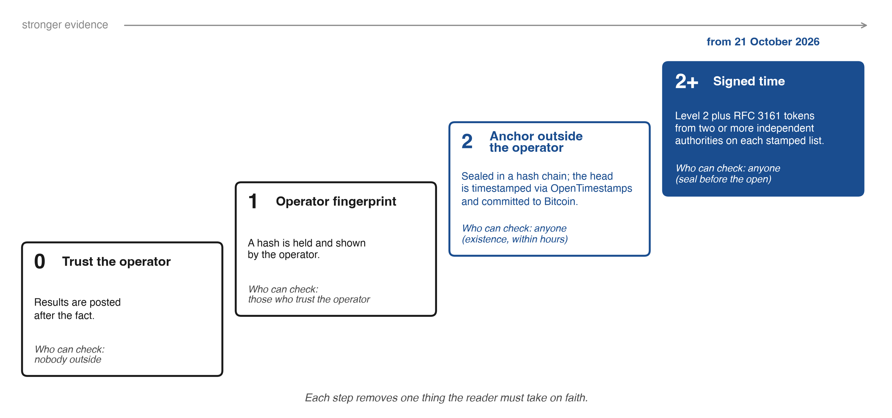

Note: The levels describe what a reader must trust about the time of a record. Level 2+ adds RFC 3161 tokens, in the league from 21 October 2026, when the record holding the counted answers was signed before the 09:30 ET open. Sealing on arrival, the reference price after the seal and the counted-run rule are separate requirements (Section 3.13).

In the reference implementation the anchor gives level 2 for P1a and P2, against any party holding an independent copy of a proof, and against everyone for each stamped list entered in the Rekor log (Section 3.11). P1b stands at level 2+ in the counted record (Section 3.11). P3 rests at level 1 on the operator's chained record and, from 21 October 2026, on a counted-run rule declared in advance. The clock levels measure trust in the clock. What a reader may claim about prices or skill climbs the ladder of claims (Table B1, Appendix B): published rules, recomputed files, a verified external commitment, outcomes reconciled with an independent price source, a prospective paired evaluation frozen before its window, and replication by a second pipeline. That second ladder ends in the registered comparisons of Section 8.

## Appendix H. Measures in detail

Sections H.1 to H.22 keep passages of the previous version that the main text now gives in short; each heading names the section where the passage stood, and the main text points here for the fields, formulas and dated counts.

### H.1 From the Abstract and the Executive summary

The Brier score of the event asked is set against a 50% benchmark, the climatological base rate and prediction-market prices, and agreement is reported as a count of independent voices.

### H.2 From Section 3.5, Direction, probability and the draw

A draw band and a proper score can go together. One design asks for the probability of a rise given a move outside the band and scores it only on rows that are not draws. The other asks for three probabilities, of a rise, a draw and a fall, scored by the three-outcome Brier score, strictly proper for the triple (Brier, 1950; Gneiting & Raftery, 2007):

$$
B_3 = \tfrac12 \sum_{k \in \{\text{up},\, \text{draw},\, \text{down}\}} \big(p_k - \mathbf{1}\{Y = k\}\big)^2 .
$$

A forecast that gives the draw zero probability on a row that is not a draw scores exactly the binary Brier score, $(p - o)^2$. The uniform forecast of one third each scores $1/3$ against 0.25 for the binary coin, so the three-outcome score needs its own benchmark. A probability of exactly 50 backs no side and is scored by Brier only.

### H.3 From Section 4, Measures

The protocol fixes what was said and when. The measures turn that record into scores; together they are the forecast evaluation the standard requires. I describe each measure as published in the methodology (version 2) and the league protocol (`arena-3`, Pro league `pro-1`) and, where the standard asks for more, the requirement. Section 5 reports the dependence values on live data, and accuracy results arrive as dated revisions of this paper.

### H.4 From Section 4.3, The uninformative 50% benchmark and climatology

A forecaster who always says 50% scores 0.25 on every forecast. This is the uninformative 50% benchmark (the "coin" of the league's files), a neutral reference. A forecaster who knows the base rate of rises can score below 0.25 with no skill about the day, and at long horizons the base rate can be far from one half. I therefore add a climatological benchmark (requirement 9): the frequency of a strict rise of the same event for each asset and horizon, estimated on a fixed window that ends before the season and sealed in the methodology, with the Brier skill score

on the same rows. The same event means the event the contract scores: for the day, from the reference to the terminal price by the price-source rule of Table 1 (09:30 to 16:00 ET, the yield to 15:00 ET, Bitcoin from the seal minute to 16:00 ET). For longer horizons it runs over the same counts of sessions or calendar days (Section 3.7). A base rate of a different event would bias the benchmark.

In the reference implementation the fixed climatology is the field `climatology_fixed` of `council-calibration.json`: per asset and horizon, `p_up`, the 2016 to 2025 frequency of a strict rise with every row counted, `p_up_ex_draw`, the same with draws left out, the counts `n` and `n_independent`, the window and the rule. The primary benchmark is $q$ = `p_up`, because the primary Brier score counts all rows. `p_up_ex_draw` serves the league's own skill score without draws (`bss_reference`). The field is sealed by `council-clim-window.json`, published under the data address, with `2810d11e…3cabb7`, the SHA-256 of its content: Python's `json.dumps` of the object without its `sha256` key, with sorted keys and default settings. The filed script recomputes this content hash before it reads $q$. The field entered the live file on 21 October 2026 at 08:54 UTC, its content hash checks (`sha256_ok`), and it is the benchmark of the primary comparison. Where the live window has no daily history, the nearest daily event stands in: the daily bar for gold, WTI, Brent, copper and the dollar index, the daily close for the 10-year yield, the UTC day for Bitcoin and, from one week, moves from the open. The four US equity indices take theirs from the daily bar of the 09:30 to 16:00 ET session itself, the event the models answer, and the primary test is also reported on those four alone (Section 8). The approximations bias $q$ and leave the forecasts untouched (Section 10).

### H.5 From Section 4.4, Calibration and sharpness

Calibration asks whether stated probabilities come true at the stated rate. The league reports directional confidence calibration: each resolved probability is folded to the side it backs ($p < 50$ becomes $100 - p$ with the outcome flipped, and exactly 50 left out), the folded forecasts fall into four bins, [50, 60), [60, 70), [70, 80) and [80, 100], and each bin shows the mean stated probability and the share that came true, plotted from 20 forecasts (`calib_min`). Folding measures whether confidence in the backed side is matched by the hit rate on that side. The calibration of the raw probability of a rise can also be computed from the open rows. The Brier score splits into a calibration term and a resolution term (Murphy, 1973), and the bins are a readable companion to that split.

Bins need many forecasts, so I add, for each seat, the consensus and each horizon, the logistic calibration fit $\operatorname{logit} P(Y=1) = a + b \operatorname{logit}(p)$ on all rows of the event asked (Cox, 1958). A slope $b$ below 1 means stated probabilities stand too far from one half, above 1 too close; $a$ measures a lean toward rises or falls. The slope uses every forecast and carries a standard error, computed with sessions kept together (Section 4.6). The same fit, with intervals clustered by event, has been applied to Polymarket prices (Walker, 2026).

Calibration is judged together with sharpness, since a forecaster who always says 50% is calibrated and uninformative (Gneiting et al., 2007). I also ask for, per seat, consensus and horizon,

$$
K = \frac{2}{n}\sum_{j=1}^{n} \left| p_j - 50 \right| ,
$$

from 0 (always 50%) to 100 (always certain), on stated probabilities only, and $K_{\text{clim}}$ with the climatological probability of Section 4.3 in place of 50. Sharpness against one half is expected to grow with the horizon where long-run base rates are far from one half; sharpness against climatology is the forecaster's own. Neither needs an outcome. On the 20 October development run, counted under the earlier rule, the eight seats sealed before the reference had K of 9.2 at one day, 14.1 at a week, 13.9 at a month and 20.3 at six months (Figure 5; the cells themselves are in Figure H1, panel B). They stood about five points from an even chance for the day and were most decided at the horizon that resolves last, part of which is base rate that $K_{\text{clim}}$ removes. On 21 October 2026 the nine seats gave 10.1, 12.5, 14.6 and 19.9. Most stated probabilities lay between 40 and 60. At one day that held for 93% of them on 20 October and 95% on 21 October, and even at six months for more than half (58% and 61%).

### H.6 From Section 4.5, Baselines

The league scores the same rows against fixed baselines:

- **Coin** (0.25 on every forecast).
- **Momentum**: yesterday's direction of the same indicator at a fixed 55%, scored on the same rows as the consensus; the league's published field leaves draws out, and the registered F15 scores it on all rows (Section 8.1).
- **Buy and hold** (`_hold_all`), **S&P 500** (`_spy`), **60/40** (`_passive`), **Cash** at the 13-week Treasury bill (`_cash`) and **Random** within the league's rules (`_random`).

The first two are baselines for the probability scores, and the other five are portfolios run under the same costs and execution as the models. Momentum checks a trivial rule. When the outcome is an even chance independent of yesterday, a fixed 55% scores $0.5 \times (0.45^2 + 0.55^2) = 0.2525$ in expectation. The climatological benchmark is the bar the standard requires. The methodology also names a no-change baseline, a point forecast with no probability, which stays outside the Brier comparison. The consensus of the Council is a baseline too: the mean of the models' probabilities, with the highest and lowest dropped when five or more answer, a second seat of the same family weighted one third, and the result held within 2% to 98%.

Averaging carries a gain that is not skill. For one event with outcome $o$ and weights $w_i \ge 0$ summing to one, the Brier score of the weighted mean $\bar p = \sum_i w_i p_i$ equals the weighted mean of the members' scores minus their weighted spread (Krogh & Vedelsby, 1995):

$$
(\bar p - o)^2 = \sum_i w_i (p_i - o)^2 - \sum_i w_i (p_i - \bar p)^2 .
$$

The consensus therefore cannot lose to the average of the members it keeps, on a common event, whatever their skill; holding the result within 2% to 98% can cost at most 0.0004 on a row. A finding that the consensus beats its average member is expected mechanically. Its skill is judged against the coin, the climatological base rate, the crowd and the best single model of the preceding period, and the spread term is reported beside the consensus score (Section 5.3).

### H.7 From Section 4.6, The 30/10 rule: 30 forecasts on at least 10 trading days

A model enters the table of a horizon only when it has at least 30 resolved forecasts at that horizon and at least 10 trading sessions with at least one resolved forecast at that horizon in each. The sealed methodology states the rule and its reason in one field: "the 12 indicators of one day move together: the league shows the trading days next to the forecasts, and a model is ranked after 30 resolved forecasts on at least 10 trading days" (`independence`). The rule does not limit how unevenly the forecasts fall across those sessions, so the table shows each model's number of sessions beside its score (`days`), and the second condition is the one that binds. If forecasts within a session share a correlation $\rho$, then $k$ forecasts from one session carry the information of about $k/(1 + (k-1)\rho)$ independent ones, the design effect of cluster sampling (Kish, 1965). With $k = 12$ and $\rho = 0.2$, one session is worth 3.75 independent forecasts, and thirty forecasts from three mornings about eleven. Requiring 10 trading days forces the sample to span different news; within a horizon the unit of resampling is the session. The 30/10 rule decides eligibility, and power is treated below. The first table, after the session of 30 October 2026, is a provisional descriptive ordering, and a model that missed any of the first ten sessions becomes eligible later.

The statistics file publishes intervals from 5 scored sessions (Student t on session means) and from 20 by a bootstrap over sessions, with the 12 indicators of a day as one cluster (`council-stats.json`, `sample.note`). Before 5 sessions no interval is shown, and an interval computed on rows treats the twelve markets of a day as independent and is too narrow. For horizons longer than a day, consecutive forecasts share most of their outcome window, so I require, for horizon $h$ in sessions, heteroskedasticity and autocorrelation consistent intervals with lag $h-1$ (Newey & West, 1987) or a block bootstrap with blocks of at least $h$ sessions (Künsch, 1989), and no interval before $5h$ sessions (requirement 10). In a season of 126 sessions that rule gives intervals at one week from session 25 and at one month from session 105, and none at six months, which would need 630. Confirmatory claims rest on the day, the primary horizon, and on the week and the month where the rule is met. Six-month results and the daily intervals are descriptive in this season. A claim of skill is read at the registered check dates (Section 8), whatever the sessions between them show.

Power belongs to the comparison that will be claimed, a paired Brier difference. For a forecaster $A$ and a benchmark $C$ on the same events, let $G_s$ be the mean over the events of session $s$ of $B_{C} - B_{A}$. With a standard deviation $\sigma_G$ of the session means and a declared smallest effect $\delta$, a two-sided test at 5% with 80% power needs about $n \approx 7.85\,\sigma_G^2/\delta^2$ independent sessions. Persistence raises the number, and the registered analysis keeps consecutive sessions together (Diebold & Mariano, 1995; Künsch, 1989). At 126 sessions the file's Brier calculation (`power_brier`) detects a drop below the coin of 0.0105, and a drop of 0.005 needs 554 sessions. It extrapolates from 171 forecasts of two sessions (the file generated 21 October 2026, 05:33 UTC, on the data of 20 October; the live field is recomputed each run), taking their forecast-level standard deviation of 0.062 and $\rho = 0.41$ as a proxy until five sessions are scored. It is recomputed at session 30 on session-level data, and the registered tests do not depend on it. The file's hit-rate calculation (`power`) needs 209 sessions to tell 55% from 50% at an assumed $\rho = 0.2$. An independent analysis of binary prediction-market questions reaches the same order: about 350 resolved predictions to detect a Brier edge of 0.02 over the market (Nechepurenko & Shuvalov, 2026a).

A negative result needs its own rule. A small estimated difference, an interval too wide to decide and evidence of no difference are three findings. I declare one equivalence margin, ±0.01 Brier, for every confirmatory comparison, and read "no material difference" only when the 90% interval of the paired difference (two one-sided tests at 5%) lies wholly inside it. I chose the margin. It is close to what the two-session extrapolation says 126 sessions can resolve (`power_brier`, above), it does not move when that extrapolation is recomputed, and it is a scoring tolerance, distinct from any economic threshold.

### H.8 From Section 4.7, The portfolio league

Probabilities measure judgement. A portfolio, a secondary measure, shows what a model does with it. Each of the 14 models manages $100,000 of simulated money under the same rules: eleven traded funds stand for the markets (VIX is an indicator only), positions are long only at 5% to 25%, cash earns the 13-week Treasury bill, every dollar that changes costs 0.1%, and a decision trades at the first open after its seal (the first price of 09:30 to 09:45 ET). "Hold" is a decision with no trade and no cost. A decision that breaks a rule is refused, and the positions hold. Each account is marked at the close with its return and maximum drawdown, and from 20 sessions with the Sharpe and Sortino ratios (Sharpe, 1994; Sortino & Price, 1994). The full rules are in the protocol file (Appendix A, Table A1). The account scores the instrument, a Treasury fund for the yield and a fund for each commodity future, so a lower Brier score does not establish a higher account value. The account is compared instead with the passive baselines under the same costs, within one rules version.

### H.9 From Section 4.8, The Pro league

Each model holds a second $100,000 account in the Pro league (`pro-1`), a long-short book with signed weights of 5% to 30% of equity and gross exposure of 100% to 200%, so leverage up to 2×; VIX can be traded here. Its baselines are the S&P 500 held long and held short.

### H.10 From Section 4.9, AI against the crowd

For up to eight of the 12 markets, prediction markets trade a daily question close to the league's. The question of each run lists them with their full resolution rules and asks each model for its own probability of "Up" on each, in a separate field of its answer line (`crowd_up`). The instruction not to look up Polymarket, Kalshi or any betting odds is sealed in the question, and what a model's search returned lies outside the seal. Where Polymarket lists the market, the models answer Polymarket's question, and a Kalshi question is asked only for a market Polymarket does not list (`council-calibration.json`, `method.crowd_window`). The crowd's prices and traded volumes (`vol`) are recorded when the question goes out and sealed in the run line (`crowd.odds` for Polymarket, `crowd.kalshi` for Kalshi). On 20 October they were recorded at 12:30:06Z, before the first model began its answer. I hide the price by design. A model that is shown the market price and asked to revise it can beat the market on some contracts (S. Kim et al., 2026), but its answer is then no longer evidence independent of the crowd. The league keeps the two apart: the sealed answer is blind to the price, and any combination with the crowd is a separate strategy, sealed before it is scored (Section 5.3). Each comparison names its information clock: the sealed price is the crowd at question time, while the calibration file compares each model's answer with the crowd's price at that model's own answer minute, both scored on the crowd's resolution. After resolution the league reports, per question, the models' probability and the crowd's, the Brier score of each and the sides each got right (book line `crowd`; `council-league.json`, field `crowd`).

On 20 October Polymarket listed six daily "Up or Down" questions (S&P 500, Dow, gold, WTI, the dollar index and Bitcoin) and Kalshi five (S&P 500, Nasdaq-100, the 10-year yield, gold and WTI): eight markets, three of them on both venues. Where both venues list a market, I use the Polymarket contract, the one the models answered; otherwise the Kalshi contract. Each crowd probability comes from one contract. A Kalshi question is set at a strike, and its price is turned into "above the previous close" by interpolation between the two adjacent strikes (`lo`, `hi` in the run line). The interpolated price approximates the probability of that event from two traded prices, and both sides are then scored on that synthetic event by the source the contract names. I admit a contract to the primary comparison when its sealed volume is at least $1,000 at the time the question goes out, and report thinner contracts apart. The threshold shows that money traded on the contract. Requirement 17 asks for bid, ask and the time of the last trade on each crowd row, since on Polymarket spreads are wider on unlikely outcomes (Dubach, 2026).

The crowd's questions are close to the league's, and their clocks differ. The league's day runs from the 09:30 reference to 16:00 ET (the yield to 15:00 ET); the crowd's questions run close to close and several resolve at other hours and from other sources: gold and the dollar index at the 5:00 PM ET Pyth candle, WTI at the daily close of the active futures contract, the yield at the Treasury's 3:30 PM par yield, Bitcoin from noon to noon on Binance. I therefore make the comparison question by question, on the crowd's own terms, with the separately elicited probability. Prediction-market prices are a strong baseline (Wolfers & Zitzewitz, 2004; Berg et al., 2008), and Kalshi's macroeconomic contracts forecast about as accurately as the Survey of Market Expectations and the Bloomberg consensus (Diercks et al., 2026). Sharpness (Section 4.4) is compared on the same contracts, model by model, from `crowd_up`, since the crowd does not price the event of `prob_up`.

How far a mismatch of events can move a score can be stated exactly. Suppose an index closed yesterday at 100, opens at 98 and closes at 99: it fell from the previous close and rose from the open. Let two versions of an event resolve with opposite outcomes on a share $d$ of $N$ rows, with the probabilities and the rows fixed. On a flipped row a forecast $p$ changes its Brier score by $(1-p)^2 - p^2 = 1 - 2p$, at most 1 in absolute value, so a mean Brier score moves by at most $d$. The gap between forecasters $p$ and $q$ changes on that row by $2(q - p)$, so the gap moves by at most $\frac{2}{N}\sum_{j \in D} |p_j - q_j| \le 2d$, where $D$ is the set of flipped rows. The bounds hold for fixed forecasts on a fixed sample. Two rules follow. Forecasts enter a common score only on one event, with one reference price (requirement 4). And each comparison with the crowd reports its share $d$ of market-sessions on which the two questions resolve with opposite signs; a gap no larger than $2d$ is not read as an advantage of either side.

### H.11 From Section 4.10, The grid: model × market × horizon

Every counted answer fills one cell of a three-way grid: up to ten Council models (a spare fills a seat on a morning it is out), 12 markets and four horizons (Figure H1). Each cell accumulates its own Brier score, hit rate, calibration and sharpness. The grid answers questions a single leaderboard cannot: which markets are predictable at which horizon, whether a model's edge sits in one asset class, and whether the month is easier than the day once each is measured against its own base rate. The marginal views are published in `council-league.json` (`models`, `by_asset`, `by_horizon`), the full rows in `council-forecasts.csv`.

**Figure H1.** *The measurement grid. (A) The design: model × market × horizon. (B) The grid filled: the sealed probabilities of one morning, the 20 October development run, counted under the earlier rule.*

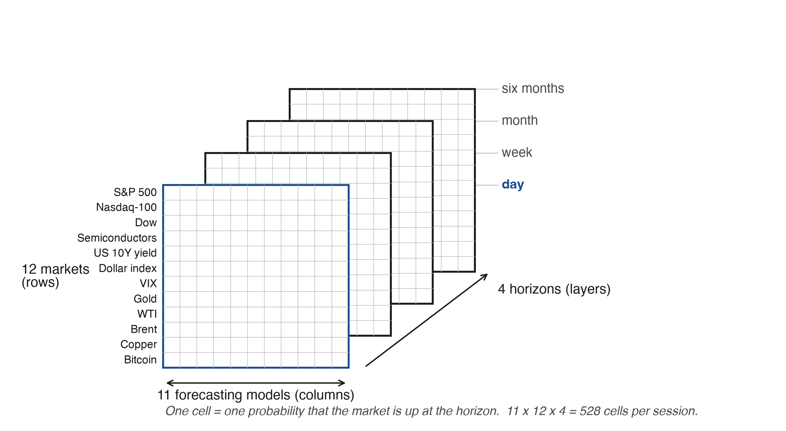

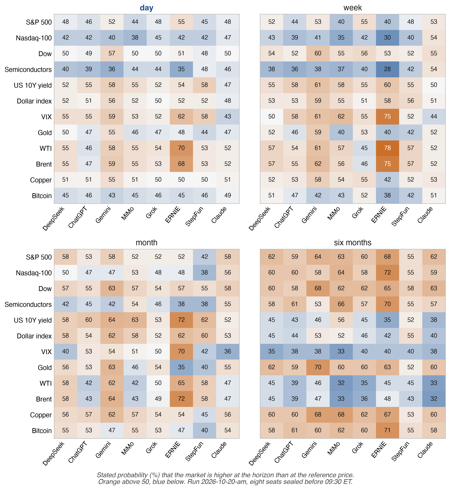

Note: (A) Cells are filled from the counted rows of `council-forecasts.csv`; a cell is ranked only under the rule of Section 4.6. (B) The eight seats whose answers were sealed before the 09:30 ET reference on 20 October 2026 (run `2026-10-20-am`), one cell per market and horizon, coloured by the stated probability of a rise and centred on 50%. Seats are ordered by their loading on the first principal component of the probability pictures, not by country. Source: `council-forecasts.csv`, read 21 October 2026.

### H.12 From Section 4.11, Reproducibility

Every score can be recomputed from open files. The portfolio engine's code is published as text, 19 files and the league's settings, each with its SHA-256 (`arena-code.json`). A recount script (`replay.py`) recomputes the value, cash share, fees and weights of every account from the trades and the prices. On the files as of 20 October 2026 it reproduced all 253 published rows of 145 accounts within the publication rounding (Appendix B, Step 7). A second script, `tools/replay_brier.py` under the same address, recomputes from council-forecasts.csv the Brier score of every counted forecast and the totals by seat, horizon and methodology version, and compares them with the published figures; on the live files of 22 October 2026, 00:09 UTC, it matched all 9,318 published numbers exactly. Every forecast row in `council-forecasts.csv` names the book line that seals it (`line`), so each score traces to a sealed answer and from there to a stamped prefix and a Bitcoin block (Appendix B). A score line is covered by the first stamp after it.

Anyone can recompute the published outputs. The chain and the anchor fix the sealed answers, their times and their questions. The raw model calls, the price feed and the deployed code are published with their hashes as the operator supplied them. Reconciling reference and closing prices with a second independent source is the outcome rung of the ladder of claims (Table B1). Because the live files change every run, each revision cites an immutable analysis release on Zenodo (10.5281/zenodo.23552700) with a manifest of every file's SHA-256, size and retrieval time (Appendix C).

### H.13 From Section 5, How many independent voices

The league has ten forecasting seats. A council of that size looks like as many opinions, and the league is built to count how many it holds. If the errors of N forecasters correlate at a common ρ, their average carries the evidence of

N_eff = N / (1 + (N − 1)ρ)

independent forecasters, and as N grows, N_eff approaches 1/ρ and stops there. The formula is the design effect of cluster sampling (Kish, 1965), and the saturation of the value of dependent experts was shown for forecast combination by Clemen and Winkler (1985). The companion paper applies it to panels of AI models (Chernets, 2026a). The ceiling does not depend on how many models were asked. At ρ = 0.5 a thousand models are worth two witnesses, and once a council is larger than 1/ρ, lowering ρ buys more than adding members. The input is measured. When two language models are both wrong they often give the same wrong answer, more so within an architecture or a provider (Kim et al., 2025). Three frontier models' forecasting errors correlated at a mean r of 0.77 on 568 binary questions (Spiro, 2026), and frontier models make highly correlated predictions on the Metaculus AI benchmark (Aitchison et al., 2026). When many decision makers adopt one algorithm, the collective decision can get worse even if the algorithm beats each of them alone (Kleinberg & Raghavan, 2021). Theory and simulations calibrated to institutional holdings suggest that wide adoption of similar AI models shortens the life of the signals they trade (Meng & Chen, 2026). Such arguments need a measured likeness of the models as input. A market league supplies an outside ground truth every trading day and up to ten live streams of probabilities on which ρ can be estimated. N_eff is a count of variance. A bias every model shares stays in the mean whatever the number of models, which is why the league also counts unanimous error directly (Section 5.3). A consensus of models printed without its effective number of voices is a poll printed without its sample size: the reader sees the share who agree and cannot tell how much evidence the agreement holds. Requirement 14 therefore makes the count a MUST wherever a consensus is shown. On 20 October eight seats sealed a one-day picture before the open, and their pictures were as alike as those of 1.46 independent forecasters (Section 5.2).

### H.14 From Section 5.3, The consensus, and why it discounts families

I define the consensus for a market as the mean of the seats' probabilities, with three rules. When at least five seats answer, the lowest and the highest probability are dropped. A second model from the same family counts one third, and so does each further one, so a laboratory that fields several models cannot outvote the others by number. Under a block structure the uniform formula overstates N_eff (Kim et al., 2025). The result is clamped to 2 to 98%. Every seat on the current roster comes from a different laboratory (Table 3), so every family weight is 1. The rule is written into the open methodology before a laboratory holds two seats.

By the identity of Section 4.5, the consensus beats the mean of the members it keeps mechanically on a common event, and against the full council the trim is a choice that the shadow consensus and F10 measure, an arithmetic gain. Skill is judged only against references outside the council: the coin, the climatological base rate, the crowd and, for F10, the model that led an earlier window. The value of one seat is measured directly: the consensus Brier score on common events with and without that seat, on the same sessions. A leave-one-out computed after the outcomes is a description. Any weighting other than the frozen trim, family weights and clamp, chosen because it would have won on seasons already seen, is a new strategy (White, 2000): it is sealed before the first session it governs and scored only after that seal.

I seal one such strategy with the registration, as a test of the thesis of Section 5.3: if correlated voices are worth less, discounting them should help. The shadow consensus weights each seat by the inverse of its mean pairwise correlation with the other seats, computed on the one-day probability pictures of the counted runs sealed before the registration timestamp, answers sealed before the reference only, with the mean correlation floored at 0.05 (a seat with no eligible answer in that window takes the median weight of the others). The weights are filed with the registration and frozen for the season. On each event they are renormalised over the answering seats, and the trim of extremes, the family weights and the clamp are those of the published consensus. A filed script computes the shadow from the open files and scores it on the same events as the published consensus, which it never replaces. Section 8 declares the comparison. Requirement 17 also gives each seat two descriptive counts of distinctiveness, its mean correlation with the other answering seats and the share of its directional cells that agree with the majority. A seat that is distinct and adds to the consensus on common events is the seat the family rule and the ceiling of Section 5 argue for keeping. On 20 October 2026, across the eight seats sealed before the reference and all 48 cells, the two counts ran from a mean correlation of 0.47 and 70% agreement with the majority of the others (Claude) to 0.71 and 88% (DeepSeek). Claude stood alone on its side of an even chance in four of the 48 cells, more than any other seat, among them semiconductors and the Nasdaq-100 at a week, which it gave 54 while the seven others gave 28 to 43. Accuracy is scored separately.

`all_wrong` counts the market-sessions on which every answering seat was wrong, with at least four answering, and `minority_right` counts those on which the consensus was wrong and at least one seat was right. In both, rows are all rows with the outcome "rise" meaning a change greater than zero, and a stated 50% is neither right nor wrong, so that seat does not count as answering for that row. Under independence, unanimous error among four or more seats with error rates near one half would be uncommon, and its frequency against the product of the answering seats' own error rates on the same rows is F6. The count is a clustering diagnostic that mixes the co-movement of outcomes, the difficulty of particular sessions and a shared bias, and it does not identify copying. A right minority that recurs is the case for showing every seat's call next to the consensus.

### H.15 From Section 5.4, Shared sources

Every forecast row of council-forecasts.csv carries the domains and links its model cited (`source_domains`, `source_urls`). For the one-day answers of each run I report the concentration of citations on the most cited sites, the mean Jaccard overlap of cited links and sites between pairs of seats, and whether pairs that share a link agree on the action more often than pairs that do not, within strata of run and market, by permutation. On the first five runs one news site drew about a fifth of all citations, the overlap of exact links was small (mean Jaccard 0.006), and the higher agreement of the 34 pairs sharing a link was not distinguishable from chance (permutation p = 0.14). A cited link is a string the model emitted and does not prove the page was read, and its label can differ from its address. On 19 October one answer cited "Reuters" with a link to investing.com (book line 83). Requirement 17 therefore asks for a fetch record (status, time, SHA-256 of the content, stated publication time) before a link enters the overlap. Numbers the question itself supplied, such as the pre-open futures, are removed before shared figures are counted. In Prediction Arena, how much a model researched did not track its result (Zhang et al., 2026), so the league measures what search does to agreement instead of assuming it. Citation overlap measures reported provenance, and F5 states what it should show.

### H.16 From Section 5.5, The closed book: the same question without search

Added news does not make a language-model forecaster better by default: on questions resolved after the models' cutoffs, news context helped on some questions and hurt on others, through recency bias, overweighting of rumours and drift in what a term refers to (Karkar & Chopra, 2025).

In the Closed Book league, after each run, the same models receive a sealed packet instead of the open web: the run's price snapshot and dated headlines, each with source, link, publication time and hash, and they are told not to search or use tools. Each answer line records the search state under one of three labels: verified (the tool configuration prevents retrieval and the answer shows none), configured but unverified, or instruction only. Links outside the packet are marked `outside`. The packet is sealed with its hash before the answers and is not rebuilt, and the Closed Book runs its own $100,000 accounts outside the daily table.

The file arena-cb-experiment.json reports, run by run, the heat of disagreement (100 times the mean split of the day's actions), N_eff and the spread of portfolios, closed minus open on the same models. If the closed council agrees more, identical inputs drive the herd. If it agrees less, search pulls the models toward the same pages. A claim about search holds when the arms differ in search alone. Each closed answer comes from a fresh context not shown the open answer, the crowd or another seat, with the same question, snapshot and information deadline, matching versions and recorded access states. For F20 and F21, the answers of both arms are sealed before the same common reference, otherwise each arm is scored on its own reference, and the order in which the arms are asked is balanced across days. If the closed council disagrees less and its Brier loss is higher, identical inputs made the models alike without making them better.

Two arms cannot separate the two sources of likeness, the same news read the same morning and the same beliefs learned in training. Requirement 17 therefore specifies a third arm, prices only: the same models receive the run's sealed price snapshot and the question, with no headlines and no search, under the same deadline and rules of independence. Agreement that remains without news comes from shared priors; agreement added by the packet comes from shared news; agreement added by the open web comes from search. When the arm runs, each run reports N_eff and the heat of disagreement in all three arms on the same seats and sessions.

### H.17 From Section 5.6, Discussion against plain consensus

Blind-parallel elicitation gives each model the raw question with no view of the others, so agreement carries evidential weight. Informed-sequential elicitation buys error correction at the price of independence (Chernets, 2026a). On seven language benchmarks, majority voting alone accounts for most of the gains usually credited to multi-agent debate (Choi et al., 2025), so a discussion has to beat the plain vote on the same questions before it earns a place. The daily forecasts are blind-parallel by construction. Discussion runs in a separate weekly track that never touches the daily record: a chair, rotating between the sides, reads every sealed portfolio under shuffled letters and writes the council's portfolio and two or three critiques, each naming a market, a risk, a weight and the direction of the fund over the next five sessions, so every critique has a checkable consequence. Each criticised model answers once and states the portfolio it would hold. Shadow accounts trade the chair's portfolio, the sealed weights, the weights with the critique applied, and the stated reply (council-talk.json, council-talk-critiques.csv; F22, F23).

### H.18 From Section 5.7, One model, asked again

Once a week the portfolio question is asked again, three times, of three or four models, and the repeats are sealed as their own lines, not as decisions. council-repeats.json reports the heat among one model's own answers against the heat between models, which gives the noise floor of disagreement (F24). Because N_eff is computed on probabilities, requirement 17 extends the repeats to probabilities: under a frozen packet a selected model answers the same probability question three times in independent contexts, each sealed as a diagnostic line, and the league reports the within-model variance against the between-model variance. A change of model version is dated, and the record since the version is shown apart.

### H.19 From Section 6, Humans before AI

The league measures models. The page that shows them also asks whether seeing the models helps a person forecast or only moves the person toward them. Most evidence comes from designs in which the advice arrives first. Schoenegger et al. (2025) gave 991 participants a language-model assistant and found accuracy gains of roughly a quarter, even from an assistant designed to give noisy advice; Schoenegger et al. (2024) found an ensemble of twelve models matched a crowd of 925 forecasters, and that a simple average of human and machine forecasts did better still. People abandon an algorithm after seeing it err (Dietvorst et al., 2015), and in other settings weight it above human advice (Logg et al., 2019). In a geopolitical forecasting tournament, forecasters rarely relied on machine forecasts and tended to choose models that agreed with their prior beliefs (Abeliuk et al., 2020). What these designs cannot separate easily is help from anchoring.

### H.20 From Section 6.1, Design

Any visitor can mark each of the 12 markets up or down for the session, with a confidence from 55 to 95%, without registering. Each reader is assigned once and permanently, by an anonymous random identifier, to one of two groups. The seeing group sees the models' answers at once; the blind group sees them only after its first forecast of the session.

### H.21 From Section 6.2, What is measured

For the first forecast in a session the league records four quantities. I take as the primary outcome the Brier score (a confidence c on a side read as probability c/100 of that side), on the same markets for both groups, each market weighted by the smaller group's count on it. Time to the first forecast shows whether the models speed a decision. Stated confidence against the hit rate gives overconfidence. Anchoring is the share of first forecasts that agree in direction with the consensus, compared between groups. A blind reader who opens the models first is counted as a peek. The analysis follows assignment, with peeks as non-compliance. council-league.json publishes the counts, hit rates, times, confidence, peeks and Brier scores under `experiment` (`g0`, `g1`), and requirement 16 has the data dictionary label which group is blind before the first scored forecast. The experiment is live and open to every visitor, and its count opened with the counted record on 21 October at n = 0 scored first forecasts in both groups. F28 and F29, registered on OSF with the predictions of Section 8, fix its two outcomes at 200 matched first forecasts per group.

### H.22 From Section 6.4, What the comparison shows

Random assignment makes the two groups comparable with each other. Both are visitors of a public page who chose to come, so the comparison speaks for them and not for investors. It measures an effect of access, and the second protocol below measures revision of an earlier judgement. Greater agreement with the council is measured as a shift, and the revision protocol tells learning from copying. An identifier stands for an observable participant, and one person may hold several, so the league reports identifiers assigned and contributing, first forecasts and return rates by group. Repeated participation is a secondary analysis clustered by identifier and session.

A second protocol, specified by the standard, measures revision directly. Every reader first records a private direction and confidence with the council hidden, is then shown the council or a control display by random assignment, and records a final forecast for the same market and session. The primary outcome is the difference between arms in the change of Brier score from private to final forecast; movement toward the council is reported separately for sessions on which its call was right and wrong, so learning and copying can be told apart. The revision protocol enters the dated revisions of this paper when it runs.

## Appendix I. The mornings in detail

Sections I.1 to I.9 keep passages of the previous version that the main text now gives in short; each heading names the section where the passage stood, and the main text points here for exact times, rows and per-seat numbers.

### I.1 From the Abstract and the Executive summary

On that first counted morning every counted answer was signed before the 09:30 ET open, eight of them 29 minutes before it.

They were most decided at six months, where their forecasts resolve last, and on 20 October three of the four closest pairs joined a US and a Chinese laboratory.

### I.2 From Section 3.1, A day of the league

**Snapshot.** Before the question goes out, the engine takes one price snapshot of the 12 markets: S&P 500, Nasdaq-100, Dow Jones, the semiconductor index (SOX), the US 10-year yield, the dollar index (DXY), VIX, gold, WTI, Brent, copper and Bitcoin (Table A4). Each row carries its price, recent changes, 52-week range and the minute it was read; before the open the stock-index and yield rows hold the previous session, while the other rows are live. The snapshot's SHA-256 is written into the run line (`snapshot_sha256`), so a later claim that the models saw different prices can be tested.

**Question.** Fourteen seats trade; ten of them also give probabilities and form the Council, five from US and five from Chinese laboratories, and four spares, two per side, trade, take a seat when they pull ahead on public benchmarks, trends or the news, and answer in a seat's place on any morning that seat is out (Table 3). One question goes to every model of the Council, word for word except one block that gives each model its own account. The SHA-256 of the common text is written into the run line (`ask_sha256`) and repeated in each answer line, and the text is published as `asks/<sha256>.md`. The hash of the text each model received, its own account included, is sealed when it is sent (`asks.jsonl`). On 20 October the question opened at 08:30 EDT, and its published file hashes to the value in the run line, `77d3c627…6f07`. It also gave the pre-open changes of the stock-index futures and told the models they may use them (Section 3.3).

**Seal before 09:30 ET.** Each answer is booked as one line of the hash-chained book. On 20 October the eight counted answers carry answer times from 12:31:11Z to 12:42:02Z; the run line and the answers entered the book in one batch, the answers with `booked_at` 13:00:25Z, and the batch was stamped at 13:00:25Z (09:00:25 ET). A batch seal times the batch. Requirement 12 seals each answer on arrival, and the morning of 21 October shows both forms. Its first eight counted answers (12:32:52Z to 12:44:59Z) were booked in one batch at 13:00:19Z, the second at which two outside authorities signed its stamped list, and a ninth was booked at 13:23:37Z, 14 seconds after it arrived, the second at which three authorities signed the next list (Section 3.2). The proof page of 20 October records that "the intake for the score closed at Tue, Oct 20, 2026, 9:30 AM ET (2026-10-20T13:30:00Z)". Four stamps were taken that day, at 13:00:25Z, 15:00:12Z, 15:36:05Z and 16:52:54Z, anchored in blocks 972,334, 972,344, 972,354 and 972,359. The first covers lines 1 to 159, which hold the run line (151) and the eight counted answers (152 to 159).

**Open.** The reference price of every market but Bitcoin is the first price at or after 09:30 ET; for Bitcoin, which trades around the clock, it is the close of the first one-minute bar that starts at or after the line's seal. The reference is always taken after the seal (Section 3.3).

**Score after the close.** After the 16:00 ET close the engine writes a score line into the same book with each market's reference, close, change, draw flag and the probability each model gave. On 20 October the score line (line 184) was booked at 20:30:36Z, after the last stamp of the day, so it is covered by the next stamp, the first of 21 October. Longer horizons are scored when their windows close, as their own lines.

Note: Times are those of run `2026-10-20-am` read from `council-book.jsonl` and the proof page `/markets/proof/2026-10-20/`. ET is New York time. The Bitcoin block time is the header time of block 972,334, which holds the anchor of the 13:00:25Z stamp. A header time bounds the time of mining by the practical bound (Section 3.11). The second stamp of the day, 15:00:12Z (11:00:12 ET), is marked to show that stamps go on through the day; the score line of 20:30:36Z is covered by the first stamp of the next day.

### I.3 From Section 3.6, "Buy on dips" as a level fixed in advance

Each answer cell therefore carries two sealed answers on one event, a probability and an action, and on the 20 October development morning and on the first morning of the counted record, 21 October, they line up (Figure 2). Across the 384 cells of the eight seats sealed before the reference on 20 October 2026 and the 432 cells of the nine seats on 21 October 2026, no action field was empty, every `sell` and `trim` stood below 50, `hold` sat around an even chance (median 52 on both mornings) and the median rose step by step to `buy_strong`. I find a buy on dips beside a probability below 50 in four cells: three one-day cells of Claude on 20 October (S&P 500 48, Nasdaq-100 47, semiconductors 46) and MiMo's S&P 500 at a week on 21 October (47). A buy on dips is an order that fills only at an entry level fixed below the reference, so a probability below 50 beside it is coherent. Table I1 counts the actions by horizon. `hold` filled 64 of the one-day cells on each morning (out of 96 and 108 cells), and at six months `buy_dips` led (37 and 38 cells).

Note: Each point is one answer cell (seat × market × horizon), slightly jittered; bars mark the medians (sell 35 and 38, trim 41.5 and 43, hold 52 and 52, buy on dips 58 and 58, buy strong 60 and 63); n gives the cells of 20 | 21 October. Actions as sealed in `items.<market>.<horizon>.action`, probabilities in `prob_up`. Source: `council-forecasts.csv` saved 22 October 2026, 01:32 UTC. Like every figure and table of Sections 3 to 5 built from sealed answers, it shows no outcome.

**Table I1.** *Actions sealed by horizon: runs 2026-10-20-am (eight seats sealed before the reference, 96 cells per horizon) and 2026-10-21-am (nine seats, 108 cells per horizon).*

| Horizon | Run | Sell | Trim | Hold | Buy on dips | Buy strong |
|---|---|---|---|---|---|---|
| 1 day | 20 Oct 2026 | 1 | 11 | 64 | 16 | 4 |
| 1 day | 21 Oct 2026 | 0 | 12 | 64 | 26 | 6 |
| 1 week | 20 Oct 2026 | 3 | 23 | 33 | 31 | 6 |
| 1 week | 21 Oct 2026 | 1 | 18 | 31 | 54 | 4 |
| 1 month | 20 Oct 2026 | 2 | 15 | 42 | 24 | 13 |
| 1 month | 21 Oct 2026 | 3 | 22 | 34 | 36 | 13 |
| 6 months | 20 Oct 2026 | 6 | 25 | 14 | 37 | 14 |
| 6 months | 21 Oct 2026 | 4 | 25 | 24 | 38 | 17 |

Note: Counts of answer cells by the action sealed in them. Source: `council-forecasts.csv` saved 22 October 2026, 01:32 UTC.

### I.4 From Section 3.8, Target and "wrong if"

For each market and horizon the model also gives `target`, where it expects the price to go, and `invalidation`, shown as "Wrong if", the level at which it would admit the view was wrong, with its main risk and what would make it revise the view (`risk`, `revise_if`). All are sealed with the probability, so the forecast is falsifiable in the model's own terms. One sealed answer shows the fields at work. On 19 October 2026, before the open, ChatGPT (GPT-6.1 Sol) gave the S&P 500 a 54% chance of rising on the day, with a target of 7,678.59 and "Wrong if" at 7,560, then 42% at a week, 38% at a month and 61% at six months. Its stated view was "I put more weight on AI spending's immediate inflation effects than its eventual productivity dividend", and its condition for revision was "I would abandon the monthly bearish view if SPX clears 8000 alongside improving earnings guidance" (book line 83). Each of these levels can be checked against the price path without asking the model what it meant. In Figure 3 I draw the whole answer, with the probability, the action, the target and the "Wrong if" level at each horizon, and the entry level of 7,350 at six months at which its buy on dips would fill. The question had shown the previous close, 7,659.44, and the reference price of the day, 7,700.34, was taken after the seal.

Note: All values as sealed in the answer line (answer time 12:36:50Z, booked 13:24:17Z, before the 09:30 ET reference). The dotted line is the S&P 500 price in the question's snapshot (`asks/02577f9c….md`); the line through the targets joins the horizons for reading and is not a path. The entry level is the field `items.SPX.6m.entry` of the answer line; the column `entry` of `council-forecasts.csv` is empty for this cell.

### I.5 From Section 5.1, How the league estimates ρ

Each sealed run gives, for every forecasting seat, a probability that each of the 12 markets will be up at each horizon. For each run and horizon the league computes the mean over pairs of seats of the Pearson correlation of their probabilities across the markets both answered, and evaluates N_eff = n / (1 + (n − 1)ρ) with that run's own n and ρ. N_eff is convex in ρ, so the mean of the per-run counts is at least the count at the mean ρ, and the sampling noise of ρ, estimated from twelve markets, pushes the per-run count up as well. A mean below a threshold, as in F1 and F2, is therefore the conservative reading, and a comparison between horizons is read on ρ itself (F9). With twelve markets one pairwise correlation carries a standard error of about 0.26 to 0.18 across the observed range of 0.38 to 0.64; the pairs of one run share seats and markets, so their mean is steadier than one pair but not by the root of their number. An interval comes from five counted runs. I use each seat's latest answer line and leave out cells restored after the seal by a dated `correction` line, because they were not in the sealed answer. The eligibility rule is part of the estimator. I admit only counted runs, and only answers sealed before the reference price, so that a late answer, which could see the opening move, does not enter. The open file council-stats.json publishes this series under `n_eff.counted`, with the rule stated in the file. The older block `n_eff.per_run` and its mean average all sealed runs, trial runs and late answers included. Appendix C gives the fields for recomputation from council-forecasts.csv and council-book.jsonl. Table I2 follows the rows of the open file through this rule, from the six sealed runs to the counted record.

**Table I2.** *From the open file to the counted record, by run: rows, corrections, seats, rows sealed before the reference, stated 50s, invalid cells and counted one-day rows (council-forecasts.csv, 3,792 rows).*

| Run | Role | Rows in file | Correction rows | Seats answering | Seats sealed before the reference | Rows sealed before the reference | Stated 50 | Invalid cells | Counted one-day rows |
|---|---|---|---|---|---|---|---|---|---|
| 2026-10-16-eve | Trial | 1,056 | 39 | 9 | 9 | 1,017 | 20 | 0 | 0 |
| 2026-10-17-btc | Trial | 864 | 32 | 9 | 9 | 832 | 40 | 0 | 0 |
| 2026-10-18-radar | Trial | 672 | 21 | 8 | 8 | 651 | 22 | 0 | 0 |
| 2026-10-19-am | Development | 336 | 11 | 7 | 7 | 325 | 4 | 0 | 83 |
| 2026-10-20-am | Development | 432 | 0 | 9 | 8 | 384 | 14 | 12 | 105 (96 sealed before the reference) |
| 2026-10-21-am | Counted record | 432 | 0 | 9 | 9 | 432 | 24 | 0 | 108 |

Note: Correction rows are cells added by later correction lines (`line_kind`); the other columns count the cells of answer lines. A row is sealed before the reference when its line's seal, max(`at`, `booked_at`), precedes 09:30 ET of the session it aims at; the three trial runs aim at 19 October. Stated 50 and invalid cells are read from `cell_status` (`explicit_50`, `invalid`), counted rows from `status`. On 20 October the ninth seat, Meta AI, sealed at 16:16:52Z: its 12 invalid cells hold no probability, and its nine counted one-day rows are scored from its own reference, outside the common event. On 21 October the four Bitcoin cells of the ninth answer have their own reference (Section 3.3). Source: `council-forecasts.csv` and `council-book.jsonl` saved 22 October 2026, 01:32 UTC (SHA-256 of the CSV `9fa4747e…c299d`).

I publish companion statistics beside the count. The correlation is computed across markets, so it includes the way markets move together (the three US equity indices, WTI and Brent); a second version keeps one market per group, dropping the Nasdaq-100, the Dow and Brent. The correlation across markets also depends on the direction in which each market is asked: a rise of the VIX, the dollar or the yield usually goes with a fall of equities, and the league asks every market as a rise, fixed in its event contract. I also compute a version free of that convention, which correlates the deviations from 50 without subtracting each seat's mean across markets, so turning any market upside down changes nothing. At one day it gives 1.85 and 1.54, on 19 and 20 October, against 1.74 and 1.46 for the headline count. Taken from the climatological probability instead of 50, the same deviations give the reading Section 4.3 asks for at long horizons. The participation ratio of the matrix is a different dimension count, and under equicorrelation the two differ, so I read it beside N_eff as a second count. A third statistic removes each market's consensus first. Subtracting a consensus estimated from the same models makes the deviations negatively correlated by construction, so this one is descriptive and not registered. Requirement 17 adds the share of the largest eigenvalue. A share near one says that a single common factor carries the likeness, the structure under which one common ρ is a fair summary, and a low share says that the single ρ hides several factors. On the 20 October development run, counted under the earlier rule, across all 48 cells of the eight seats sealed before the reference, the largest eigenvalue carries 68% of the trace (5.47 of 8). One common factor holds most of the likeness. The participation ratio of the one-day matrix was 2.28 on 19 October, 1.79 on 20 October and 3.28 on 21 October (`n_eff_participation`).

The headline counts how alike the probability pictures are. The correlation of errors, the ρ of the formula above, is the second count, and the league computes it from scored sessions: the mean pairwise correlation of the seats' error indicators across the markets, turned into N_eff in the same way (`n_eff_errors`). It carries the co-movement of outcomes as well. When the three equity indices fall together, models that said up err together whatever their likeness.

### I.6 From Section 5.2, A first reading of the method

I read the method first on the development sessions of 19 and 20 October 2026 (Section 8). On their two morning runs, counted under the development rule, using only answers sealed before the 09:30 ET reference price, I find N_eff at one day of 1.74 on 19 October 2026 (n = 7 seats sealed before the reference, ρ = 0.505) and 1.46 on 20 October 2026 (n = 8, ρ = 0.64). The pictures of those two mornings were as alike as those of about 1.6 independent forecasters. Keeping one market per group gives 1.69 and 1.57. The first run of the counted record, on 21 October 2026, gave 2.23 (n = 9, ρ = 0.379), and 2.09 with one market per group (`council-stats.json`, `n_eff.counted.per_run`, generated 21 October 2026, 22:16 UTC).

The same rule at each horizon, with the three descriptive measures that need no outcome beside it, gives Table I3.

**Table I3.** *Descriptive reading by horizon of the morning runs of 19 to 21 October (two development runs and the first run of the counted record), answers sealed before the reference: N_eff of the probability pictures (mean pairwise ρ in brackets), sharpness K, share of probabilities between 40 and 60, and spread across seats.*

| Run | Measure | 1 day | 1 week | 1 month | 6 months |
|---|---|---|---|---|---|
| 19 Oct 2026 (n = 7) | N_eff (ρ) | 1.74 (0.51) | 2.81 (0.25) | 2.39 (0.32) | 1.16 (0.84) |
| | K | 10.7 | 14.4 | 17.9 | 25.0 |
| | Share in [40, 60] (%) | 88 | 81 | 67 | 42 |
| | Spread (points) | 4.2 | 6.3 | 7.4 | 5.1 |
| 20 Oct 2026 (n = 8) | N_eff (ρ) | 1.46 (0.64) | 1.99 (0.43) | 2.68 (0.28) | 1.14 (0.86) |
| | K | 9.2 | 14.1 | 13.9 | 20.3 |
| | Share in [40, 60] (%) | 93 | 82 | 80 | 58 |
| | Spread (points) | 3.5 | 5.7 | 6.2 | 4.7 |
| 21 Oct 2026 (n = 9) | N_eff (ρ) | 2.23 (0.38) | 2.63 (0.30) | 2.41 (0.34) | 1.58 (0.59) |
| | K | 10.1 | 12.5 | 14.6 | 19.9 |
| | Share in [40, 60] (%) | 95 | 90 | 84 | 61 |
| | Spread (points) | 4.3 | 4.8 | 5.7 | 6.8 |

Note: Twelve markets per horizon. N_eff by the rule of the filed script neff-horizons.py (Section 5.1), with cells that carry a reference of their own left out (on 21 October the Bitcoin cells of the ninth answer); the one-day value of 21 October equals the published `n_eff.counted.per_run`. K = (2/n)Σ|p − 50| over the seats' cells (Section 4.4); spread is the population standard deviation across the seats, averaged over the twelve markets. Values from `council-forecasts.csv` and `council-book.jsonl` saved 22 October 2026, 01:32 UTC.

On all three runs the voices are fewest at six months and more numerous at a week and a month than at a day. The six-month likeness can come from shared base rates (equities and gold drift up over six months), so the six-month count is also to be read on deviations from the climatological probability. I see the pattern on the run of 20 October (Figure H1, panel B), and in Figure 6 I draw it market by market. The eight seats sealed before the reference put five markets below an even chance for the day and near 60% at six months. In mean probability the S&P 500 went from 48 to 62, the Nasdaq-100 from 42 to 61, semiconductors from 42 to 60, gold from 48 to 61 and Bitcoin from 46 to 61, while oil, VIX and the 10-year yield went the other way (WTI 55 to 40, VIX 55 to 38, the yield 54 to 45). The council saw a short shock that fades. At six months it converged on the long-run drift. On 21 October the short end moved and the long end held. The nine seats gave the S&P 500 55.9 for the day and 60.4 at six months, and only copper (47.9) and VIX (45.7) stood below an even chance for the day. At six months the risk assets again stood at 56.7 to 62.7 and oil, VIX, the yield and the dollar at 41.2 to 46.1.

The same run gives the spread that Section 8 uses. Across the eight seats, the population standard deviation of the probabilities averaged 3.5 points at one day, 5.7 at one week, 6.2 at one month and 4.7 at six months. At one day it ran from 1.5 points on copper to 6.4 on WTI, and the widest cells were VIX and Brent at one month (9.9 and 9.8). On 21 October the mean spread was 4.3, 4.8, 5.7 and 6.8 points, widest at six months (Brent 9.5, WTI and VIX 8.4). Figure I1 shows every cell on both mornings.

**Figure I1.** *Spread of the stated probabilities across seats, by market and horizon: (A) run 2026-10-20-am, eight seats sealed before the reference; (B) run 2026-10-21-am, nine seats.*

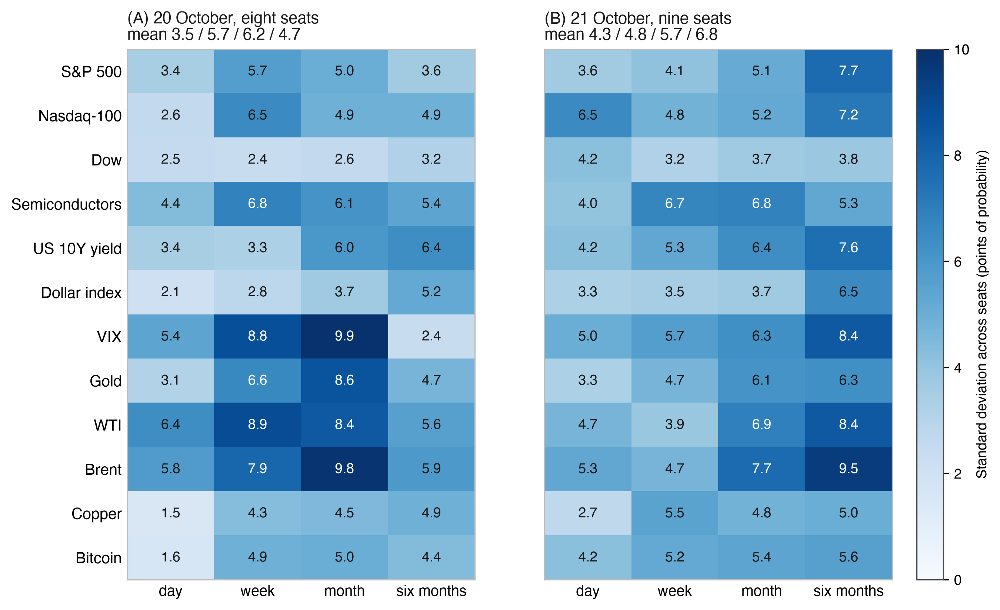

Note: Population standard deviation of `prob_up` across the seats in each cell, in points of probability; the panel titles give the mean over the twelve markets at each horizon. Section 8 registers the use of spread as a secondary analysis. Source: `council-forecasts.csv` saved 22 October 2026, 01:32 UTC.

Successive runs answer overlapping questions about the same markets, and the week and month windows of neighbouring runs overlap. A comparison between horizons is therefore made on paired run-by-run differences, with intervals over blocks of runs (F9). The three trial runs of 16 to 18 October, all aimed at the session of 19 October and not counted, gave 4.01, 2.69 and 2.06 at one day. The count on error indicators follows the same eligibility rule and is computed by the filed script of F3. The field `n_eff_errors` of the open file is a broader descriptive series and is not the headline. Figure 7 places the per-run values on the curves of the formula. Predictions F1 to F3 and F9 (Section 8) state what the counted runs after registration should show.

### I.7 From Section 5.4, Shared sources

In Figure I2 I count who cites what. The one-day answers sealed before the reference in the six runs of 16 to 21 October 2026, 918 rows, carry 1,875 citations of 233 sites. Reuters drew 407 of them (21.7%) and was cited by ten of the eleven seats that answered in those runs (the ten Council seats and ERNIE as a spare), all but Claude. Its share ran from 6.2% to 30.3% by run. The next sites were cnbc.com (139) and bloomberg.com (66). On the 20 October development morning and the first counted-record morning, 21 October, sites that at least two seats cited drew 68.5% and 58.3% of the citations.

**Figure I2.** *Cited sites by seat: citations in the one-day answers sealed before the reference, runs of 16 to 21 October 2026, the ten most cited sites.*

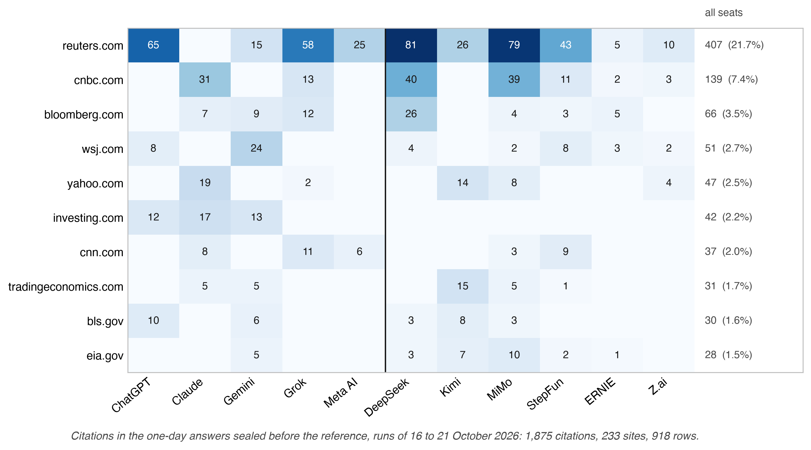

Note: One count per cited site per answer cell (`source_domains`), US seats first, with a rule between the sides; the right column gives each site's total and its share of all 1,875 citations. A cited domain is read as Section 5.4 reads a cited link. Source: `council-forecasts.csv` saved 22 October 2026, 01:32 UTC.

### I.8 From Section 5.8, Laboratory of origin: the same conditions

All fourteen seats trade in the portfolio league. Ten Council seats give probabilities, five from US laboratories and five from Chinese laboratories, and four seats are spares, two per side, which trade, take a seat when they pull ahead on public benchmarks, trends or the news, and answer in a seat's place on any morning that seat is out (Table 3). ERNIE did so for the Chinese side on 18 and 20 October. Every model receives one question, built on one price snapshot, with the text published under its SHA-256. Every answer is sealed by one deadline and scored by one set of rules, and every seat holds the same $100,000, costs and limits. The asks file shows the timing. On 21 October the first question went to every seat within 0.17 seconds, at 12:30:09Z, and a resend to the same seat carries the same hash. Seats without an answer at 13:00 received a second wave at 13:00:21Z, under its own run line and question hash (`asks.jsonl`). Each model is asked at the strongest reasoning mode its roster entry lists, and the mode sealed on the answer line is the mode scored. Each provider serves its model with its own tools and computation, so the comparison is between laboratories as they serve their models (Section 10).

Earlier comparisons did not put the two sides on one question and one snapshot. Cao et al. (2025) found that a US model forecast Chinese firms more optimistically and less accurately than a Chinese model, and that the gap disappeared once Chinese news was added, which points to access to information as its source. The comparison here is observational, because provider, generation, language and tools travel with the country label (Section 10). It is reported between and within the sides, and any gap, in probabilities or scores, is published with its range when each seat in turn is left out. A gap that changes sign or loses most of its size when one seat is dropped is reported as that seat's, not the side's (F18, F19). Requirement 17 also asks whether the side is a block at all. For each run it sets the mean correlation of probabilities within each side against that between the sides, with the probability of a difference at least as large when side labels are permuted among the answering seats. With five and six seats the test is a diagnostic. If the closest pairs join the two sides, the country label is not where the herd divides. I read it first on the 20 October 2026 development run, counted under the earlier rule (eight seats sealed before the reference, 48 cells) and find no block by country. The mean correlation of probabilities is 0.66 within the sides and 0.61 between them, and three of the four closest pairs join them: ChatGPT and MiMo (0.88), Gemini and DeepSeek (0.86), DeepSeek and Grok (0.77). Single cells can split by side. The largest gap between the side means on that run sat in gold at one month, 56 for the four US seats against 44 for the four Chinese seats, and gold at one week came third, 52.5 against 43.5. A maximum over 48 cells is large by construction. When the eight seats are split four and four in every one of the 70 possible ways, 26 of the splits produce a largest cell gap at least as wide (p = 0.37). DeepSeek gave gold at one month 56, above three of the four US seats, so even the widest cell does not split cleanly by side. In Figure 8 I show the whole matrix, with the morning of 21 October beside it.

I read the first counted run, on 21 October 2026, the same way with nine seats sealed before the reference, five US and four Chinese. The mean correlation is 0.43 within the sides and 0.48 between them. The closest pair again joins them, Meta AI and DeepSeek (0.87), with Claude and MiMo (0.72) third. The largest gap between the side means fell to 7.0 points, in Brent at one month, and 110 of the 126 splits of the nine seats into groups of five and four give a largest gap at least as wide (p = 0.87). Gold at one month, 12.0 points apart on 20 October, stood 0.1 apart (Figure I3). The likeness also spread over more factors. The first eigenvalue carried 54% of the trace (4.86 of 9) against 68% the day before, with a participation ratio of 2.95 against 2.02. On both mornings the two seats furthest from the others were Claude and StepFun. Their mean correlations were 0.47 and 0.52 on 20 October and 0.35 and 0.20 on 21 October. Two mornings of the diagnostic show no block by country, and F18 and F19 decide it over the season.

**Figure I3.** *Difference between the mean stated probabilities of the US and the Chinese seats, by market and horizon: (A) run 2026-10-20-am (four and four seats sealed before the reference); (B) run 2026-10-21-am (five and four seats).*

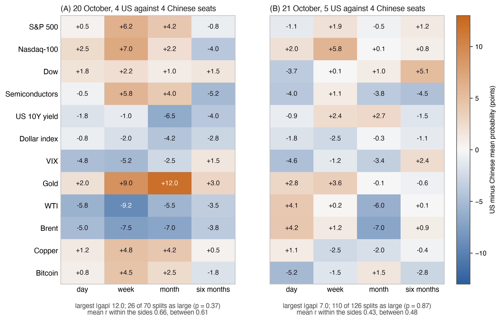

Note: Points of probability, US minus Chinese; orange where the US seats stand higher, blue where the Chinese seats do. Under each panel are the largest absolute difference, the number of all splits of the same seats into groups of the same sizes that give a largest difference at least as large (70 splits in A, 126 in B), and the mean correlation within and between the sides. On 21 October the Bitcoin row leaves out the cells of Meta AI, which carry their own reference. Source: `council-forecasts.csv` saved 22 October 2026, 01:32 UTC.

### I.9 From Section 9, Objections and the rule that answers each

 The crowd is itself cautious: over 188,509 resolved Polymarket markets, prices sat too close to one half, with a logistic recalibration slope of 1.112 (Walker, 2026). The seats stood closer to one half still. On the league's own one-day question the same eight seats stood on average 4.6 points from 50% (K = 9.2, Section 4.4).

**Table I4.** *Crowd price and the seats' separately elicited probability on the same contract, 20 October 2026 (eight seats sealed before the reference; contracts with a sealed volume of at least $1,000).*

| Market | Venue | Sealed volume ($) | Crowd price (%) | Seats' mean `crowd_up` (%) | Seats' range (%) |
|---|---|---|---|---|---|
| S&P 500 | Polymarket | 20,637 | 34.0 | 46.4 | 42 to 52 |
| WTI | Polymarket | 3,736 | 83.0 | 61.6 | 47 to 76 |
| 10-year yield | Kalshi | 3,199 | 7.0 | 48.2 | 20 to 56 |
| Gold | Polymarket | 3,112 | 29.0 | 44.8 | 36 to 50 |
| Nasdaq-100 | Kalshi | 1,150 | 22.6 | 41.6 | 34 to 46 |

Note: Crowd prices and volumes recorded at 12:30:06Z and sealed in run line 151 of `council-book.jsonl` (`crowd.odds`, `crowd.kalshi`); `crowd_up` from answer lines 152 to 159. Kalshi prices are interpolated to "above the previous close" (Section 4.9). The contracts resolve close to close, so the crowd's price already holds the pre-market move. Bitcoin, the Dow and the dollar index traded below the volume threshold. No outcome is shown.

 By the Murphy decomposition the Brier score is reliability minus resolution plus uncertainty (Appendix H). A cautious forecaster is calibrated and gives up resolution, so it scores near climatology and loses little to a sharper crowd, while a forecaster that translates a qualitative view into a probability poorly is miscalibrated as well, with a calibration slope away from one (Cox, 1958), and loses to the crowd by more than its sharpness explains.

## Appendix J. Reading times, sources and the register of scope

Table J1 states the reach of each claim. The other sections of this appendix keep, word for word, the reading times and source lines of the previous version, each under the section where it stood. Levels here are the clock levels 0, 1, 2 and 2+ (Figure G1), the clock part of the rungs L1 to L3 (Section 3.12). The title-page note of J.1 is dated as first written; the statuses of Table 2, Table F1 and Table F2 were read on 22 October 2026 at about 19:45 ET.

### J.1 From the title-page notes

*The scored sessions are read as of 20 October 2026, from the open files generated on 21 October 2026 between 02:42 and 05:33 UTC. The first counted run, of 21 October 2026, is read from the files generated at 22:16 UTC. Table F1 gives the conformance status as read on 21 October 2026 at 15:05 UTC, the conformance check of requirement 1 at 22:33 UTC and the Rekor entry of requirement 3 on 22 October 2026 at 00:00:16 UTC.*

### J.2 From Section 4.4, Calibration and sharpness

Note: Histograms in steps of 2 points, scaled to equal area; the shaded band runs from 40 to 60. K = (2/n)Σ|p − 50| (Section 4.4). On 21 October the four Bitcoin cells of the ninth answer carry a reference of their own (Section 3.3) and are left out of this and every other pooled reading of the run (428 of 432 cells). Source: `council-forecasts.csv` saved 22 October 2026, 01:32 UTC.

### J.3 From Section 5.2, A first reading of the method

Source: `council-forecasts.csv` saved 22 October 2026, 01:32 UTC.

Source: council-forecasts.csv and council-book.jsonl, read 21 October 2026, by the rule of Section 5.1.

### J.4 From Section 5.8, Laboratory of origin: the same conditions

Source: `council-forecasts.csv` saved 22 October 2026, 01:32 UTC.

### J.5 From Section 9, Objections and the rule that answers each

 The standard controls selection among runs with a hash of each outgoing question at send time, a counted run declared in advance (sealed in the chain of questions from 21 October 2026), and each stamped list entered at stamping in a public transparency log the operator does not control (Sigstore Rekor, from 22 October 2026; Section 3.13).

### J.6 From Section 10, Scope and boundary conditions

**Table J1.** *Reach of each claim.*

| Claim | Rests on | Reach |
|---|---|---|
| Order of seal and reference price, 19 and 20 October 2026 | The operator's record (clock level 1); the Bitcoin anchor bounds when the lines existed (clock level 2) | Development sessions, outside every confirmatory estimate |
| Order of seal and reference price, from 21 October 2026 | RFC 3161 tokens of at least two independent authorities (clock level 2+) | The counted record |
| Climatological benchmark $q_e$ | Daily history 2016 to 2025; the exact 09:30 to 16:00 ET session for the four US equity indices, the nearest daily event elsewhere | Moves $q_e$, not the forecasts; the primary test is also reported on the four exact indices |
| Reference and closing prices | The operator's price feed, named on every forecast row (provider, symbol, reference rule) | The seal fixes the forecast; a second price source is the outcome rung of Table B1 |
| Accounts | $100,000, costs of 0.1%, the first open after the seal | A secondary, descriptive measure |
| First readings (N_eff, likeness, sharpness) | The sealed runs to 21 October 2026: two scored development sessions and the first counted run | They illustrate the measures; the primary endpoint and the scorecards of Section 8 carry the conclusions |
| US and Chinese sides | The same question, snapshot, deadline and rules for all fourteen models | A comparison of two sets of laboratories, observational |

**Time.** Sealed runs began on 16 October 2026 and scoring on 19 October 2026. League numbers here were read from the open files on 21 October 2026, the readings of the morning of 21 October from copies saved on 22 October 2026 at 01:32 UTC, and cover six sealed runs: three trial runs, the two development sessions and the first run of the counted record. Each scorecard of Section 8 names the market path it scored.

**Timing evidence.** For the development sessions this version scores, 19 and 20 October, the operator's record (`booked_at` and the prev/link chain) shows that an answer was sealed before the reference price (level 1). The Bitcoin anchor bounds the existence of the anchored prefix to within a few hours of the block's header time (level 2, Section 3.11). A rewrite is detectable by anyone holding an earlier proof, and, for every stamped list in the Sigstore Rekor log (from 22 October 2026 at stamping, the earlier lists from 21 October 2026, 23:47 UTC), by anyone. In the counted record, from 21 October 2026, at least two independent RFC 3161 authorities sign each stamped list (level 2+). That day the batch of counted answers was signed 29 minutes 41 seconds before the reference price, and an answer that arrived later was sealed and signed by three authorities 14 seconds after its arrival, still before the reference.

 The climatological benchmark is estimated on daily history and approximates the live event where no matching window exists: the contract's daily bar for gold, WTI, Brent, copper and the dollar index, the daily close for the 10-year yield, the UTC day for Bitcoin, and, at one week and longer, moves from the open where the live contract measures its band from close to close; the approximations are stated in the field and bias $q_e$, not the forecasts. The accounts hold each market through the instrument named in arena-protocol.json; for oil, metals and copper that instrument is a fund that holds futures and rolls them, so an account can drift from the indicator it trades, which is one reason F27 compares ranks of forecasting and of return rather than their levels. A crowd row is admitted by its sealed volume of at least $1,000; requirement 17 adds bid, ask and the time of the last trade to each crowd row, with freshness and spread rules frozen before the window they govern, and a pooled venue only where the contracts resolve on the same predicate.

 Accounts are simulated, $100,000 each, with costs of 0.1% and execution at the first open after the seal; they exclude market impact and taxes. Trading is a classic channel of underperformance (Barber & Odean, 2000), so requirement 17 reports each account's turnover (traded value over mean equity) and the costs it paid beside a sealed no-trade shadow that keeps the holdings before each rebalance; an association between turnover and return is descriptive.
